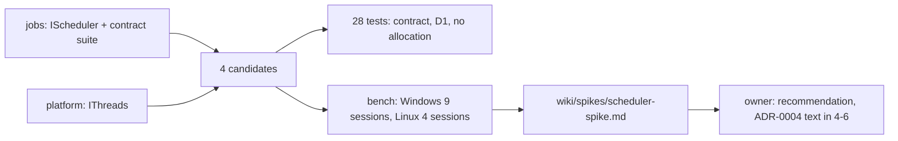

# Review 4-5: scheduler spike, four std-only work distribution candidates

Task: 4-5. Class 2 (concurrency, `unsafe`, new tool crate). Loops: see the end. Open blocker/major: see the end.

Delivers: crate `engine/tools_scheduler_spike` (workspace member line in `Cargo.toml`, `Cargo.lock` entry), page `wiki/spikes/scheduler-spike.md`, README index row 35 and changelog v0.80, this file. No protected path touched. The ADR edit is card 4-6, the real pool is card 4-7.

## Decisions

1. **Harness as a layer 4 tool**, `publish = false`, `std` only. Because it is under `engine/` the unsafe-budget scan (layers 0 to 2) does not count it and `gates/unsafe-budget.toml` is untouched.
2. **One `unsafe` module.** `erased.rs` has the only `unsafe fn` and the only dereference of the erased job pointer, with a `// SAFETY:` comment and the protocol in the module doc; three call sites wrap it in `unsafe { }` blocks with `// SAFETY:` comments (4 blocks in total). The lock-free deque is safe code on `AtomicU64` slots.
3. **Lints deviation, for the owner.** The crate has its own `[lints]` table instead of `workspace = true`, because `unsafe_code = "forbid"` at workspace level cannot be lifted per crate. The table repeats the workspace clippy rules and sets `unsafe_code = "deny"`, and `lib.rs` carries one `#![expect(unsafe_code, reason = "...")]`, the same pattern as `base` and `skeleton-unsafe`. The classifier reads the `expect` and the `unsafe` lines as Class 2 (as expected for this card).
4. **Fairness fix.** The first harness version let the calling thread idle-scan after finishing its work, which inflated the join latency of (b) and (c). Fixed (caller patience 0), all earlier numbers discarded.
5. **Linux through WSL**, same machine, so the Windows and Linux columns share hardware but not a scheduler.

## Evidence

- Tests: 15 unit and 13 integration tests, green on Windows and Linux (WSL); 90 repeated runs on Windows.
- Red evidence: `block_bounds` deliberately broken so the static partition covered too few items: 5 contract tests failed; restored.
- Benchmarks: Windows 6 park and 3 spin sessions, Linux 3 park and 1 spin session, 15 repetitions per cell, D1 mismatches 0 and bad runs 0 in every session. Raw TSV in `target/spike-raw/` (git-ignored); the page gives medians and session ranges.
- The independent review R3 (read-only agent, figures checked against the raw outputs) is recorded below.

## Not verified

- No ThreadSanitizer, no Miri; memory orderings reasoned and stress-tested, not model-checked.
- One machine, synthetic workloads, Windows noise up to about 1.8 times on the inline baseline, one Linux spin session, idle CPU on Windows only. Full list: section 9 of the page.
- The hash is checked per run, but the harness does not prove that an unrelated bug would change it.

## R1 to R8

| phase | result |
|---|---|
| R1 self | harness read through, nesting and pedantic clippy clean on Windows and `x86_64-unknown-linux-gnu` |
| R2 automated | fmt, clippy, workspace tests, headless graph check, local gates: see the PR body |
| R3 independent | read-only agent, all raw sessions re-aggregated: 0 blocker, 6 major, 9 minor; see Loops |
| R4 QA | the contract suites run against every candidate |
| R5 architecture | no new dependency edge outside the allowed ones; no adapter or app crate in the headless graph |
| R6 security | `unsafe` confined to one module; no secrets, no network |
| R7 performance | the subject of the spike |
| R8 product fit | answers the ADR-0004 question with a recommendation and its limits |

## Loops

Loop 1 of 3. R3 confirmed that every table cell matches the raw data and that the unsafe, test and lints claims are true. Findings fixed in the page:

- F1 (major): workers of (b) and (c) scan about 128 steps before parking, (a) and (d) do not, so the park-mode comparison mixed wait policy with data structure. Fixed by disclosing it, running the ablation (scan set to 0 for (b) and (c), Linux and Windows, 3 sessions each; on Linux the advantage of (c) disappears: 15.7 us against 15.9 us for (a) at 4 workers), adding the spin-budget rows, and changing the recommendation to (c) with an explicit bounded spin-then-park policy. The scan was not given to (a) and (d); listed as not verified.
- F2 (major): the explanation of (a)'s latency growth was unsupported; now labelled as untested hypotheses. F3 (major): (a) never batches claims; stated as a handicap. N1 (major): the "400-fold" figure replaced by 23 times (own park value) and 511 times (spin at 4 workers). N2 (major): the "(c) only" claim narrowed to park mode, the Linux spin result of (d) reported.
- Minor: N3 to N9 numbers and wording, F4 (splitting is eager, not lazy), F5 (sequential, not nested), F6 and F7 (abort-on-panic dependence, late-worker tests incidental), M1 (class diagram edges), M2 (the batching threshold is a rule of thumb).
- The harness code was not changed; the ablation used a temporary one-constant edit that was reverted before the commit.

Open blocker/major after loop 1: 0 known. A second independent pass was not run.
