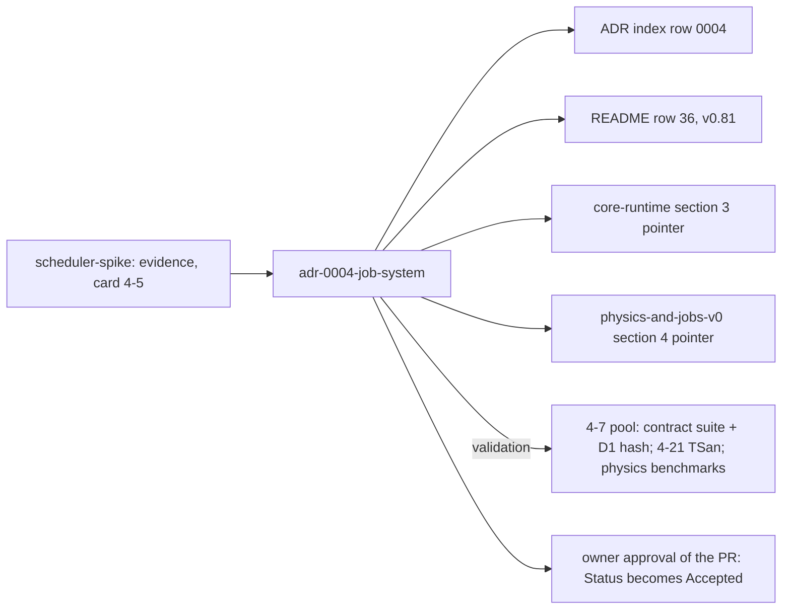

# Review 4-6: ADR-0004 job system

Task: 4-6. Class 3 (governance: an ADR). Declared a governance task by the owner in the session of 2026-11-03 ("Go on with 4-6"). Documentation only: no code, gates, workflow or CI touched.

Delivers: `wiki/decisions/adr-0004-job-system.md` (new), the ADR index row 0004 in `wiki/decisions/README.md`, README index row 36 and changelog v0.81 in `wiki/README.md`, pointers in `wiki/architecture/core-runtime.md` section 3 and `wiki/architecture/physics-and-jobs-v0.md` section 4, this file.

The ADR itself carries a class view (candidates, chosen one, kept test schedulers, excluded fibers) and a state view of the wait policy.

## Decisions recorded

1. Candidate (c), lock-free Chase-Lev deques, behind `IScheduler`; threads through `IThreads`.
2. The wait policy is an explicit bounded spin-then-yield-then-park and a decision of its own: the park-mode latency advantage came from the pre-park scan (Linux: 1.9 to 15.7 us for (c) without it). The bound is a time budget to be set and benchmarked in card 4-7; the ADR fixes the form, not the number.
3. Fork-joins batched; "well over 10 us" is a rule of thumb, no break-even measured.
4. Fibers excluded in phase 4 (O4); deterministic inline, reversed and shuffled schedulers kept; job-body contract for D1; abort-on-panic as a soundness condition.
5. Status: Accepted upon the owner's approval of the PR; the owner has not yet accepted the recommendation.

## Evidence

Every measured number is from `wiki/spikes/scheduler-spike.md`; the independent review (below) re-checked them. No new measurement was made.

## Not verified

No TSan or Miri; one machine; synthetic workloads; scan asymmetry only half ablated; Windows ablation noisy; soundness relies on abort-on-panic; Mermaid diagrams read through, not rendered (no renderer installed here).

## R1 to R8

| phase | result |
|---|---|
| R1 self | numbers re-read against the spike page |
| R2 automated | local gates and wiki lint: see the PR body |
| R3 independent | read-only agent compared the ADR with the spike page: 0 blocker, 0 major, 5 minor (loop 1) |
| R4 QA | links resolve (checked by the reviewer and the wiki lint) |
| R5 architecture | no architecture rule or layer changed; the ADR names a future allowlist entry as a later governance edit (4-7) |
| R6 security | no code, no secrets |
| R7 performance | none claimed beyond the spike's figures; limits stated |
| R8 product fit | answers the open ADR-0004 and records O4 |

## Loops

Loop 1: the 5 minors were fixed: header softened to "every measured number"; citation "section 1 and finding 5" added; the Linux-only clarity of the ablation and the with-scan qualifier on the 1.9 us figure added; "lazy" binary splitting wording changed to "binary splitting" (the spike page calls it lazy in one place and eager in another; not edited here); the (c) over (b) basis stated explicitly; class diagram bodies made multi-line. Open blocker or major: 0.
