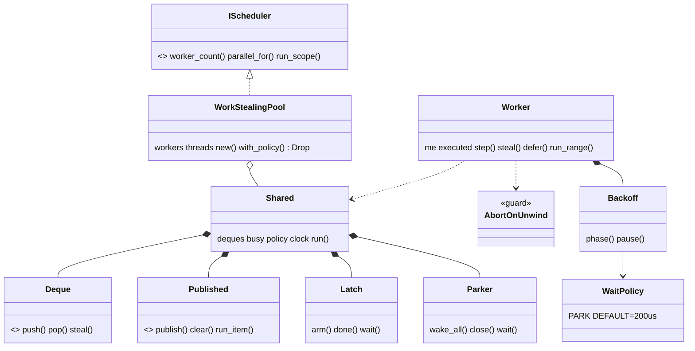
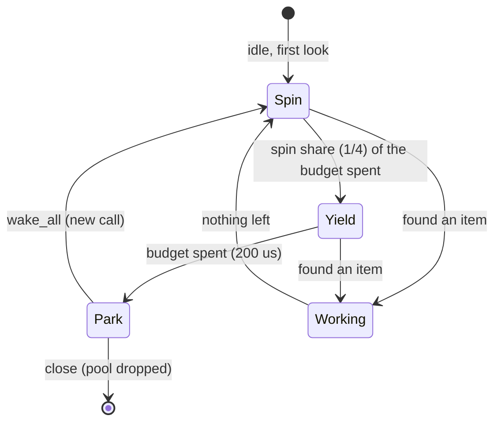

# Review 4-7: jobs work-stealing pool

Task: 4-7. Class 3 (governance task declared by the owner's pick: one row in `gates/unsafe-budget.toml`) on top of Class 2 content (concurrency, `unsafe`, new public API, new `platform` function). One PR into `main`. Loops: see the end. Open blocker/major: see the end.

Delivers: `engine/jobs/src/pool/` (`mod.rs`, `deque.rs`, `erased.rs`, `job.rs`, `wait.rs`, `tests.rs`), `engine/jobs/tests/pool_no_allocation.rs`, `engine/tools_scheduler_spike/tests/pool_abort_on_panic.rs` and `engine/tools_scheduler_spike/examples/wait_budget.rs`, `platform::process::abort`, the `jobs` lints table and `platform` dependency, one row in `gates/unsafe-budget.toml`, wiki pages (core-runtime section 3, physics-and-jobs-v0 pointers, README changelog v0.82), this file. No ADR, workflow, arch-check, classifier or other gate file touched.

## Decisions

1. **Pool as in ADR-0004.** Per-worker lock-free Chase-Lev deques of packed ranges (`lo << 32 | hi`) in 64 `AtomicU64` slots (safe code), binary splitting, stealing of the oldest range, the caller is worker 0 and joins on a latch. Threads only through `IThreads` (the Null platform is refused with `Unsupported`). `JobError` as in the inline scheduler: grain checked first, an empty call is `Ok` even when busy, `Busy` for a nested call or a call from another thread.
2. **One `unsafe` line**, in `pool/erased.rs`: the borrowed job is read through an `AtomicPtr`. Protocol (module comment): publish, arm the latch, push; a thread runs an item only while it holds an item not yet counted on the latch; the caller clears the pointer after the latch reached zero. `Published::run_item` is a safe function that relies on that documented protocol (private module, one call path). The independent review accepted this; making it an `unsafe fn` would raise the budget row to 2 lines and was not done.
3. **Abort on unwind.** `AbortOnUnwind` ends the process through `platform::process::abort` if a job panics, because `cargo test` unwinds while the workspace builds with `panic = abort`. It also fires when the pool is called from a destructor during an unrelated unwind (reviewer minor 1, accepted: only under unwinding builds).
4. **Wait budget 200 microseconds** (spin a quarter, yield the rest), park at once when workers exceed `IThreads::parallelism()`. The clock is the `IClock` port (`StdClock`); arch-check bans `Instant` in L1, so the first draft was changed. The benchmark example lives in `tools_scheduler_spike` for the same reason (`std::env` is banned in `jobs`), and so does the abort test (`std::process`, `Command`).
5. **New `platform::process::abort() -> !`** (3 lines) so that `jobs` does not use `std::process`. It cannot be tested in process; the abort tests of the spike crate run a child and check that it ends abnormally.
6. **Wake after push.** `Shared::run` pushes the whole range on deque 0 before `wake_all` (review major 1: a worker woken before the first push parked again under `PARK`).
7. **Lints.** `jobs` has its own `[lints]` table (workspace `unsafe_code = "forbid"` cannot be lifted per crate): the same clippy rules as the workspace and `unsafe_code = "deny"` with one `#![expect(unsafe_code)]` in `erased.rs`, the pattern of `base`.
8. **Unsafe budget row**: `engine/jobs/src/pool/erased.rs`, `max_unsafe_lines = 1`. The tool reports 72 unsafe lines of 17591 code lines (0.41%), 0 violations.

## Evidence

- Tests: 92 unit tests in `jobs` (contract suites at 1, 2, 3, 4 and 7 workers, with the default and a short spinning policy; order independence; D1 against the inline scheduler; refusals; shutdown with parked workers; failed thread creation; repeated create and drop; stress; imbalanced scope; several caller threads; the full-deque path; workers really run items on at least 2 distinct threads; a rendezvous of as many tasks as threads; stealing from every other deque; wake counts), 4 no-allocation tests, 2 abort tests (spike crate). All green on Windows; the `jobs` suites also on Linux (WSL, rust 1.94.1). Line coverage of the `jobs` crate 98.0% (llvm-cov, before the last small tests).
- Red evidence (examples): deque stub tests failed by assertion; a Box allocation injected in the caller path and in the worker path made the no-allocation test fail; the abort guard disabled made both abort tests fail (unwind / hang); `worker_main` made to do nothing made the "workers really run items" and "rendezvous" tests fail (20 s deadline).
- Zero allocation: a counting allocator with per-thread counters; 0 calls on the caller over 200 frames after warm-up, and 0 allocations or reallocations on each worker over its whole life (the spawn job is wrapped), for 1, 2, 3, 4 and 7 workers with `PARK` and `DEFAULT`.
- Mutation (cargo-mutants 27.1.0, `-j 1`, all of `pool/*.rs`): 167 mutants, 13 unviable, 154 viable; 62 caught, 86 timeouts (a hung worker is a failed run), 6 missed. After the closing tests: 4 of the 6 are killed (`workers > 1` in `run_scope`, `start < count` in `run_chunk`, `&&` and `!` in `Latch::wait`), and a rerun of the touched functions found 1 more tie. Score on viable mutants: 152 of 155 killed, **98.1%** (gate: >= 80%). Survivors judged equivalent: `executed > 0` to `>=` in `Worker::step` (`done(0)` is a no-op), `|` to `^` in `deque::pack` (the two halves occupy disjoint bits), `<` to `<=` in `Backoff::phase` at `elapsed < budget` (an exact nanosecond tie).
- Benchmark (report only, no gate claimed; `cargo run --release -p tools_scheduler_spike --example wait_budget`). Windows 11, 4 workers, 3 sessions, median ns per call (gap excluded) or per phase, by budget:

| workload | 0 | 50 us | 100 us | 200 us | 400 us | 1000 us |
|---|---|---|---|---|---|---|
| gap 0 | 3548 | 4246 | 4108 | 4090 | 4069 | 3147 |
| gap 20 us | 4364 | 3722 | 4138 | 4067 | 4102 | 4043 |
| gap 50 us | 4412 | 4106 | 4057 | 3866 | 4656 | 4606 |
| gap 100 us | 4553 | 22748 | 4601 | 3651 | 3964 | 5099 |
| gap 200 us | 4848 | 32193 | 36698 | 4912 | 4147 | 6319 |
| gap 500 us | 26771 | 46855 | 37274 | 29582 | 10996 | 4521 |
| phases, per phase | 17537 | 7321 | 5789 | 5911 | 4960 | 5494 |

  Linux (WSL, 2 sessions): about 17 to 18 us per call at budget 0 against about 2 us when the gap is within the budget, a cliff of about 25 us just after the budget, and phases 18.3 us at budget 0 against about 2.4 us with any budget. The clear result is the phases row (200 us: 5.9 us against 17.5 us when parking at once, 3.0 times); the dispatch rows are noisy and within noise of parking at once for gaps up to the budget. 200 us was chosen as the smallest budget that covers a frame-phase gap without the cliff at 50 to 100 us; it is a tunable, not a gate.
- Miri (nightly, by hand, `cargo +nightly miri test -p jobs --lib -- pool::`, 169 s): 55 tests passed with no undefined behaviour reported (deque, erased, job, wait, and the pool tests: contract at every worker count, D1, stress, shutdown, failed spawn, full deque). Two pool tests are `ignore`d under Miri because they depend on real time: `workers_really_run_items_with_every_policy` (sleeps) and `as_many_tasks_as_threads_run_at_the_same_time`, which failed in the first Miri run (1 of 2 tasks met, the 20 s deadline expired on Miri's virtual clock) and whose Miri behaviour was not diagnosed further; a retry with a longer deadline was killed for memory pressure. The abort tests and the no-allocation tests are not run under Miri (child processes, global allocator).
- Local gates (`tools/local-gates`): fmt, clippy, build, tests, architecture (19 crates, 0 violations), unsafe budget, wiki lint, digest and all tool tests pass; exactly the 4 known deliberate FAIL lines remain (`mutation.score_min`, `CLAUDE.md does not import`, `G1: well-tested score`, `cannot write the report`).

## Not verified

- **ThreadSanitizer**: not run (not available on Windows; card 4-21). Orderings were reviewed against the Le/Pop/Cohen/Zappa Nardelli formulation, stress-tested and run under Miri, not model-checked.
- **Miri**: the rendezvous test (real threads that must run at the same time) was not shown clean under Miri, see Evidence; there is no Miri job in CI (follow-up).
- Benchmarks: one Windows machine and one WSL install on the same hardware, noisy; no claim about other machines, no instruction-count gate.
- `Parker::wake_all` takes the gate and notifies on every call even if nobody is parked (a syscall on Linux); the 200 us default was not tuned on native Linux.
- A worker that joins a later call while scanning rescans one more budget (CPU only, parallelism kept).
- The by-hand `ci` run on the branch will flag `unsafe-outside-allowlist` because `ci` reads the budget from `main`; expected until the PR is merged.

## R1 to R8

| phase | result |
|---|---|
| R1 self | module-by-module read; nesting, pedantic clippy clean on the workspace; first arch-check run found the clock and process bans, fixed by using the ports |
| R2 automated | fmt, clippy, workspace tests, local gates: see the PR body |
| R3 independent | two read-only passes: pass 1 found 3 major, pass 2 found 0 blocker, 0 major |
| R4 QA | contract at 5 worker counts, D1, stress, mutation 98.1%, coverage 98% |
| R5 architecture | `jobs` -> `platform` is an allowed edge; no arch-check edit; the clock, abort and benchmark were moved behind existing ports or into a tool crate |
| R6 security | one `unsafe` line with a protocol and an abort guard; no secrets, no network |
| R7 performance | benchmark above; zero allocation per call |
| R8 product fit | the pool ADR-0004 decided, ready for card 4-15 |

## Loops

Loop 1 of 3. R3 pass 1: 0 blocker, 3 major, 8 minor.
- Major 1 (woken workers parked before any work existed): fixed (decision 6); test added.
- Major 2 (no test proved workers help): `workers_really_run_items_with_every_policy`, `as_many_tasks_as_threads_run_at_the_same_time`, the steal and wake-count tests; red shown.
- Major 3 (worker counts differ from the ADR): now 1, 2, 3, 4, 7.
- Minors fixed: `Sync` assertion on `Job`; parker test sleep; several-callers test counts the run indices; doc of the benchmark reworded; a doc link; abort oracle left as "abnormal and not 101". Accepted as is: minor 1 (destructor during unwind), minor 2 (safe `run_item`), minor 3 and the rescan (follow-ups), minor 7 (cosmetics), minor 8 (ADR design).
- R3 pass 2 (re-check of the three fixes): 0 blocker, 0 major; two doc minors fixed.

Open blocker/major: 0.
