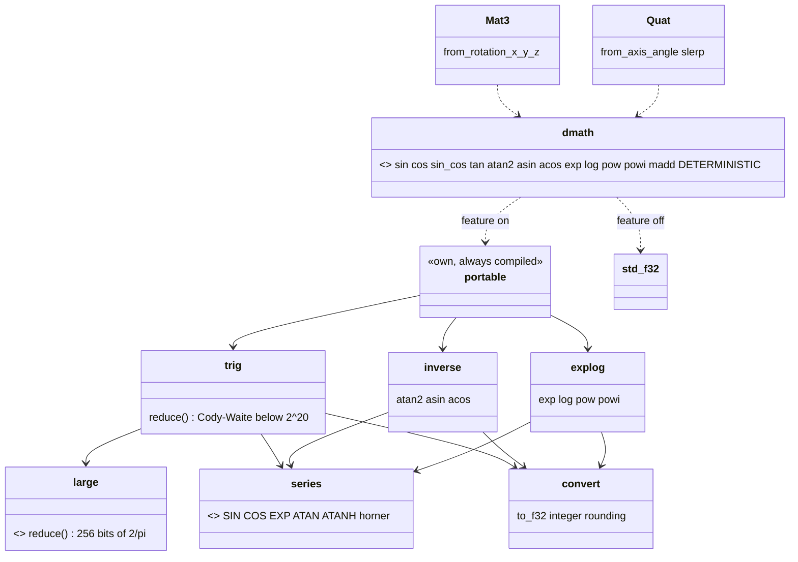
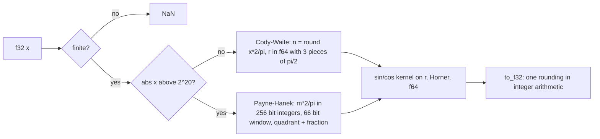

# Review 4-8: deterministic math facade and the cross-platform-determinism feature

Task: 4-8. Class 2 (determinism math, public API of layer 0), ordinary card, PR into `develop`. Size: large.

Delivers: Cargo feature `cross-platform-determinism` in `base` (off by default); module `base::dmath` (`mod.rs`, `trig.rs`, `large.rs`, `inverse.rs`, `explog.rs`, `series.rs`, `convert.rs`); `Mat3::from_rotation_x/y/z`, `Quat::from_axis_angle` and `Quat::slerp` routed through the facade; tests `dmath_accuracy.rs`, `dmath_golden.rs`, `dmath_routing.rs`, `dmath_allocations.rs`; wiki pages as built (`physics-and-jobs-v0`, `physics`, `core-runtime`, `conventions`, `README`). No new dependency, no `unsafe`, no panic path, no heap allocation.

## Design views

## Decisions

- **Module name `base::dmath`**, switched by `DETERMINISTIC = cfg!(feature = ...)`. Off: `std`. On: `dmath::portable`.
- **Own functions compute in `f64`** with `+ - * /` and `sqrt` only, then round once to `f32` in integer arithmetic (`convert::to_f32`). The result does not depend on the rounding-mode register, and Clippy's cast ban is respected. x87 `f32` arithmetic is not supported (a second `compile_error!` refuses 32-bit x86 without SSE2; that guard is not tested, no such target is built).
- **Range reduction.** Cody-Waite with three 33-bit pieces of pi/2 up to 2^20. Above 2^20 an exact Payne-Hanek reduction with 256 bits of 2/pi (first review found the NaN cliff; fixed). Every finite `f32` has a result; NaN and infinities give NaN.
- **Series coefficients** are computed by `const fn` (no typed literals). The cosine kernel truncation error is under 1.1e-15 (ten `f64` ulps, far below an `f32` ulp); sine under 6e-17.
- **pow** follows C99 Annex F; the general case is `exp(y*log|x|)` in `f64`. Exact ties are decided by `f64` noise; the 0.51 bound still holds. **powi** is square-and-multiply in `f64` (each multiply rounds, then one rounding to `f32`).
- **madd** fuses only with the feature off and `target_feature = "fma"`; otherwise `a*b + c`.
- **FMA guard.** `compile_error!` for feature + `target_feature = "fma"`. It is a conservative policy guard: Rust never contracts by itself and the portable code calls no `mul_add`, so FMA would not change the results; the guard keeps the build equal to the one the reference results are taken with. Checked by hand: `-C target-feature=+fma` and `-C target-cpu=native` on the reference machine both trigger it.
- **No protected path touched.** Needs for them are follow-ups (below).

## Measured error (f32 ulps against the f64 oracle of `std`, dense sweeps, `tests/dmath_accuracy.rs`)

| function | documented bound | measured max |
|---|---|---|
| sin, cos (all finite x, to f32::MAX) | 0.51 | 0.5000 |
| tan | 0.51 | 0.5000 |
| atan2 | 0.51 | 0.5000 |
| asin, acos | 0.51 | 0.5000 |
| exp | 0.51 | 0.5000 |
| log | 0.51 | 0.5000 |
| pow (incl. near overflow, underflow, bases near 1) | 0.51 | 0.5000 |
| powi (|n| up to 65536) | 1.0 | 0.5000 |

## Evidence

- TDD: each function started from a failing accuracy or special-value test (red), then the smallest implementation. The large-argument fix: the sweeps were extended to f32::MAX first (4 tests red with NaN), then `large.rs` made them green.
- `cargo fmt --check` clean. `cargo clippy --workspace --all-targets -- -D warnings` clean; also `-p base --all-targets --features cross-platform-determinism`.
- `cargo test --workspace` green (default features). `cargo test -p base` green with the feature on and off.
- **Linux (WSL Ubuntu, x86-64), feature on:** all `base` tests green; the pinned bit tables (14 unary rows, 8 pairs, 5 powi, 8 large-argument rows), the 4096-value sweep hash `0x24b8c8a5acee1e32` and the large sweep hash `0x27b023f17e6c6ab0` are identical to Windows.
- **Mutation** (`cargo-mutants` 27.1, `-j 1`, feature on, per file; tests run: `--lib` plus `dmath_golden` and `dmath_accuracy`, filtered by name for `large.rs`, `trig.rs` and `convert.rs`; `mod.rs` was run in three configurations: feature on; feature off with `-C target-feature=+fma`; feature off):

| file | caught | missed | unviable |
|---|---|---|---|
| large.rs | 69 | 3 | 2 |
| trig.rs | 84 | 3 | 2 |
| convert.rs | 66 | 2 | 2 |
| series.rs | 29 | 0 | 9 |
| inverse.rs | 79 | 5 | 0 |
| explog.rs | 140 | 9 | 1 |
| mod.rs (union of three configs) | 48 | 0 | 0 |

  Total 515 of 537 viable mutants caught, 95.9%. `matrix.rs` and `quaternion.rs` were not re-mutated (the change there is the call into the facade). All 22 survivors are equivalent:
  - `|` replaced by `^` on operands with disjoint bits (large.rs 3, convert.rs 2, explog.rs 1).
  - `>` / `<` replaced by `>=` / `<=` where the boundary value is handled earlier or cannot occur: trig.rs `x.abs() > limit` (at exactly 2^20 both reductions are correct); inverse.rs 4 (atan at 1, infinite x, x already non-zero); explog.rs 7 (`m > SQRT_2` cannot be equal for an f32 mantissa, odd-integer limit, `pow` special cases for 0, 1 and y = 0, `powi` n = 0 gives 1/1).
  - inverse.rs `||` to `&&` for one infinite operand: the general formula returns the same C99 values.
  - trig.rs two `-` to `+` on `n*PIO2_LO` and `n*PIO2_TAIL` (terms below 1e-15 absolute for n under 2^20): not visible to any f32 test input I have; equivalent in practice, not proven.
  - `madd` in `mod.rs`: each mutant is killed in at least one of the three configurations.
- **Coverage** (`cargo llvm-cov` 0.9.1, `-p base`): lines 100% in convert, explog, inverse, large, trig, matrix and quaternion; `mod.rs` 91.1% in either configuration (the other branch of each facade function; the union covers all); `series.rs` 57% because its `const fn` bodies run at compile time. `base` total 98.1%. Branch coverage not reported by the tool here.
- **Independent review** (read-only subagent): first pass, 1 major (NaN above 2^20), 4 minor, 6 nit; all fixed. Re-review of `large.rs`, `trig.rs`, `mod.rs`: 0 blocker, 0 major, 1 minor (doc claim "30 bits", corrected to 32 correct bits, 8 spare) and 3 nits (limit comment, string spacing in the guard, doc wrap), all fixed.
- `local_gates.py --base origin/develop`: exactly the 4 deliberate FAIL lines (`mutation.score_min`, `CLAUDE.md does not import`, `G1: well-tested score 0.0`, `cannot write the report`); everything else OK (arch-check 0 violations, unsafe 0 added). Headless graph: no `adapter_` or `app_` crate.

## Not verified

- Bit identity was verified on Windows native x86-64 and Linux x86-64 under WSL only. No AArch64, no CI run. The cross-platform proof is the D2 job, card 4-20.
- The x87 / 32-bit x86 guard is untested.
- No test runs the build with both feature configurations in CI; CI must run `base` tests with the feature on and off.
- Floating-point control state (flush-to-zero, denormals-are-zero) is not asserted by this card: integer rounding makes `to_f32` independent of it, but `f64` operations in the series are not (physics sets and asserts it per job, phase 4).
- The two `PIO2_LO` / `PIO2_TAIL` sign mutants are argued equivalent, not proven.
- Mutation was run with name-filtered tests for three files (see above), not with the whole suite per mutant.
- Quaternion and matrix routing is tested for bit-equality to the facade and for orthonormality, not against a second platform.

## Follow-ups (not done here, protected or out of scope)

- Card 4-19: Clippy `disallowed-methods` for the physics crate (needs a protected path).
- Card 4-20: the D2 job and `gates/golden/` hash (protected).
- Physics crate: forward the feature `cross-platform-determinism` and extend the arch-check scan rules (protected).
- CI: a check that `RUSTFLAGS` do not enable `fma` with the feature on, and a job running `base` tests in both configurations.
