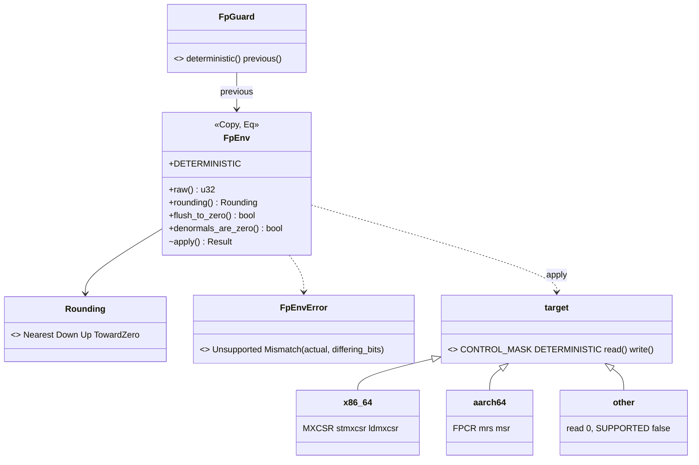

# Review 4-9: floating-point control state helper

Task: 4-9. Class 3 (governance task declared by the owner's pick, 2026-11-04: one row in `gates/unsafe-budget.toml`) on top of Class 2 content (`unsafe`, determinism, new public API in `base`). One PR into `main`. Open blocker/major: see the end.

Delivers: `engine/base/src/fpenv.rs` (module `base::fpenv`), `engine/base/src/fpenv/tests.rs`, `engine/base/src/fpenv/unsupported_tests.rs`, one line in `engine/base/src/lib.rs`, one row in `gates/unsafe-budget.toml`, wiki pointers (physics-and-jobs-v0, physics, README changelog v0.85), this file. No ADR, workflow, arch-check, classifier, `CLAUDE.md`, digest or other gate file touched. `jobs` and `physics` do not call the helper yet.



```mermaid
sequenceDiagram
  participant J as Job (worker or caller thread)
  participant H as base::fpenv
  participant R as MXCSR / FPCR of this thread
  J->>H: assert_deterministic() at job start
  H->>R: read (stmxcsr / mrs)
  R-->>H: raw bits
  H-->>J: Ok, or Err(Mismatch{actual, differing_bits})
  alt Mismatch (a driver or library changed the state)
    J->>H: set_deterministic()
    H->>R: read, merge control bits, write (ldmxcsr / msr)
    H-->>J: previous state
  end
  J->>J: simulation arithmetic (opaque boundary to the compiler)
  Note over J,R: Other threads have their own register; a new thread may inherit the creator's
```

## Decisions

1. **Module name `base::fpenv`** (O10: the helper lives in `base`; `std::arch` and assembly are allowed only there). One file holds the safe API and the four `unsafe` blocks; the layouts are private cfg modules: `mxcsr` (constants shared by x86-64 and the fallback) and `target` (x86-64, AArch64, other) with `read` and `write`.
2. **Inline assembly, not the stable intrinsics.** Checked on the pinned toolchain 1.94.1: `_mm_getcsr` and `_mm_setcsr` exist but are deprecated (since Rust 1.75, because LLVM does not model the register), and the workspace denies warnings. So `core::arch::asm!` with `stmxcsr [ptr]` and `ldmxcsr [ptr]` (x86-64) and `mrs`/`msr fpcr` (AArch64). Options `nostack, preserves_flags`; no `nomem`, the conservative choice. This resolves the `[K]` of physics-and-jobs-v0.
3. **State = control bits only.** `FpEnv` keeps the bits that select behaviour (`MXCSR` 0xFFC0: DAZ, the six masks, rounding, FTZ; `FPCR` 0x07C8_BF07: AHP, DN, FZ, RMode, FZ16, trap enables, EBF, FIZ, AH, NEP). Sticky flags and reserved bits are never compared and are preserved by `apply` (read, merge, write), which also guarantees that no reserved bit is ever written (`ldmxcsr` would fault).
4. **Deterministic = 0x1F80 on x86-64, 0 on AArch64:** round to nearest even, flush-to-zero off, denormals-are-zero off (denormals kept), every exception masked. Same meaning on both targets, as physics.md rule 6 requires for D2.
5. **API:** `current()`, `assert_deterministic() -> Result<(), FpEnvError>` (`Mismatch { actual, differing_bits }` names the bits), `set_deterministic() -> Result<FpEnv, _>` (returns the previous state), `FpGuard::deterministic()` (restores on drop, not `Send`), `FpEnv` getters. No allocation, no panic, errors as values. Unsupported targets report `FpEnvError::Unsupported` and never touch a register.
6. **Writing an arbitrary state is not public** (review finding, major 2): any state other than the deterministic one is outside the model the compiler assumes, so `apply`, the `with_*` builders and `from_raw` are `pub(crate)` or test-only. Tests corrupt the state through them. The guard restores the state it found, which is the one exception, documented.
7. **Compiler model is documented** (review finding, major 1): LLVM cannot see the register, so the helper guarantees the hardware state only and the job must separate the call from its floating-point work by an opaque boundary. The tests use `black_box`. The pool card that wires the helper must pick the boundary (a non-inlined job entry) and test it.
8. **Unsafe count: 12 lines** in four blocks (read and write on each target, three lines each after rustfmt and the Clippy rule `semicolon_if_nothing_returned`). Budget row `engine/base/src/fpenv.rs`, `max_unsafe_lines = 12`. The tool reports 84 unsafe lines of 18111 code lines (0.46%), 0 violations (before: 72 of 17591 in 4-7).

9. **`tests.rs` carries `#![cfg(test)]`** because the architecture check scans an out-of-line `#[cfg(test)] mod tests;` file as production code and bans `std::thread::spawn` outside the job system, `platform` and tests; the file attribute is the documented way to mark a whole file as test code. The first local-gates run found this (2 violations); no arch-check change was needed.
10. **AArch64 trap-enable bits are optional** (re-review, major): many cores read them as zero, so the unmasked-exceptions test checks the exact bits on x86-64 and, on AArch64, only that what is reported is what the register kept.

## Evidence

- Tests: 20 in `fpenv` (supported targets) and 1 for the fallback (final run: Windows 20 passed, Linux 20 passed, fallback 1 passed). They prove: the documented register values; the state after `set_deterministic` is Nearest, denormals kept; `assert_deterministic` names the exact differing bits for flush-to-zero, a rounding mode, denormals-are-zero (x86-64) and unmasked exceptions; `set_deterministic` returns the previous state and fixes it; the guard restores on drop; a change on a spawned thread does not reach the test thread; a worker spawned from a thread in a bad state is fixed by setting first; `apply` keeps the sticky flags (x86-64, using the inexact flag of 1/3); real arithmetic changes: a denormal result is zero with FTZ and kept without, a denormal input is zero with DAZ, an inexact sum rounds differently with Up, Down and TowardZero, and the bits of a reference computation are identical before and after a corrupted run. Every state-changing test runs on its own spawned thread and puts the state back on exit (a `Drop` guard), so the harness thread is untouched.
- Red evidence: the module and tests were written together in one sitting, so there is no earlier red run; red was shown by sabotage. With the merge in `apply` replaced by a write of the unchanged register, 7 tests failed (FTZ, DAZ, rounding, mismatch and reference-bits tests); with the XOR of `assert_deterministic` replaced by zero, 3 tests failed. Mutation testing below is the stronger check.
- Quality gates on Windows: `cargo fmt --check`, `cargo clippy --workspace --all-targets -- -D warnings` clean, `cargo test --workspace` 1176 passed, 0 failed, 1 ignored (run before the last 3 tests were added; the final `fpenv` run is 20 passed), release-mode run of the `fpenv` tests passes.
- Linux (WSL Ubuntu, rust 1.94.1, copy of the tree in `/tmp`): the 20 `fpenv` tests pass.
- AArch64: `cargo check` and `cargo clippy --all-targets -- -D warnings` for `aarch64-unknown-linux-gnu` (target already installed) pass, so the assembly and the tests type-check and lint there. **Not run**: there is no AArch64 CPU or emulator here; the tests run on the CI ARM64 runner (job `arm64`) after the release PR. The assembly was therefore never executed on AArch64.
- Fallback: the module compiled and its test passed with the target cfgs temporarily pointed at `riscv32`/`riscv64` (file restored), and clippy was clean in that configuration.
- Mutation (cargo-mutants 27.1.0, `-j 1`, `CARGO_BUILD_JOBS=2`, file `fpenv.rs`, tests `--lib fpenv`): 60 mutants, 6 unviable, 54 viable: 44 caught, 10 missed. Of the 10, 9 are in code that is not compiled on x86-64 (the AArch64 module: `<<` in two constants, `denormals_are_zero`, `read` and `write`; the fallback `read`), so no test on this machine can see them; the AArch64 ones are exercised by the ARM64 CI runner. The 10th, `|` to `^` in `FpEnv::apply` (`(register & !MASK) | (raw & MASK)`), is equivalent: the two operands occupy disjoint bits. On the code compiled here: 44 of 45 caught, the survivor equivalent (97.8%, 100% without it); counting every non-compiled mutant as missed, 44 of 54 = 81.5%, above the 80% gate. The first run (81 mutants) found one real survivor, `|` to `^` in the flag setter (setting an already-set flag), closed by `setting_a_flag_that_is_already_set_keeps_it_set`; the exception-mask path got `assert_reports_unmasked_exceptions_and_names_their_bits`.
- Miri: not applicable. Miri cannot execute `stmxcsr`/`ldmxcsr` inline assembly, and nothing else in the module is `unsafe`; not tried. The `unsafe` blocks are covered by the SAFETY comments, the tests, mutation testing and the independent review.
- Local gates: see the end of this file.

## Not verified

- AArch64 execution (above). The `FPCR` mask and encodings were checked against the Arm ARM layout by the independent reviewer from memory, not run.
- ThreadSanitizer and Miri: not applicable to a per-thread register.
- That every OS keeps the register across context switches and signals: assumed (it is part of the thread context on Windows and Linux).
- The behaviour of a new thread (inherits or default) is not tested: it differs by system and the module says not to rely on it.
- Targets other than Windows x86-64, Linux x86-64: macOS and 32-bit x86 are not tested; the fallback reports `Unsupported`.

## Follow-ups

- The pool card that wires the helper into `jobs` (worker start, caller thread) must call `assert_deterministic`/`set_deterministic` behind an opaque boundary and test that a corrupted worker is repaired.
- The `base/Cargo.toml` comment says "three modules" for `unsafe`; it was already stale (alloc, arena, simd) and is left alone to keep this PR small.

## Review loops

Independent read-only review by a subagent (soundness of the four `asm!` blocks, per-thread semantics, API, tests).

- Loop 1: 0 blocker, 4 major, 5 minor, 3 nit. Major: (1) the compiler model was not documented, (2) `apply` was public and safe although any other state is outside the model, (3) the AArch64 mask omitted FIZ, AH, NEP and EBF and a failed read could look like the deterministic state (0), (4) no test of the exception-mask bits. Fixed: a "Compiler model" section in the module comment, `apply`/builders/`from_raw` crate-private or test-only, mask 0x07C8_BF07 and a loud `u32::MAX` on a failed read, the unmasked-exceptions test. Minor and nits fixed: a vacuous test renamed, a tautological test removed, `#[inline(never)]` helper for the reference bits, thread-inheritance wording, LIFO guard note, AArch64 DAZ note.
- Loop 2 (re-review of the fixes): 0 blocker, 1 major, 1 minor, 2 nits. Major: the unmasked-exceptions test would likely fail on AArch64 cores without trap-enable bits. Fixed (exact bits on x86-64, subset on AArch64). Minor: the guard restores a possibly non-default state; documented in the module comment. Nits: the window with unmasked exceptions kept to register accesses and integer comparisons; the x86-64-only sticky-flag test is stated in Not verified.
- Open blocker/major after loop 2: **0** (the loop-2 fixes were checked by running the tests, clippy for both targets and the fallback configuration; a third review was not needed).

## Not verified (addition)

- The preservation of non-control bits by `apply` is proven on x86-64 only (the sticky flags live in `MXCSR`); on AArch64 the flags live in `FPSR`, a separate register that `apply` never touches.
- The mutation figure of 81.5% counts the AArch64 and fallback mutants as missed; the AArch64 ones are expected to be caught on the ARM64 runner, which is not run for this PR.
- The mutation run was made before the last test-only edits (unmasked-exceptions test, `#![cfg(test)]`); those edits only add or move assertions.

## Local gates

`python tools/local-gates/local_gates.py --base origin/main` on the final tree: fmt, clippy, build, tests, architecture (19 crates, 0 violations), unsafe budget (84 unsafe of 18111 code lines, 0.46%, 0 violations), wiki lint (53 pages), digest and all tool tests pass; exactly the 4 known deliberate FAIL lines remain (`mutation.score_min`, `CLAUDE.md does not import`, `G1: well-tested score`, `cannot write the report`). `cargo tree --workspace --exclude 'adapter_*' --exclude 'app_*' --locked --target all --all-features --edges normal,build,dev --prefix none` lists no `adapter_` or `app_` crate.
