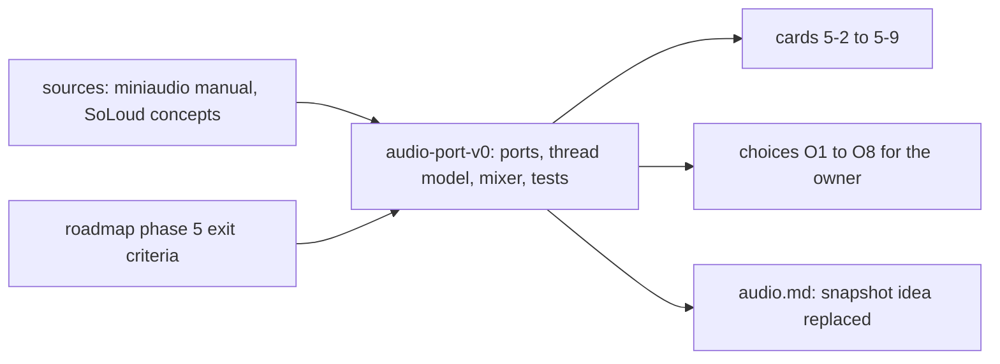

# Review 5-1: audio design note (phase 5)

Task: 5-1. Documentation only: new page `wiki/architecture/audio-port-v0.md`, two edits in `wiki/architecture/audio.md`, changelog v1.15 in `wiki/README.md`. No code, no governance file. Expected class 1 (the classifier decides at the PR).

## What was checked

- R1 self: every claim tagged K was traced to a page that was read; the rows tagged U name the card that settles them. Claims about the repository were checked against it: `audio = 2` and the `audio -> jobs` edge in `gates/architecture.toml`, `Handle` and `Pool` in `base`, the counting allocator `count_allocations`, the `contract-tests` feature pattern of `platform` and `render`, `engine/physics/clippy.toml` as the precedent for the `disallowed-types` list, `gates/benchmarks.toml` and `gates/unsafe-budget.toml` as the files a benchmark gate and the queue module would touch (both protected paths, stated in the note).
- R5 architecture: the design keeps ADR-0013 (pull model, SPSC queues, audio thread outside the job system) unchanged; it drops only the snapshot idea that `audio.md` had listed as open.
- R6 security: the WAV decoder is specified as untrusted input with checked sizes and a hard cap; the miniaudio library is hash-checked like GLFW; the C shim is the first C code and is named as a risk.
- R8 product fit: each phase 5 exit criterion (offline fidelity, real-time safety, voice benchmark) has a row in section 8.

## Limits of the evidence, reported

- Not retrievable: Ross Bencina's real-time article (connection refused), FMOD and Wwise threading documentation. The real-time rules rest on the general practice already in `audio.md` and are enforced by tests.
- The miniaudio manual does not state whether the callback size is fixed, nor how device loss is reported; the port is designed to hold either way and card 5-7 reads the pinned header.
- No independent reviewer ran: documentation only, and the owner reads this note.

Open blocker/major: 0.
