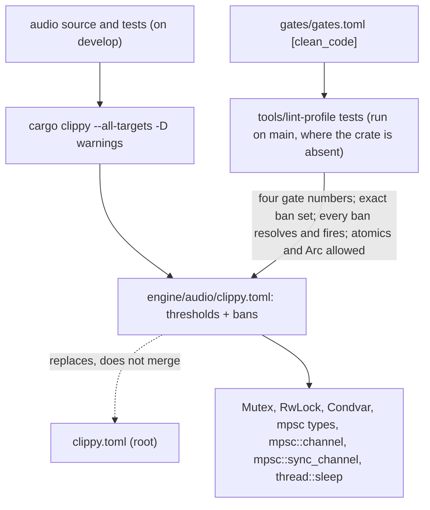

# Review 5-10: Clippy bans for the audio crate (governance)

Task: 5-10. Class 3 (governance: a crate `clippy.toml` is a protected path). Declared by the owner in the session on 2026-11-09 ("5-10 and 5-12"). Goes to `main` first (PR body line `Governance task: yes (card 5-10)`), one `ci` run started by hand, then `develop` merges `main`. The audio crate is on `develop` only, so one ordinary companion card (5-10a, a test in the crate that used a `Mutex`) goes to `develop` first, as 4-20a did for 4-20.

## What changes

- `engine/audio/clippy.toml` (new): the four clean-code thresholds of `gates/gates.toml`, `disallowed-types` for `std::sync::Mutex`, `RwLock`, `Condvar` and `std::sync::mpsc::{Sender, SyncSender, Receiver}`, `disallowed-methods` for `std::thread::sleep`, `mpsc::channel` and `mpsc::sync_channel`, each with a reason. Atomics, `Arc` and a lock-free queue are not banned.
- `tools/lint-profile/test_lint_profile.py`: 7 new tests (an exact-set check of the bans with reasons, a missing-ban report, every path resolves, every type ban fires, every method ban fires, atomics and `Arc` stay clean, the length limit still applies); the crate-config key check lets the audio file carry the two ban keys.
- `docs/gates/clean-code-lint-profile.md` and `wiki/architecture/ports-and-adapters.md`: one paragraph each and one node in the existing Mermaid views.
- `reviews/5-10.md`: this file. Not changed: `wiki/README.md` (its changelog on `main` is behind `develop`'s; the follow-up on `develop` records the card), the digest, `gates/`, `.github/`, any engine code.

## Evidence

- Red: the tests were written first; with `engine/audio/clippy.toml` removed the new run gave 44 tests, 14 errors. With the file: `python -m unittest tools/lint-profile/test_lint_profile.py` 44 tests OK (the existing 37 plus 7).
- The audio crate itself: with the new file copied into a worktree of `develop`, `cargo clippy --workspace --all-targets -D warnings` flagged `std::sync::Mutex` in five places, all in the `#[cfg(test)]` module of `engine/audio/src/offline.rs`, and nothing else. That is companion card 5-10a (a lock-free frame log replaces the `Mutex<Vec<u32>>` in that test).
- Wiki lint: OK, 58 pages, 0 violations.

## Independent review (R3)

A reviewer with no part in the work found 0 blocker, 0 major, and these minors:

| Finding | Action |
|---|---|
| Doc paragraph overstated who checks the exact ban set and was too long | Reworded into shorter sentences |
| "lock-free queue of `base`" does not exist on `main` yet | Reworded: atomics and `Arc` stay allowed, so a lock-free queue built on them is not affected |
| `Barrier`, `park`, `Once` not banned | Not in the card or the design note; join and recv are legitimately used or covered by the type bans. Reported as a possible later addition, not done |
| A test partly re-tests its helper | Kept (it pins the helper's reporting) |

## Not done, reported

- `Barrier`, `thread::park`, `OnceLock` and `LazyLock` are not banned (not in the card or the design note).
- The miniaudio adapter uses `Mutex` by design (the callback takes it with `try_lock`); it is a different crate and has no ban file.
- A hosted `ci` run on the branch (started by hand after the PR is open); the result is added to the PR.

Open blocker/major: 0.
