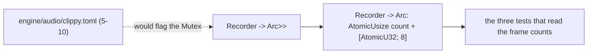

# Review 5-10a: the audio crate test without a lock (companion of governance card 5-10)

Task: 5-10a. Class 1-2 by the classifier (test code in `engine/audio/src/offline.rs`, no behaviour change). Ordinary card into `develop`. Needed because governance card 5-10 adds `engine/audio/clippy.toml`, which bans `std::sync::Mutex`, and the only use of a `Mutex` in the crate was the recorder of one test.

## Evidence

- Test-only change; the behaviour under test is unchanged. `cargo test -p audio`: 172 passed, 0 failed (the same count as before). `cargo fmt --all` clean.
- `cargo clippy --workspace --all-targets -- -D warnings` clean with the current root config, and clean with the 5-10 file copied in (before the change it flagged `Mutex` five times; after it, nothing).
- The log is lock-free (an atomic counter and eight atomic slots); calls beyond eight are counted, not stored; the tests make at most three.
- Mutation testing: not run, test code only.

## Not done, reported

- No independent reviewer: a 36-line change to one test helper, read by the author against the clippy output and the unchanged tests.

Open blocker/major: 0.
