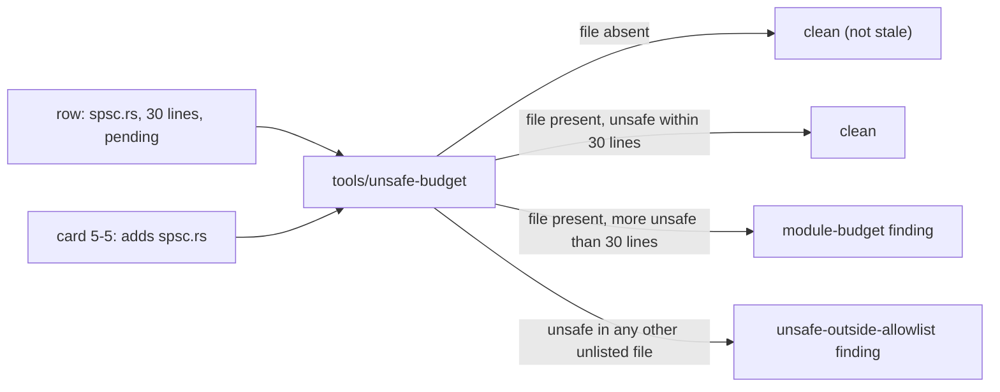

# Review 5-11: unsafe-budget row for the audio SPSC queue

Task: 5-11. Class 3 (governance): `gates/unsafe-budget.toml` is a protected path. The owner declared the governance task in the session on 2026-11-08, after being told that card 5-5 needs a lock-free queue with an `unsafe` block and that the file must be listed first. Governance card: PR into `main`, one `ci` run started by hand, then `develop` merges `main`.

## What changes

One entry in `gates/unsafe-budget.toml`:

```toml
[[modules]]
path = "engine/base/src/spsc.rs"
max_unsafe_lines = 30
pending = true
```

`pending = true` is the mechanism the tool already has for a file that does not exist yet: the entry is not reported as stale, and once the file exists it is held to its budget like any other row. No other file, threshold or tool changes; the global ratio (`max_percent = 5`) is untouched.



## Why this budget

The queue is a bounded power-of-two ring with one producer and one consumer; its unsafe code is the access to the slot array through an `UnsafeCell` (one write, one read) and the `Send`/`Sync` implementations, each with a `// SAFETY:` comment. A comparable file in the repository, `engine/base/src/alloc.rs`, has 29 unsafe lines. 30 is an upper bound set before the code exists; card 5-5 reports the real count and the budget is lowered to it in a later governance task (lowering never loosens the gate). A budget that was too small would block card 5-5 and cost another governance round; one that is a few lines too large costs nothing the global ratio does not already cap (84 unsafe lines of 40 300 code lines today, 0.21% against 5%).

## Evidence

- `python -m unittest discover -s tools/unsafe-budget`: 29 tests, OK (the pending mechanism has tests: a pending entry may name a missing file; a pending entry whose file exists is held to its budget).
- `python tools/unsafe-budget/unsafe_budget.py --config gates/unsafe-budget.toml --architecture gates/architecture.toml`: `OK 84 unsafe of 40300 code lines (0.21%), 0 violations`.
- Local gates against `origin/main`: only the four known self-test FAIL lines.
- No code, no threshold, no tool, no workflow changed.

## Independent review

Not run: the change is one data row using an existing, tested mechanism. The owner reads this governance diff before approving.

Open blocker/major: 0.
