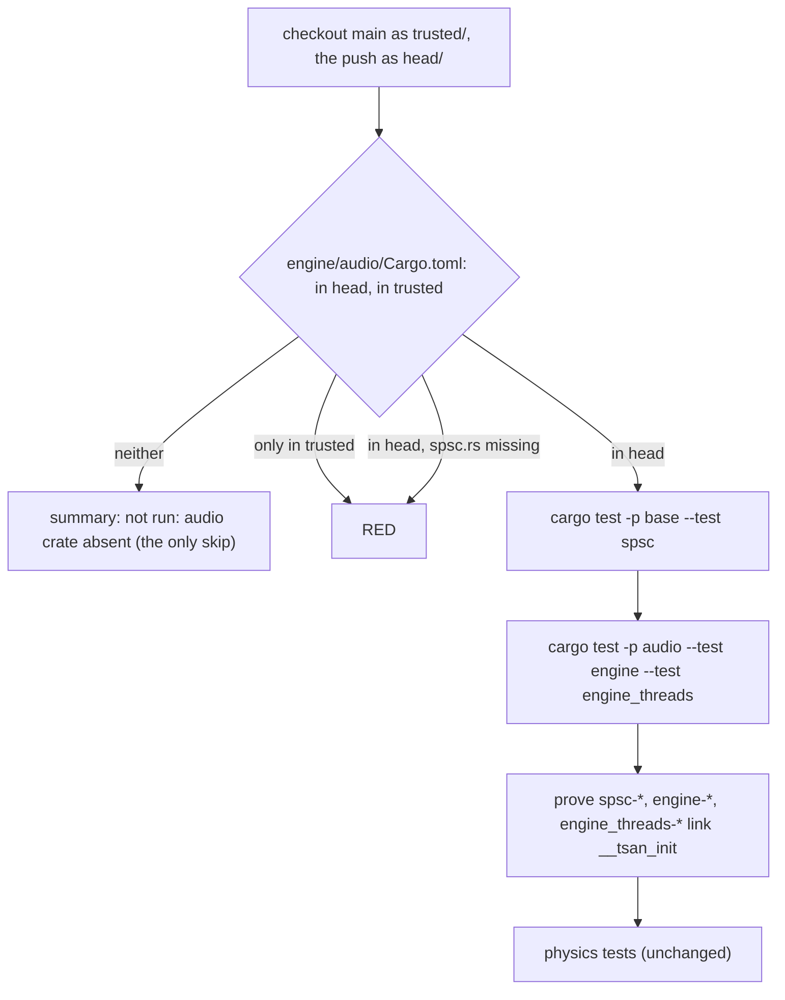

# Review 5-12: ThreadSanitizer covers the SPSC queue and the audio engine tests (governance)

Task: 5-12. Class 3 (governance: `.github/workflows/ci.yml`, a protected path). Declared by the owner in the session on 2026-11-09 ("5-10 and 5-12"). Goes to `main` first (`Governance task: yes (card 5-12)`), one `ci` run started by hand, then `develop` merges `main`. The audio crate and the queue test are on `develop` only, so the job decides by presence, like the physics part (card 4-21).

## What changes

- `.github/workflows/ci.yml`, job `tsan`: five new steps (find the audio crate; thread-sanitize the queue tests; thread-sanitize the audio engine tests; prove the three test binaries are instrumented; say that the audio tests did not run) and a third item in the job comment. Same pinned dated toolchain, same `-Zbuild-std`, `--target`, `--locked`, `halt_on_error=1`; no new action, secret or permission.
- `tools/release/test_workflows.py`: one new test for the audio steps (commands and flags, the presence rule in both directions, the summary line, the instrumentation proof, the order) and the `if:` count of the job updated from 2 to 6.
- `wiki/workflow/ci-diagrams.md`: the `tsan` subgraph gets the audio decision.
- `reviews/5-12.md`: this file. Not changed: the budget row of `spsc.rs` (30 for 4 used; the card asked only for the TSan job, lowering it stays a separate governance step), the digest, `gates/`.

## Evidence

- Red then green: the new workflow test failed (1 failure, 1 error) against the unchanged `ci.yml` and passes with the change; `python -m unittest tools/release/test_workflows.py`: 81 tests OK. Wiki lint OK (58 pages).
- **Hosted proof** (the crate is not on `main`, so the job was run on a verify branch, never a PR, `agent/5-12-tsan-verify` = this branch + `develop`, with `ci.yml` cut down to the `tsan` job to save minutes; run 42656454958, success): the new steps ran and passed on the hosted runner. SPSC queue tests 13 passed (166 s under TSan); audio `engine` 23 passed; `engine_threads` 3 passed (13 s); the proof step passed for the three binaries; the "did not run" step was skipped; the physics tests passed (21, 64, 15, 3 and 36 tests). No `WARNING: ThreadSanitizer` line anywhere. This is the first hosted race check of the queue and of the game thread against the audio thread.
- The "crate absent" path: shown by the hand-started `ci` run on this branch (the audio crate is not in this tree); the result is in the PR.

## Independent review (R3)

A reviewer with no part in the work read the diff: 0 blocker, 0 major, six minor.

| Finding | Action |
|---|---|
| The new test did not pin the "only in trusted is red" branch (`exit 1` was already present for another reason) | Test now pins the `elif` line and exactly two `exit 1` |
| Nothing pinned `set -euo pipefail`, `-perm -u+x`, `test -n "$binary"` | Pinned (two `set -euo pipefail`, the other two strings) |
| A bare total of `if:` lines would not notice an `if:` on the wrong step | The per-step counts in the audio slice pin them (3 and 1) |
| The proof finds the first binary of the name, not necessarily the one just run | Accepted: no other crate has a target named `spsc`, `engine` or `engine_threads`, and the target directory is fresh on a runner; reported |
| Diagram edge went from the decision node to physics | Fixed: the skip and the run nodes lead to physics |
| Comment and summary text | Checked accurate |

## Not done, reported

- The `base` tests that spawn threads for other reasons (allocation counters, profile sink) and the miniaudio adapter (native device thread) are not in this job: the card names the queue and the audio engine tests.
- Miri and the unsafe-budget row (30 for 4 used) are separate steps.
- `engine_threads` waits by spinning; under TSan it took 13 s on the hosted runner. One run, so flakiness is not excluded.

Open blocker/major: 0.
