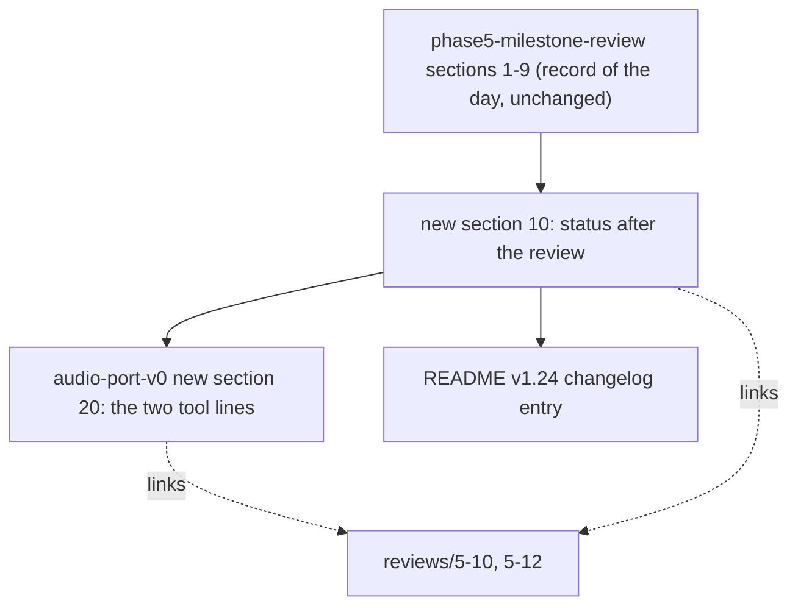

# Review 5-13: phase 5 wiki and README follow-up

Task: 5-13. Class 1 (documentation only, no governance file, no code). Ordinary card into `develop`. Asked by the owner on 2026-11-09 ("phase 5 wiki and readme follow-up"), after the phase 5 release (pull request 28, v0.10.0).

## What changes

- `wiki/spikes/phase5-milestone-review.md`: a pointer under the title and a section 10 (a Mermaid view, a table of what changed since the review, what stays open, one process note). Sections 1 to 9 are not rewritten.
- `wiki/architecture/audio-port-v0.md`: section 20, the Clippy bans (5-10, 5-10a) and the ThreadSanitizer coverage (5-12), and what they do not cover.
- `wiki/README.md`: status line v1.24 and one changelog entry.
- `reviews/5-13.md`: this file. Not changed: the digest, `gates/`, `.github/`, any code, the older changelog entries (they are history).

## Evidence

- Every figure and identifier in the new text was taken from git or the hosted runs of this session: pull requests 25 to 28, merge commit `fc3c384`, tag v0.10.0, `ci` run 42666048599 (all jobs green, including the ThreadSanitizer steps for the audio crate and the Ubuntu and ARM64 jobs).
- No threshold-like number was added (wiki lint).
- Local gates: result in the pull request.

## Not done, reported

- The older changelog entries v1.16 and v1.19 still say "waits for 5-10" and "5-12 is proposed": they are history and the new entry v1.24 says what became of them.
- The F-LINUX claim is limited to what the jobs show (build, lint, test green on Ubuntu and ARM64); the real-device path on Linux is not tested.
- The cause of the `trusted-pr-gates` startup failures is unknown and stated as such.

## Independent review (R3)

A reviewer with no part in the work checked every identifier, link, anchor and claim against git, `gh` and the files: 0 blocker, 0 major, four minor.

| Finding | Action |
|---|---|
| README entry put 5-10a next to "both on `main`" | Reworded: 5-10 and 5-12 on `main`, 5-10a on `develop` |
| "`develop` equals `main`" is a snapshot, and the push `ci` run on `main` was still running | Accepted: section 10 does not claim that run passed |
| "once on the PR of 5-12" not confirmed by the reviewer | Kept: run 42660158119 on the branch of 5-12 ended in startup_failure (read in this session) |
| Mermaid views not rendered | Accepted: checked by reading |

Open blocker/major: 0.
