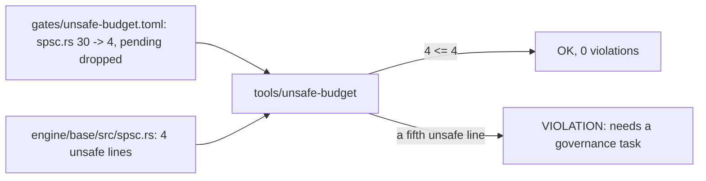

# Review 5-14: lower the unsafe budget row of the SPSC queue (governance)

Task: 5-14. Class 3 (governance: `gates/unsafe-budget.toml` is a protected path). Declared by the owner in the session on 2026-11-09 ("5-12 spsc budget row and the benchmark gate"). Goes to `main` (PR body line `Governance task: yes (card 5-14)`), one `ci` run started by hand. The queue is on `main` since the phase 5 release (v0.10.0), so the row is no longer `pending`.

## What changes

- `gates/unsafe-budget.toml`: the `spsc.rs` row goes from 30 to 4 (the count the tool reports: the `Sync` implementation, the drop of left-over slots, the slot write, the slot read) and loses `pending = true`; the comment says why.
- `wiki/architecture/audio-port-v0.md` section 15: "a later governance step" becomes "card 5-14 lowered the row".
- Not changed: any other row, `max_percent`, the tool, any code.

## Evidence

- Red then green with the real tool on the real tree: with the row at 3 the tool prints `VIOLATION module-budget engine/base/src/spsc.rs: 4 unsafe lines, budget 3` and `FAIL`; with 4 it prints `OK 88 unsafe of 45322 code lines (0.19%), 0 violations`.
- `python -m unittest discover -s tools/unsafe-budget`: OK. The hosted result of the hand-started `ci` run is in the PR.

## Not done, reported

- Every other row keeps its budget (they were set to counts earlier).
- A future fifth unsafe line in `spsc.rs` now fails the gate until a governance task raises the row, which is the intent.

Open blocker/major: 0.
