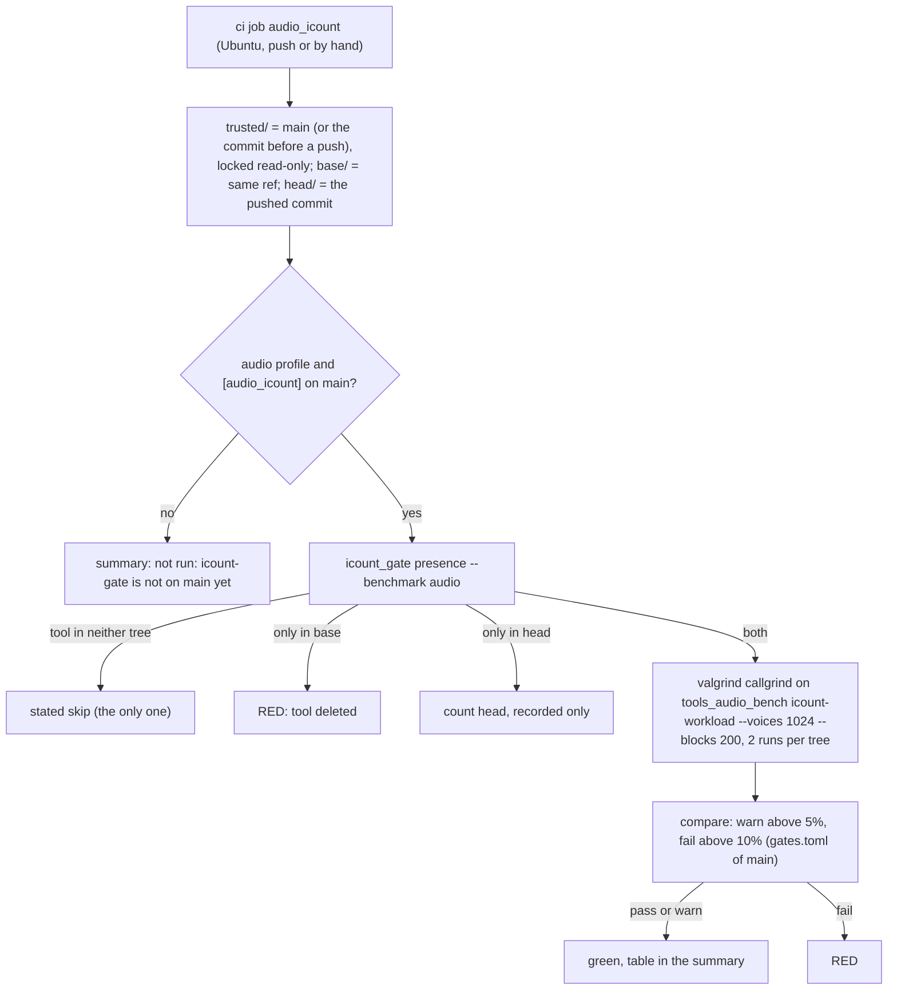

# Review 5-15: the audio instruction-count gate

Task: 5-15. Class 3 (governance: `tools/icount-gate`, `gates/benchmarks.toml`, `.github/workflows/ci.yml`). Declared by the owner on 2026-11-09 ("clean up then 5-12 spsc budget row and the benchmark gate"); design chosen by the owner: instruction count, head against base, the method of the physics gate (card 4-23). Governance card: pull request into `main` first. Companion card 5-15a (the `icount-workload` mode) is already on `main` (v0.11.0).

## Why

A wall-time budget ("1,000 voices under a quarter of a core") cannot be a gate on hosted runners: the same benchmark gave about 19.3 % of a core on one CPU type and about 37 % on two others (Actions run 42694570079, card 5-15a). An instruction count does not depend on the CPU type, and comparing the base tree with the pushed commit on the same runner makes the verdict about the change, not the runner lottery. The quarter-of-a-core figure stays a documented, report-only line.

## What changes

- `tools/icount-gate/icount_gate.py`: a `Profile` (benchmark table, workload flags, skip line, words). `PHYSICS` is the default and behaves as before; `AUDIO` reads `[audio_icount]` (`voices`, `blocks`). `--benchmark {physics,audio}` on `presence`, `measure` and `compare`. `Config` keeps `rows` and `steps` as properties, so the physics tests are untouched.
- `gates/benchmarks.toml`: `[audio_icount]` (package, manifest, 1024 voices, 200 blocks, 2 runs, noise limit as physics). The bands are the shared ones in `gates/gates.toml [benchmark]`; no threshold was added or changed.
- `.github/workflows/ci.yml`: job `audio_icount`, the `physics_icount` job with `--benchmark audio` and Audio wording; its bootstrap step also waits for `[audio_icount]` on `main`. The tool tests step runs `test_icount_gate_audio` too.
- Tests: `tools/icount-gate/test_icount_gate_audio.py` (16 tests: config bounds, argv, skip line, summary words, the CLI, physics default unchanged) and three tests in `tools/release/test_workflows.py` (the audio job equals the physics job after substitution; bootstrap; skip line).
- Docs: `wiki/workflow/ci-diagrams.md` (job and diagram), `wiki/architecture/audio-port-v0.md` section 18 (the stale "proposed budget" bullet replaced), `wiki/README.md` v1.26.

## Evidence

- Red first: the new test file failed (4 failures, 14 errors) against the physics-only tool; green after the profile (95 tool tests, 84 workflow tests).
- Local gates against `origin/main`: all pass (fmt, clippy, build, test, architecture, unsafe budget, wiki lint, digest, diff hash, all tool test folders). Not run locally: Miri, coverage, mutation, benchmarks, metrics.
- Hosted proof on throw-away branches (deleted), `ci` cut down to the `audio_icount` job with `trusted/` = the branch, base = `main`:
  - same code as base: run 42708650413 green, 6103249456 instructions for head and for base, both runs identical, `+0.00%`;
  - head renders every block twice: run 42708679553 red, 12161977045 against 6103249445, `+99.27%`, above the fail band of 10%.
- The full `ci` run on the branch is started by hand before approval (result in the pull request).

## Limits, stated

- It detects a regression of the voice scene against its base, not an absolute speed; it cannot say whether a given machine meets a quarter of a core.
- One scene (1024 voices, 200 blocks, the scene of `tools_audio_bench`); buses, resampling variety and the SPSC queue are only covered as far as the scene uses them.
- Callgrind counts instructions, not cache or memory effects; the real-time deadline is still checked by the report mode and by the real-time-safety harness.
- The first push after the merge has base = the commit before it, so it compares real trees; the bootstrap line can appear only on a `main` that lacks the profile.

## Independent review (R3)

A reviewer with no part in the work compared the diff with `origin/main`, the `audio_icount` job line by line with `physics_icount`, the trust model (config only from the trusted checkout, `--benchmark` restricted to choices, package name validated, count read from valgrind's own log) and the wiki claims, and ran the tool tests (95 and 177 pass): 0 blocker, 0 major, five minor.

| Finding | Action |
|---|---|
| ci-diagrams said "Eleven independent jobs" | Fixed: "Twelve" |
| audio-port-v0 section 18 "Not done here" still listed the gate | Fixed: points to card 5-15 |
| `Config.rows`/`steps` raise `KeyError` on an audio config | Commented as physics-only; nothing in the production path calls them |
| Workload bounds (1,000,000 voices or blocks) looser than the mixer's | Accepted: `benchmarks.toml` is read from `main` and a bad value fails the run, never passes it; hardening only |
| Review file uncommitted, R3 pending | Done |
| (note) no-op tuple in a test | Removed |

Open blocker/major: 0.
