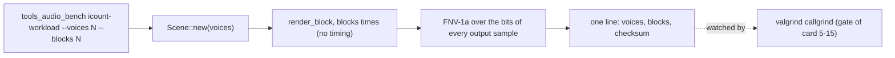

# Review 5-15a: an instruction-count workload for the audio benchmark

Task: 5-15a. Class 2 (a new command line mode of a dev-time tool; no governance file, no engine code). Ordinary card into `develop`; companion of governance card 5-15, which needs this mode on `main` before its gate can compare a base tree with a pushed commit.

## Why

Wall time cannot be the gate. Six hosted Ubuntu jobs ran the same benchmark (Actions run 42694570079): about 19.3 % of a core for 1024 voices on one CPU type (1 job), about 37.1 % and 37.4 % on two others (5 jobs); inside a CPU type the runs agree within 2 %. An instruction count of the same work does not depend on the CPU type, so the owner chose, in the session on 2026-11-09, an instruction-count gate, head against base, like the physics gate (card 4-23).

## What changes

- `engine/tools_audio_bench/src/lib.rs`: `icount_workload(voices, blocks)`, a deterministic workload with an order-sensitive checksum of every output sample (it proves the work was done and changes with voices and blocks).
- `engine/tools_audio_bench/src/main.rs`: `icount-workload [--voices N] [--blocks N]` (defaults 1024 and 200), the same limits as the existing flags.
- `engine/tools_audio_bench/tests/scene.rs` and the unit tests in `main.rs`: new tests (three in `tests/scene.rs`, four unit tests in `main.rs`).
- `wiki/architecture/audio-port-v0.md` section 18 and `wiki/README.md` v1.25: the finding and the mode.

## Evidence

- Red then green: the three library tests failed to compile before the function existed; with it `cargo test -p tools_audio_bench` passes (1 + 11 + 7 tests). Clippy with `-D warnings` is clean.
- The workload prints the same checksum on repeated release runs (`voices 1024 blocks 200 checksum 7d56f729e6c05fb3`), zero voices exits with code 2.
- Local gates: result in the pull request.

## Not done, reported

- The checksum was compared across runs on one machine (Windows) only; it is bit-exact arithmetic in a deterministic scene, but a Linux value is not recorded here. The gate of card 5-15 compares two trees on one runner, so it does not need the two to agree.
- The existing report mode is unchanged.

## Independent review (R3)

A reviewer with no part in the work found 0 blocker, 0 major, six minor.

| Finding | Action |
|---|---|
| Test count in this file wrong | Fixed |
| The `u32::try_from` branch cannot fire | Kept, commented (it avoids a cast) |
| No test of the dispatch in `run` | The line is built by `workload_line`, now tested |
| Determinism test compares two runs in one process only | Accepted, stated above |
| Unknown flag with a non-numeric value reports the number error | Accepted: still an error |
| No test for the cap or a duplicate flag | Added |
| "within 1 %" too tight for the hosted sample | Reworded to 2 % |

Open blocker/major: 0.
