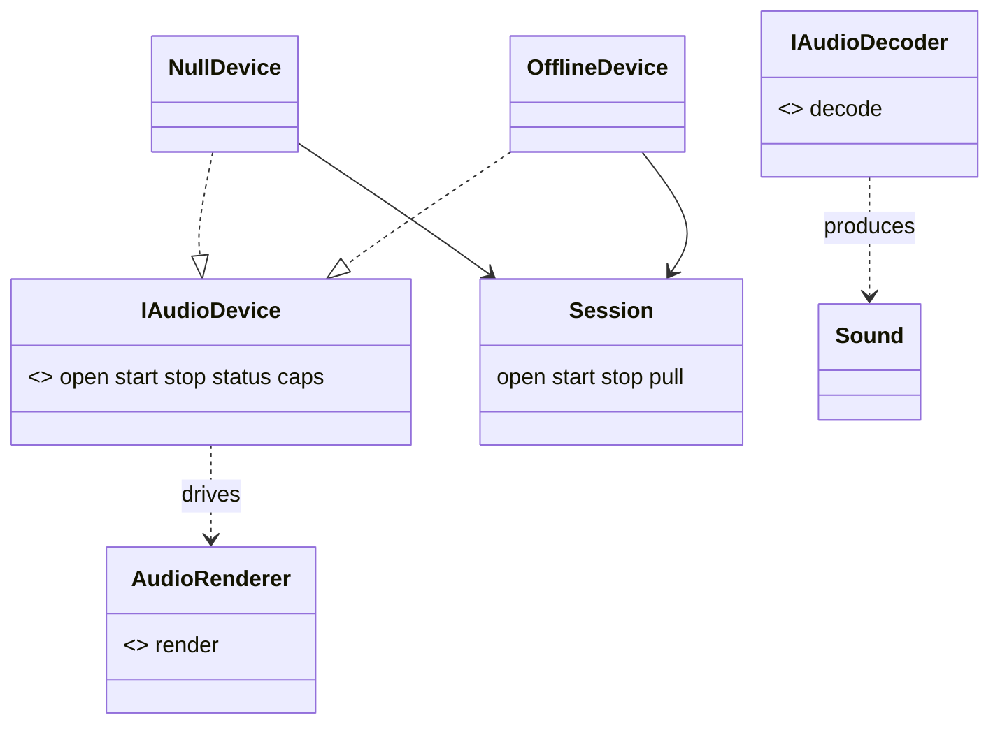

# Review 5-2: the audio crate, ports and Null / Offline devices

Task: 5-2. Class 2 (new public port in a new crate). Ordinary card into `develop`; no governance file (the Clippy ban list for the crate, which needs a `clippy.toml`, is card 5-10).

## Evidence

- Red: with only the test modules in place, `cargo test -p audio` failed to compile with 100 errors (missing types). Then the code was added and the tests went green. The contract suite got its own tests by deliberate faults (see below).
- `cargo test -p audio --features contract-tests`: 40 passed, 0 skipped.
- `cargo clippy --workspace --all-targets -- -D warnings` clean; `RUSTDOCFLAGS="-D warnings" cargo doc -p audio --no-deps` clean; `cargo fmt` clean.
- Mutation (`cargo mutants -p audio --features contract-tests`): 80 mutants, 12 unviable, 67 caught, 1 missed. The missed one replaces `NullDevice::status` by the default status; it is equivalent, because the Null device never calls the renderer and its status is always the default. Score 67 of 68.
- No `unsafe`, no new dependency, no `unwrap` or `expect` in engine code, `panic = abort` untouched.

## Independent review (R3) and what was done with it

A reviewer with no part in the work read the crate. No blocker. One major and nine minor findings:

| Finding | Action |
|---|---|
| Major: the contract suite accepted adapters that break stated rules (stop returning another renderer, a refused start keeping its renderer, status counts not compared with what the renderer saw, only one layout opened, no test of a second stop or of open while started) | Fixed. The suite now checks renderer identity and drops with a counting probe, exact status counts after stop, an open table of four requests against `caps`, `open` after `stop`; `faulty.rs` holds an Offline device with one fault each (eight faults), and each must make the suite panic with the expected message. This is what raised the test count from 32 to 40 |
| Device loss undefined | Documented in `IAudioDevice::stop`: after a loss `stop` still succeeds and gives the renderer back, `open` is allowed again. No code produces a loss yet; the miniaudio card (5-7) adds the test with its adapter |
| `AudioError` / `DecodeError` not `non_exhaustive` | Done |
| Hint versus maximum, renderer-format match, stop is synchronous, real-device `open` failing the suite | Documented on the types and on `device_contract` |
| Counters used `+=` | `saturating_add` |
| `stop` before start only checked `is_err` | Now checks `WrongState` |
| Redundant `frames` and `out.len()` in `render` | Kept: the design note fixes this shape; the mixer will `debug_assert` it (5-3) |
| Failed `open` leaves the previous format | Kept and documented as the behaviour (`Session::open` only replaces the format on success) |

## Not done, reported

- Real-time safety harness and the Clippy `disallowed-types` list: no mixer exists yet (5-3); the list is a protected path (card 5-10, governance).
- No coverage run locally (the tool is not installed here); the tests exercise every public function and the contract suite checks both devices.
- Device loss is specified but not exercised.

Open blocker/major: 0.
