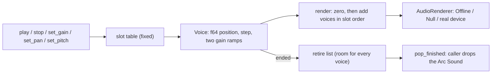

# Review 5-3: the mixer core and the real-time-safety harness

Task: 5-3. Class 2 (new public API in the `audio` crate, real-time code). Ordinary card into `develop`; no governance file (the Clippy ban list for the crate is card 5-10, the unsafe-budget row is card 5-5, the benchmark gate is card 5-8).

## Evidence

- Red: the test list (`tests/mixer.rs`, 29 tests) was written first against a stub mixer; 28 of 29 failed (the one that passed asserts silence from a mixer without voices, which the stub also gives). Then the code was written and all went green.
- `cargo test -p audio`: 89 passed, 0 skipped (43 unit, 43 mixer, 3 real-time safety).
- `cargo clippy --workspace --all-targets -- -D warnings` clean, `cargo fmt --check` clean, `RUSTDOCFLAGS="-D warnings" cargo doc -p audio --no-deps` clean.
- Mutation (`cargo mutants -p audio` on `mixer.rs` and `voice.rs`): 177 mutants, 5 unviable, 172 caught, 0 missed. The first run missed 7 (the right channel of a gain change, stereo frames after the first, interpolation across the loop point, the right channel of the interpolation); three tests were added for them.
- Real-time safety: 5 000 blocks of 100 to 999 frames with start, retarget, stop, finish and capacity refusals: 0 allocations, 0 reallocations, 0 deallocations on the calling thread (counting allocator, per-thread counters). A second test shows the harness counts a mixer build; a third shows that `render` frees nothing when the mixer holds the only reference to a sound and that the free happens when the caller drops the sound from `pop_finished`.
- Chunk independence: the same commands rendered in calls of 1, 7, 255, 256, 257 and 1 000 frames give identical bits.
- No `unsafe`, no new dependency, no `unwrap`/`expect` in engine code.

## Independent review (R3) and what was done with it

A reviewer with no part in the work read the code. No blocker, one major, ten minor:

| Finding | Action |
|---|---|
| Major: the harness could not see a drop of the last `Arc` inside `render` (the scene kept its own references) | Fixed: a test where the mixer holds the only reference |
| Sample rate 0 accepted (a looping voice would never finish) | Refused as `InvalidParameter`; test added |
| `render` with a slice shorter than `frames` left stale data | The part that exists is zeroed, the frames that fit are rendered; test added |
| A second `stop` restarted the fade | `stop` is idempotent; test added (fade ends on schedule) |
| Last frame of a one-shot fades to silence when slowed down | Documented (section 13) and pinned by a test |
| Pan ramp moves channel gains linearly, a power dip of up to about 3 dB mid-sweep | Documented; angle ramp is a later refinement |
| `u32::try_from(index).unwrap_or(0)` quiet fallback | Replaced by an early return |
| `pop_finished` order (stack) and `play` dropping its `Arc` on error | Documented on the functions and in section 13 for card 5-5 |
| Weak tests (stop fade shape, NaN in setters, one-frame loop, step longer than the loop, fractional position kept on a pitch change) | Tests added |
| `render` visits every slot | Kept; a free list is a candidate once the voice benchmark (5-8) shows a need |

## Not done, reported

- No coverage run locally (the tool is not installed here); the tests exercise every public function.
- The Clippy `disallowed-types` list (`Mutex`, `RwLock`, ...) is the second line named in the design note; it needs a `clippy.toml`, a protected path (card 5-10).
- Output is stereo only; mono and 5.1 output, buses and scratch buffers come with 5-6.
- No Miri or ThreadSanitizer run: the mixer has no `unsafe` and no threads of its own (queues are 5-5).

Open blocker/major: 0.
