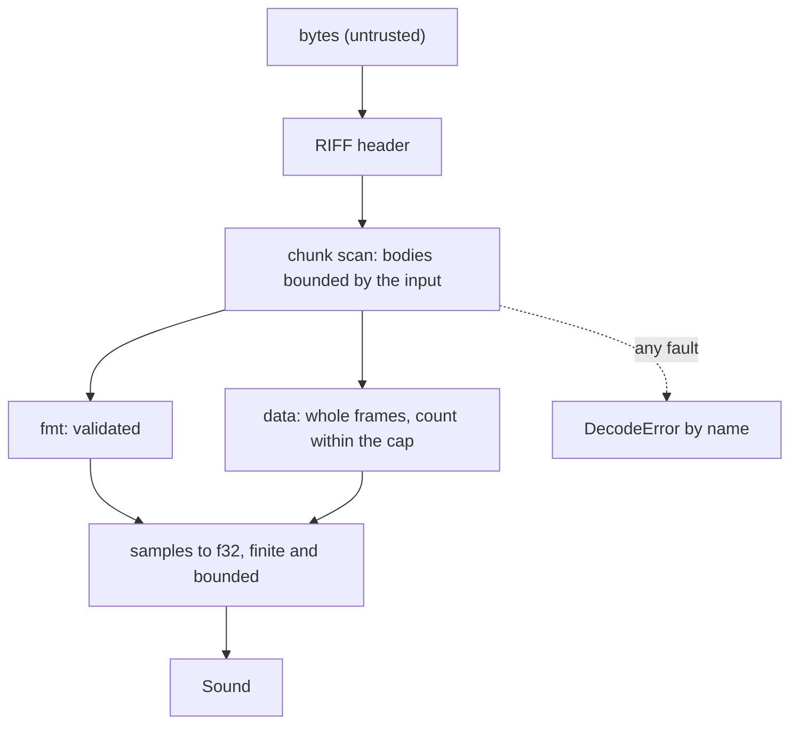

# Review 5-4: the WAV decoder

Task: 5-4. Class 2 (a decoder on a public port that reads untrusted input; security review required by the card). Ordinary card into `develop`; no governance file.

## Evidence

- Red: the test list (`tests/wav.rs`, 25 tests) was written first against a stub decoder; 24 of 25 failed (the one that passed is the no-panic mutation loop, which a stub trivially satisfies). Then the decoder was written and all went green.
- `cargo test -p audio`: 124 passed, 0 skipped (43 unit, 43 mixer, 3 real-time safety, 33 decoder, 2 decoder allocation).
- `cargo clippy --workspace --all-targets -- -D warnings`, `cargo fmt --check` and `RUSTDOCFLAGS="-D warnings" cargo doc -p audio --no-deps` clean.
- Mutation (`cargo mutants -p audio --file engine/audio/src/wav.rs`): 97 mutants, 6 unviable, 90 caught, 1 timeout (an offset mutated so that the chunk loop never advances; the harness kills it by time, so it is detected), 0 missed. The first run missed 4: the constant of the default cap (now pinned by a test) and an equivalent `||` in the channel/rate check (split into two checks).
- Security properties tested: every prefix of a good file is an error, a data size larger than the file, a chunk size of 0xFFFFFFFF, a wrong RIFF size, zero channels/rate/bits, more than eight channels, compressions, a wrong block align at every depth, a partial frame, duplicate and misplaced chunks, NaN, infinite and huge floats, the sample cap (an over-cap file allocates nothing), and a deterministic mutation loop (every byte of four files set to five extreme values, 12 000 random mutations with truncation) that must not panic and never yields a non-finite sample.
- No `unsafe`, no new dependency, no `unwrap`/`expect`, no panic path found.

## Independent review (R3, security focus) and what was done with it

A reviewer with no part in the work read the decoder. No blocker, no major. Minor findings:

| Finding | Action |
|---|---|
| The reservation of the output could abort on failure (large cap on a 32-bit target) | `try_reserve_exact`, a failure is `TooLarge` |
| Finite but huge floats (3e38) could overflow to infinity in the mixer | Magnitude above `MAX_FLOAT_MAGNITUDE` (1e6) is `Invalid`; boundary tested |
| Comment said the range is [-1, 1) while the largest 32-bit value rounds to 1.0 | Comment and `expect` reason corrected; a test pins the value |
| Cap test only checked the result, not that nothing was allocated first | New test with the counting allocator: zero calls for an over-cap file |
| Truncation test only asserted an error | Asserts `Truncated` or `Invalid` |
| Test name said overflow but only exercised an end beyond the input | Renamed |
| Missing cases (odd final chunk without pad, 18-byte `fmt `, extreme samples, block align at every depth, duplicate `data`, huge rate, 8-bit extensible, valid-bits boundaries) | Seven tests added |
| Error order with several faults; short non-WAV input is `Truncated`; streaming files with a `data` size of 0 or 0xFFFFFFFF are refused | Documented in section 14; the refusal is deliberate for v0 |
| `cbSize` and valid bits 0 in the extensible form are accepted | Kept: harmless and common; documented by a test |
| No `cargo fuzz` target; the mutation loop only proves no panic in a debug build | Reported below |

## Not done, reported

- No coverage run locally (tool not installed here).
- No `cargo fuzz` target: it would add a tool and a dependency; the in-test loop is the v0 substitute. A release-mode run of the loop was not done.
- No 32-bit target test; the code uses checked arithmetic by reading and the reviewer traced the 32-bit paths by hand.
- Streaming WAV files (unknown data size) and other formats (Ogg Vorbis, Opus, FLAC) are not supported.

Open blocker/major: 0.
