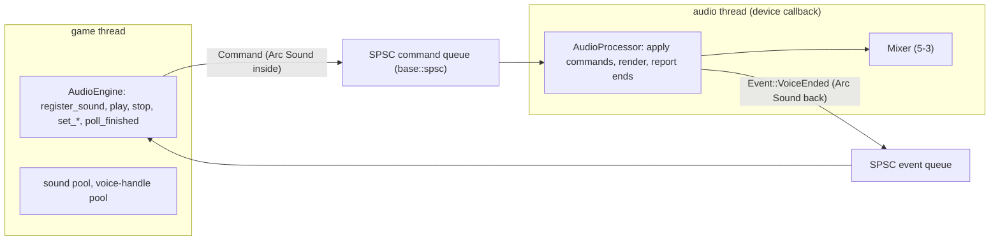

# Review 5-5: SPSC queue, `Command`/`Event`, the game-side engine API

Task: 5-5. Class 2 (`unsafe`, concurrency, new public API). Ordinary card into `develop`. The protected file `gates/unsafe-budget.toml` was handled first by governance card 5-11 (already on `main` and `develop`); this card changes no governance file.

## Evidence

- Red: `base/tests/spsc.rs` was written before the module existed (compile error: no `spsc`); the engine tests before `audio::engine` existed. Then the smallest implementations.
- `cargo test -p base -p audio`: all green (queue 13 plus a `compile_fail` doctest; engine 18, in-module 1, threads 3; the earlier 124 audio tests unchanged). `cargo clippy --workspace --all-targets -- -D warnings` and `cargo fmt --check` clean.
- Unsafe: `engine/base/src/spsc.rs`, 4 lines (tool total 84 to 88), every block with a `// SAFETY:` comment; budget row 30 (card 5-11), to be lowered later by a governance card.
- Miri (nightly): all 12 queue tests (13 now; the largest-capacity test returns early under Miri) pass, including two threads. In the engine tests 16 of 18 pass; the two that fail compare float output bit for bit between two runs, and Miri deliberately perturbs `sin`/`cos`, so they are meaningful natively only (they pass natively). The threaded engine test passes under Miri; the process then reports UB at teardown inside the counting allocator (`base::alloc`) on Windows, which also happens in the existing 5-3 test `realtime_safety` and is not in the new code. ThreadSanitizer is not run on these tests yet (card 5-12).
- Mutation: `spsc.rs` 47 mutants, 24 caught, 17 unviable, 6 timeouts (a hang is a detection), 0 missed (the first run missed `>` vs `>=` at the capacity limit; a test now builds the largest queue with a zero-sized type). `engine.rs` 38 mutants, 33 caught, 5 unviable, 0 missed (first run: 6 missed; fixed by removing a check that cannot matter, a bounded loop without arithmetic, and tests for messages and stereo sounds). The rerun came before the small review changes that added only tests and one in-module test.
- Coverage (`cargo llvm-cov`, lines): `spsc.rs` 98.67%, `engine.rs` 95.39%, `audio` crate 97.43%. Branch coverage not measured (needs nightly options). The unreached lines are the defensive branches below.
- Real-time: with the counting allocator, 4 000 blocks of `AudioProcessor::render` with voices started, changed, stopped, ended and sounds unregistered while playing make zero allocations, reallocations and frees.
- Threads: 20 000 voices started from the game thread against a looping audio thread; every started voice is reported exactly once; all voices are free again at the end.

## Independent review (R3, concurrency and real-time focus) and what was done

A reviewer with no part in the work read the code. No blocker, no major. Memory ordering, `Sync` soundness, drop of left-over values, handle reuse and the real-time rule were each traced and found sound. Minor findings and actions:

| Finding | Action |
|---|---|
| Late-command test did not prove a stale command cannot reach a reused place | Test rewritten: commands for the ended voice wait in the queue while its place is reused; the new voice must stay audible and have the same index |
| Two-thread test asserted nothing about progress | Counts started and finished voices; asserts they are equal and above a target |
| Allocation counters are per thread | Stated in the test header; the allocation test runs the processor on the test thread |
| Nothing ties the game-side parameter checks to the mixer's | New test: the same edge values (NaN, infinities, -0, limits) are accepted or refused identically |
| Refusal path of `Mixer::play` untested | In-module test with a deliberately small mixer: the event returns the sound |
| `mem::forget` branches untested | Kept and documented: unreachable by invariant; leaking is safer than freeing on the audio thread |
| Doc notes (`Sync` of the ends, dropping the processor where freeing is allowed, `compile_fail` for non-`Send`) | Added |
| `take_while(..).count()` is obscure | Kept deliberately: a loop with arithmetic had two surviving mutants |

One flaky test was found by running it repeatedly: the two-thread test assumed the audio thread would keep pace. It now runs until a number of voices has started; 14 consecutive runs passed afterwards.

## Not done, reported

- ThreadSanitizer for the new tests: the `tsan` job covers `jobs` and `physics` only. Governance card 5-12 created.
- Lowering the `spsc.rs` budget from 30 to 4 lines: a governance step, to bundle with 5-12 or later.
- The Miri notes above (two float-equality tests, the allocator teardown report).
- Branch coverage; a 32-bit target run; a Linux run (no CI runs on `develop`).
- The device adapter that drives the processor is card 5-7; until then only the Offline and Null devices can drive it.

Open blocker/major: 0.
