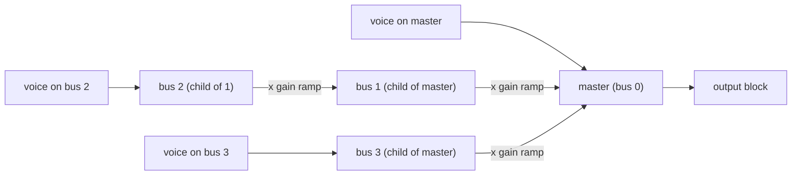

# Review 5-6: buses and the resampler bound

Task: 5-6. Class 2 (public API of the audio crate, mixer hot path). Ordinary card into `develop`; no governance file is changed.

Per chunk of at most 256 frames: clear the bus buffers, voices add to their bus in slot order, a backward pass adds each bus into its parent scaled by the bus gain ramp (mute = ramp to 0), the master is written over the output.

## Evidence

- Red first: `tests/buses.rs` was written before `audio::bus` existed (compile error), then the smallest implementation, then the engine API tests.
- `cargo test -p audio`: all green (44 in-module, 20 buses, 23 engine, 3 engine_threads, 43 mixer, 3 realtime_safety, 33 wav, 2 wav_alloc, 1 bus_allocation). `cargo clippy --workspace --all-targets -- -D warnings` and `cargo fmt --all --check` clean.
- Mutation, `bus.rs`: 26 mutants, 23 caught, 1 unviable, 2 missed. Both missed mutants change `CHUNK_FRAMES * 2` (the samples per chunk) to `+` or `/`. They are equivalent: the chunk size only decides how a block is cut, and the output is bit-identical for every cut (test `the_output_does_not_depend_on_how_the_frames_are_split`), so no test can tell them apart. An earlier run of `mixer.rs`/`engine.rs` mutants in the changed code: 69 mutants, 60 caught, 7 unviable, 2 missed (the same chunk-size family, fixed by naming `CHUNK_SAMPLES`); the render mutants were rerun, 5 of 5 caught.
- Coverage (`cargo llvm-cov`, lines, measured before the small review changes): `bus.rs` 97.56%, `mixer.rs` about 96-97%, `engine.rs` about 95-96%, `audio` crate about 97%. Branch coverage not measured.
- Real-time: `tests/bus_allocation.rs`, counting allocator with per-thread counters, 3000 blocks through a three-level tree with plays, bus gain and mute changes: zero allocator calls, more than 100 voices ended.
- Resampler bound: sine at 1000 Hz resampled by 1.1 stays above 55 dB signal to error (measured 55.6); at 8000 Hz it lands between 25 and 30 dB (measured 26.3). These numbers are the stated quality of the linear interpolation, written as tests so a change in the resampler shows.
- Behaviour kept: a mixer without buses gives the same bits as the direct sum of the voices (test `a_master_only_mixer_gives_the_bits_of_a_direct_sum`); the 5-3 and 5-5 tests pass unchanged except that `PlayParams` literals gained `..PlayParams::default()`.
- No `unsafe` added.

## Independent review (R3) and what was done

A reviewer with no part in the work read the code. No blocker, no major. Minor findings and actions:

| Finding | Action |
|---|---|
| No bit-equality test between the bus-less mixer and the old direct sum | Added (`a_master_only_mixer_gives_the_bits_of_a_direct_sum`) |
| A repeated bus setter restarts the 256-frame ramp | Documented in wiki section 16 (set a bus when its value changes) |
| No test with odd, empty or long output slices | Added (`odd_empty_and_long_slices_are_handled`, NaN sentinel in the tail) |
| Quality estimator naming, whole-period fit | Doc comment says correlation, exact for whole periods; the 8000 Hz run uses 4800 frames (a whole number of periods) |
| `Bus::pass` took a function pointer | Now generic over `Fn`, so the combine step is inlined |
| Idle buses cost a pass each block | Noted for the benchmark card 5-8; 16 buses at most |

## Not done, reported

- Branch coverage; Miri on the new files (the bit-equality float tests fail under Miri by design, as in 5-5; the new code has no `unsafe`); ThreadSanitizer (card 5-12); a Linux run (no CI on `develop`).
- A benchmark for the bus pass: card 5-8.
- The device adapter that drives the engine is card 5-7.
- Two mutants of the chunk-size constant stay missed as equivalent (above).

Open blocker/major: 0.
