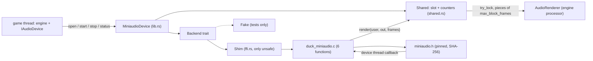

# Review 5-7: the miniaudio device adapter

Task: 5-7. Class 2 (new adapter, new dependency, `unsafe` in `ffi.rs`, real-time callback). Ordinary card into `develop`. The governance step (pinned header, `THIRD_PARTY.md` row, architecture edge, single-file fetch helper) was merged earlier by PR #21 on `main`; this PR changes no governance file.

The callback never blocks and never allocates: if the game thread holds the renderer slot (only while the device is stopped) it writes silence and counts an underrun. A stop that nobody asked for sets a lost flag; `stop` still hands the renderer back so it is dropped on the game thread.

## Evidence

- Red first: device logic tests (`device_tests.rs`, `shared_tests.rs`) and source-fetch tests (`source_tests.rs`) were written against a fake backend and a fake downloader before the code; the review fixes (odd manifest names, held-slot underrun, status underruns) were also written first and failed to compile or pass before the change.
- `cargo test -p adapter_audio_miniaudio -p adapter_runtime_libs`: 24 device/shared tests, 4 real-device tests, 1 manifest-agrees-with-`THIRD_PARTY.md` test, 34 runtime-libs tests, all green. `cargo clippy --workspace --all-targets -- -D warnings` and `cargo fmt --all` clean.
- Real device (Windows, default output): the contract suite passes on `MiniaudioDevice`; an engine sound plays to its end; the device restarts three times and a started device can be dropped. `DUCK_REQUIRE_AUDIO=1` turns a missing device into a failure; without it those tests return early.
- Stub path: with `DUCK_RUNTIME_LIBS_OFFLINE=1` and an empty cache the build warns, compiles the shim without miniaudio, and the adapter reports `NoDevice`; tests green (24 + 4 + 1).
- Mutation (cargo-mutants): `shared.rs` + `lib.rs` 37 mutants, 32 caught, 4 unviable, 1 missed. The missed one is `is_compiled_in -> true`, equivalent in a build that has the header (the test compares it with what the build did, and the stub-build run covers the false side). `source.rs` + `manifest.rs` 52 mutants, 50 caught, 2 unviable.
- Coverage (lines, `cargo llvm-cov`): `shared.rs` 100%, `lib.rs` 96.3%, `source.rs` 98.3%, `manifest.rs` 100%, `ffi.rs` 93.1% (the uncovered lines are the stub-build branches, run in the stub-build check above). Branch coverage not measured.
- Real-time: counting allocator test, per-thread counters, zero allocator calls in the callback path.
- `unsafe`: confined to `ffi.rs` (adapter, `#![expect(unsafe_code)]`), every block has a `// SAFETY:` comment; the budget tool is run with the gates.
- Supply chain: the header is pinned by URL and SHA-256 (`source-file.txt`, cross-checked against `THIRD_PARTY.md` by a test), downloaded over https only, verified in the cache and again after the copy into the build folder; a header of the user's own (`DUCK_MINIAUDIO_HEADER`) is held to the same hash.

## Independent review (R3) and what was done

A reviewer with no part in the work read the code. No blocker, no major. Findings and actions:

| Finding | Action |
|---|---|
| Null backend would let a machine without a sound card "open" successfully | `MA_NO_NULL` in the shim; a machine without a device reports `NoDevice` |
| Underruns always reported 0 | Counter of callbacks that found the slot taken; `status().underruns` reports it; tests added |
| The compiler could read a header that changed after hashing | `stage()` copies the header into `OUT_DIR` and verifies the copy |
| Manifest file names such as `.`, `a:stream`, `./x` | Refused as `BadPath`; test added |
| No restart / drop-while-started test on the real device | Added (`the_real_device_restarts_and_a_started_device_can_be_dropped`) |
| Two cold-cache builds could race on the cache rename | Not changed, see below |

## Not done, reported

- Concurrent cold-cache race: two builds fetching at once can both rename into the cache; the loser's file is verified and the build continues, but this is not covered by a test.
- Miri on `ffi.rs` (it cannot run foreign code); ThreadSanitizer (card 5-12).
- A Linux run: the `ubuntu` jobs run only on the release PR and will report "not run" without a sound card (the null backend is off).
- Device enumeration and selection, more than two channels, a native WASAPI adapter (the port stays `experimental`; window/input/audio become `stable` only with a native adapter).
- The build needs a C compiler.
- A benchmark of the callback path: card 5-8.

Open blocker/major: 0.
