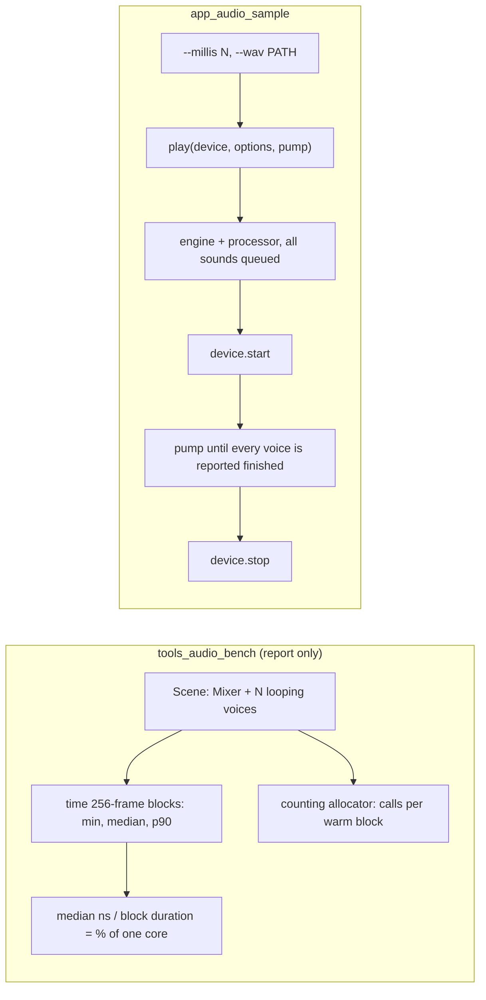

# Review 5-8: the voice-count benchmark and the audio sample

Task: 5-8. Class 2 (new crates, a measured budget proposal). Ordinary card into `develop`. No governance file is changed: the budget gate in `gates/benchmarks.toml` is a governance step and is proposed, not done.

## Evidence

- Red first: `tools_audio_bench/tests/scene.rs` and `app_audio_sample/tests/session.rs` were written before the crates had code (unresolved import), then the smallest implementation. The review fixes were written as tests first (device stays closed on a bad WAV, device stopped after a timeout, loop point reached by the scene test).
- Tests: `app_audio_sample` 2 unit + 5 session tests, `tools_audio_bench` 1 + 9 + 4 tests, all green. `cargo clippy --workspace --all-targets -- -D warnings` and `cargo fmt --all` clean.
- First measurement (Windows x86-64, Intel Family 6 Model 154, rustc 1.94.1, release, scalar, one run): 64 voices 54.8 us per block (1.03 % of a core), 256 voices 217.8 us (4.08 %), 1024 voices 870.6 us (16.32 %); allocator calls per warm block 0 in all three. Cost is linear (about 0.85 us per voice and block). One shared sound: a best case for the cache (said in the wiki).
- Real device: the sample plays a 400 ms and a 600 ms tone on the Windows default device and exits 0; `--millis 0` is refused with exit 2.
- Mutation (cargo-mutants, on the final code): `app_audio_sample` 54 mutants, 39 caught, 7 unviable, 6 missed, 2 timeouts; `tools_audio_bench` 84 mutants, 74 caught, 3 unviable, 7 missed (this run was made before the review fixes, which did not touch that crate except the scene test). The missed ones: `main` and `report` (glue that prints), `cpu_name` returning another string (environment text), the arithmetic of the 64 MiB cap constant, `% -> +` in the phase wrap of the tone and of the waveform (equivalent: a sine is periodic, only float drift differs), `alloc_calls -> 0` (equivalent to the measured value, the requirement is 0), `rep > 0` to `>=` (changes only whether the warm-up repetition is sampled, not observable from outside). The two timeouts (`+= -> *=` on a counter, `/ -> *` on a constant) make the loop run forever and count as caught. An earlier run found the pump limit and the size cap untested; they became `pump_limit`, `sound_millis` and `read_wav` with tests. These crates are layer 4: the mutation gate applies to layers 0 to 2.
- Not measured here: line coverage of the new crates (layer 4, no gate); branch coverage.
- `unsafe`: none added. No new third-party dependency.

## Independent review (R3) and what was done

A reviewer with no part in the work read the diff. No blocker; 3 major, 6 minor. Actions:

| Finding | Action |
|---|---|
| Major: the device stayed started when an error came after `start` | All sounds are made, registered and queued before `device.start`; the timeout path calls `stop` |
| Major: long WAV files always timed out (fixed 20,000 pumps) | The limit is twice the longest sound plus ten seconds, in pumps of 10 ms |
| Major: the WAV file was read with no size cap | The binary refuses files above 64 MiB (exit 2) |
| Minor: a failing `stop` hid the timeout | The stop result is ignored on the timeout path |
| Minor: the scene test never reached the loop point | 4000 blocks with 8 voices (passes the end of the sound several times at the highest pitch) |
| Minor: wiki did not say the bench is a cache best case | Added to section 18 |
| Minor: bad-WAV test did not check the device stayed closed | Asserts `open` still succeeds |
| Minor: timeout test did not check the device was stopped | Asserts `stop` now reports a wrong state |
| Minor: section 17 claim changed without a changelog line | Added to the v1.22 line in `wiki/README.md` |

## Not done, reported

- The budget gate (proposed: 1,000 voices below 25 % of one core): registering it in `gates/benchmarks.toml` and in `ci` is a governance step for the owner to declare.
- A Linux or second-machine measurement (no CI on `develop`); one run on one machine only, no noise figure.
- A benchmark of the engine path with the command queue; latency; many different sounds (cache); SIMD (the measurement does not call for it).
- Sound in the graphical samples.

Open blocker/major: 0.
