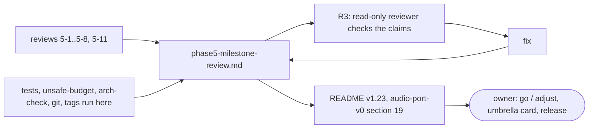

# Review 5-9: phase 5 exit record and milestone review (documentation)

Task: 5-9. Class 1 (wiki and review files only; no protected path, no governance file). One PR into `develop`. Out of scope: starting phase 6, closing the phase 5 umbrella card (the owner decides), cards 5-10 and 5-12, any code or CI change.
TDD: documentation change (exception); the check is the independent comparison of every number and verdict with the repository, and the wiki lint.

## What changes

- New page `wiki/spikes/phase5-milestone-review.md`: exit criteria item by item, cards and pull requests, plan against actual, per-card against whole-phase metrics, open findings, lessons, decisions for the owner.
- `wiki/README.md`: v1.23 line, status line, index row 40.
- `wiki/architecture/audio-port-v0.md`: section 19 (pointer to the exit record).
- `reviews/5-9.md`: this file.
- Not changed: the digest, every file under `gates/`, `.github/`, `tools/`, `engine/`.

## Evidence

- Measured here: `cargo test` on the four audio crates (22 targets, 224 passed, 0 failed, 0 ignored); `unsafe_budget.py` (88 of 45,300 code lines, 0.19%, 0 violations); `arch_check.py` (27 crates, 0 violations); `git rev-list --count origin/main..origin/develop` (10); `git ls-tree` of `origin/main` (no audio file); a script over `*.rs` for sizes.
- Recorded in the cards, not re-run: coverage, mutation, Miri, benchmark numbers (marked as such on the page).
- Wiki lint: OK, 60 pages, 0 violations.

## Independent review (R3)

A read-only reviewer (fresh context) checked about 45 claims against the reviews, git, gates and the tools: 0 blocker, 1 major, 5 minor.

| Finding | Action |
|---|---|
| Major: the page claimed fix-loop counts ("one per card", "no card needed more than one") that no review file records, and said fixes were made in every card (5-1 had none) | Claims removed; the page says the files do not record loop counts and that 5-1 had no independent review |
| Minor: wiki-lint and mutation-correction anecdotes of card 5-8 not sourced in the repository | Removed from the page |
| Minor: card count "9 plus 2 governance steps" vs the plan | Reworded to "5-1 to 5-9, one more than planned" plus the governance steps |
| Minor: "26 of 1,179" format | Written as in review 5-4 |
| Minor: 5-3 coverage statement and 5-7 allocation claim reported as unsourced | Checked: both are in the review files (5-3 "Not done" section, 5-7 "Real-time" line); no change |

## Not done, reported

- No repeat of coverage, mutation, Miri or benchmark runs; no Linux or ARM64 run; Trello state not analysed; Mermaid read, not rendered.
- Decisions of the page are the owner's; nothing is closed or started.

Open blocker/major: 0.
