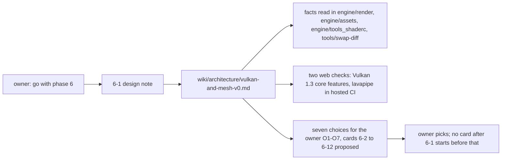

# Review 6-1: phase 6 design note

Task: 6-1. Class 1 (documentation only, no code, no governance file). Ordinary card into `develop`. Phase 6 started on the owner's explicit go-ahead of 2026-11-10 ("go with phase 6").

## What changes

- New page `wiki/architecture/vulkan-and-mesh-v0.md` (design note: evidence table with known and unverified claims, code layout, the port-to-Vulkan mapping, shaders, the one port revision, tests, how the exit criteria are measured, proposed cards, choices, risks).
- `wiki/README.md`: status line v1.27 and one changelog entry.
- Not changed: any code, gate, workflow, ADR, digest.

## Evidence

- Facts about the port, the shader file, the sample and the swap-diff tool were read from the files named in the page's evidence table (`desc.rs`, `stream.rs`, `dshd.rs`, `external.rs`, `sample.rs`, `swap_diff.py`).
- Web facts (Vulkan 1.3 core, lavapipe in hosted jobs) are linked in the page; what the research did not settle is tagged unverified with the card that checks it (Mesa version on the runner, a Vulkan device on hosted Windows, licences of optional crates).
- No threshold-like number was added.
- Local gates: result in the pull request.

## Independent review (R3)

A reviewer with no part in the work checked every [K] claim against the files and the plan against `gates/swap-diff.toml`: 2 blocker, 3 major, 5 minor, all addressed in the note.

| Finding | Action |
|---|---|
| Blocker: the SPIR-V/`dshd` card sat inside the swap-diff range, and `engine/assets` and `engine/tools_shaderc` count as engine code, so the tool would fail | Moved before the Vulkan cards (6-4); the measured range is stated as adapters, composition roots, plumbing and non-code only (section 7, O5, O7) |
| Blocker: the tool lists only `platform` files as ports, so it cannot see a render port revision | Stated in section 5; the revision stays outside the range and the owner counts it; an optional governance card to list the render port files added as O5 (b) |
| Major: the revision needs a depth format on the pipeline and a depth-capable barrier target, not only a pass attachment | Section 5 item 1 lists all four additions |
| Major: golden streams "unchanged" vs a stream change | Old commands keep their bytes (new opcodes or trailing flag); 6-2 starts with a byte-equality test |
| Major: mapping omitted upload layouts, depth aspect, present transition, semaphore and pool rules, scissor, swapchain format | Rows added to the mapping table |
| Minor: mesh frontend ownership, validation-layer requirement, loader as system library, semaphores per image | Cards 6-3 and 6-9 and the system-library paragraph |
| Minor: Mermaid views not rendered | Accepted: checked by reading by two readers |

Open blocker/major: 0.

## Not done, reported

- No Vulkan code or prototype was run; the mapping table is design, not measurement.
- The licences of binding or allocator crates were not checked, because the recommendations avoid them (O1, O2).
- The Mermaid views were checked by reading, not rendered.
