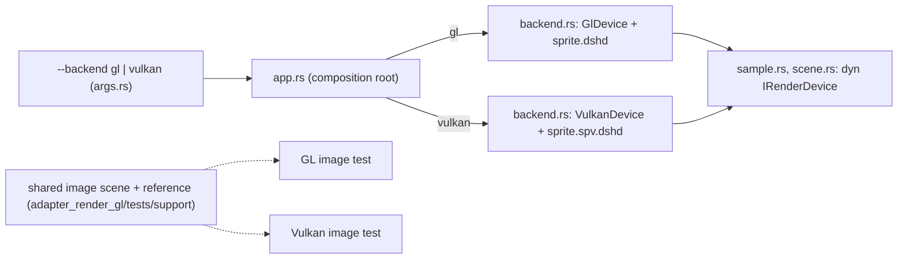

# Review 6-10: Sprite sample on Vulkan

Task: 6-10 (phase 6). TDD, Class 2 (backend choice in a composition root, a change to an adapter's pipeline state), ordinary card into `develop`. Design page: [examples](../wiki/architecture/examples.md) section 6.

## What changed

- `app_sprite_sample` and `app_input_sample` take `--backend gl|vulkan` (default `gl`). Only `app.rs` and the new `backend.rs` name an adapter device; `sample` and `scene` still see `&mut dyn IRenderDevice`. `Opened` is generic over the device with OpenGL as the default, so `app_physics_sample` is unchanged.
- The sample picks the SPIR-V binary or the GLSL text from the shader module (`GOLDEN_SPIRV` next to `GOLDEN_SHADER`).
- After each frame the backend's `check()` runs: the OpenGL error flag, or any message of the Vulkan validation layer (a failure of the run).
- The scene, the reference picture and the comparison of the OpenGL image test moved to `engine/adapter_render_gl/tests/support/sprite_image.rs`, included by the OpenGL test and by `adapter_render_vk/tests/device.rs` (new Vulkan image test). The OpenGL test keeps its assertions.
- **Bug found by the image test (a defect of 6-14):** the Vulkan pipeline blended the alpha channel by the source alpha (a half-transparent sprite over an opaque target left alpha 191); OpenGL keeps the source (`glBlendFuncSeparate`, alpha 255). The Vulkan pipeline now uses the same factors; a unit test pins them.

## Evidence

- Red then green: the Null-device test with the SPIR-V asset failed with `ShaderRejected` before the sample took the binary; the argument tests did not compile before `Backend` existed; the blend unit test failed (`left: 6, right: 1`) before the fix; the Vulkan image test failed with 320 wrong pixels (alpha 191 against 255) before the fix.
- `cargo test -p app_sprite_sample` (45 unit, 5 binary, 2 input binary, 12 sample, others), `-p adapter_render_vk` (288 unit; 6 real-device tests in `tests/device.rs` including the image test, with the Khronos validation layer installed and active), `-p adapter_render_gl --test sprite_image` (3, `DUCK_REQUIRE_GL=1`), all green on this machine (NVIDIA RTX 3050 Laptop).
- `app_sprite_sample --frames 90 --backend gl` and `--backend vulkan`, and `app_input_sample --frames 30 --backend vulkan`, ran and exited 0 on a real window; the Vulkan runs were checked by the validation layer after every frame.
- `cargo clippy --all-targets` for the touched crates is clean on Windows and `x86_64-unknown-linux-gnu`; `cargo fmt` applied.
- Not run locally: Miri, coverage, mutation, benchmarks, a Linux run of the Vulkan sample (local gates report what ran).

## Limits, stated

- The picture in the window is not compared automatically (the image test is offscreen, on a texture); it was run by hand on both backends.
- Vulkan on Linux is built and linted but not run here.
- The open minors of 6-14 (1024 changed-binding draws per frame, unwritten descriptors for unbound slots, descriptor type not checked against the layout, semaphore after a failed acquire) are unchanged.

## Independent review (R3)

A reviewer with no part in the work read the diff: 0 blocker, 0 major, 3 minor, 2 nit.

| Finding | Action |
|---|---|
| minor: a stray carriage return in `examples.md` (an old typo in the cache path) was turned into a line break by my editing script | Fixed: the file is byte-identical to the original apart from the intended section |
| minor: the "missing value" message does not name the flag | Open, kept (one message for both flags) |
| minor: `Args::parse` error doc did not name `--backend` | Fixed |
| nit: eager `unwrap_or` in the test support | Fixed (`unwrap_or_else`) |
| nit: `draw_frame` doc still said "GL error flag" | Fixed |

Fix loop: 1 of 3. 0 open blocker, 0 open major.
