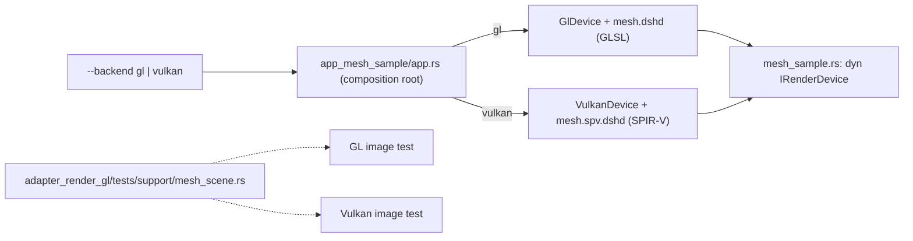

# Review 6-11: Mesh sample on GL and Vulkan

Task: 6-11 (phase 6). TDD, Class 2 (a new composition root, a new public item), ordinary card into `develop`. Design page: [examples](../wiki/architecture/examples.md) section 7.

## What changed

- New crate `engine/app_mesh_sample`: a textured cube that turns, with a depth buffer, drawn through the mesh frontend (6-2, 6-3) on the OpenGL or the Vulkan device (`--backend`). It reuses the window, loop, argument and backend plumbing of `app_sprite_sample`. Shader sources and both assets (GLSL, SPIR-V) are in the crate, so the swap-diff gate sees no engine change.
- `MeshSample::new` refuses an asset that does not match the mesh vertex layout; the depth texture is remade on resize.
- The two-cube image test of 6-3 moved to `adapter_render_gl/tests/support/mesh_scene.rs` and runs on both devices (new Vulkan test). The GL test keeps its probes and control frame and now takes its GLSL from the golden `mesh.dshd`.
- A drift test compares both assets with what `shaderc` makes today.
- `USAGE` of `app_sprite_sample` names the new program. Wiki: examples section 7, README v1.38.

## Evidence

- Red then green: the Null-device tests were written against the frame API before the crate built; the first Vulkan image run was the first real check of depth on Vulkan and passed with the validation layer active.
- `cargo test -p app_mesh_sample` (9 Null-device, 4 binary, 1 drift), `-p adapter_render_gl --test mesh_image`, `-p adapter_render_vk --test device -- two_cubes` with `DUCK_REQUIRE_GL=1`, `DUCK_REQUIRE_VK=1`, `DUCK_REQUIRE_SHADER_TOOLS=1`: green on this machine (NVIDIA RTX 3050 Laptop).
- `app_mesh_sample --frames 90 --backend gl` and `--backend vulkan` ran and exited 0 on a real window; the Vulkan run is checked by the validation layer after every frame.
- `tools/local-gates` all pass (fmt, clippy, build, test, architecture, unsafe budget, wiki lint, digest, diff hash). Swap-diff over 6-6..6-11: 0 engine/game files. Classifier: class 2.
- Not run locally: Miri, coverage, mutation, benchmarks, a Linux run.

## Limits, stated

- The picture in the window is not compared automatically; it was run by hand on both backends.
- `MeshSample` has no `destroy`: its buffers, pipeline and textures live until the device is dropped (as in the sprite sample).
- The cube jumps to its start pose every 100000 frames.

## Independent review (R3)

0 blocker, 0 major, 6 minor, 4 nit.

| Finding | Action |
|---|---|
| minor: `MESH_SPIRV` split a doc comment in the Vulkan test | Fixed |
| minor: wrap comment claimed an invisible jump | Fixed (comment now states the jump; constant moved up) |
| minor: unnamed stream capacity | Fixed (`STREAM_CAPACITY`) |
| minor: no cleanup of earlier resources when `new` fails midway; no `destroy` | Open, kept (device teardown frees them) |
| minor: resize not atomic if the depth texture fails after the surface resize | Open, kept (next frame retries) |
| minor: shared test `render` leaves its target and depth textures | Open, kept (test support, one device per test) |
| nit: texture side literals in the scene | Open |
| nit: GL test header wrap | Fixed |
| nit: `stage_codes` panic without message | Open (test support) |
| nit: doubt that "lost surface" and "wrong assets" tests exist | Checked: they exist (`a_lost_surface_is_an_error_value`, the three refusal tests) |

Open: 0 blocker, 0 major.
