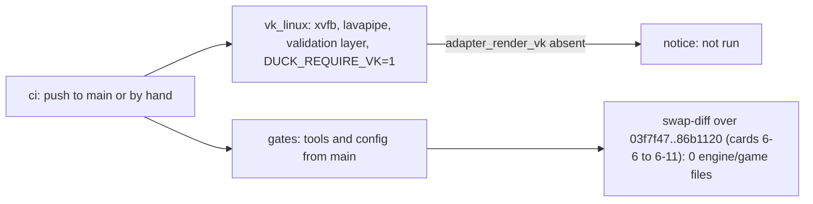

# Review 6-12: Vulkan in CI (governance)

Task: 6-12 (phase 6). Class 3 governance (`.github/workflows/ci.yml`, workflow tests), declared by the owner; PR into `main` first, one `ci` run by hand, then `develop` merges `main` in. Design: [vulkan-and-mesh-v0](../wiki/architecture/vulkan-and-mesh-v0.md) section 8 (O6), [ci-diagrams](../wiki/workflow/ci-diagrams.md) section 2.

## What changed

- New `ci` job `vk_linux` (Ubuntu): installs xvfb, GLFW, the Vulkan loader, lavapipe and the validation layer, prints the device and API version into the run summary, and runs `cargo test -p adapter_render_vk` with `DUCK_REQUIRE_VK=1`. While the crate is absent from the tree it says "not run" (as `gl_linux`).
- New step in the `gates` job: `tools/swap-diff` and `gates/swap-diff.toml` from the checkout of `main` over the measured Vulkan range (two fixed `develop` commits, fetched by hash). The step records that range; it does not judge what a push contains.
- `tools/release/test_workflows.py`: three tests (job content, "not run" branch, swap-diff step). Red before the YAML change (1 failure, 2 errors), green after.
- Docs: ci-diagrams (13 jobs, both additions), ports-and-adapters swap-diff paragraph, README v1.27.

## Evidence

- `ci` run by hand on the branch (based on `main`): all jobs green; the swap-diff step printed `engine_game: 0`, `OK swap-diff`; `vk_linux` printed the "not run" notice, as designed, since `main` has no Vulkan crate yet.
- The job cannot run for real on `main` yet, so I ran it on throwaway branches (`develop` plus this workflow change, deleted afterwards): the device is `llvmpipe` on Mesa 26.0.8 with Vulkan 1.4.335 and the validation layer 1.4.341. **All real-device tests passed on lavapipe** (contract suite, sprite and two-cube image tests, presenter, resources: 7 + 3 + 6). **The fake-device unit tests of the adapter fail on Linux, and not the same ones each run** (4 of 288, then 1 of 288; "Unsupported" or "no X11 display" from `create_surface`); they pass on Windows. Cause not diagnosed. Card **6-15** (ordinary card into `develop`) tracks it.
- Local gates: 29 pass; `test_workflows` 87 tests pass.

## Consequence the owner must know

Until 6-15 is merged, the Vulkan unit tests are red on Linux. That also turns the `g1` job on Ubuntu red (it runs the whole workspace) on the release PR. So **6-15 must be in the same release batch as 6-12**; this card does not hide the failure (no retry, no `continue-on-error`).

## Limits, stated

- The swap-diff step is a record of one fixed range: it needs the two commits to stay reachable (a rewrite of `develop` that drops them makes it red) and cannot go red because of a push.
- Not run: Miri, coverage, mutation, benchmarks.

## Independent review (R3)

0 blocker, 1 major, 4 minor, 2 nit.

| Finding | Action |
|---|---|
| major: `vk_linux` is red at random until the unit tests are fixed | Not hidden; tracked as 6-15, same release batch (section above) |
| minor: swap-diff step checks the same range on every push | Wording changed (record, not a gate) in the diagram and the page |
| minor: step depends on `develop` still holding the SHAs | Fixed: both commits are fetched by hash; the remaining dependency is stated |
| minor: tests only matched strings | Added `pipefail` and base != head checks |
| minor: `if:` count in the job test | Kept (mirrors the `gl_linux` test) |
| nit: `vulkaninfo` step does not fail without a device | Comment added (the test step fails) |
| nit: fetch relies on the public repository | Comment added |

Open: 0 blocker; the major is a tracked dependency, not a defect of this diff.
