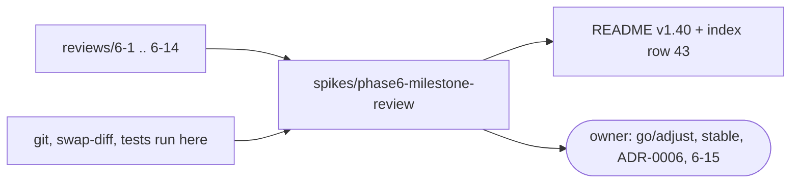

# Review 6-13: phase 6 exit record, stable proposal, milestone review

Task: 6-13 (phase 6). Class 1, documentation only. Ordinary card into `develop`. No governance file edited; the ADR-0006 update and the `stable` status change are left to the owner (a governance task).

## What changed

- New `wiki/spikes/phase6-milestone-review.md`: summary, exit criteria, cards and PRs, metrics, findings, lessons, `stable` proposal, decisions.
- `wiki/README.md`: changelog v1.40 and index row 43.

## Evidence (measured here)

- Swap-diff over `03f7f47..86b1120`: adapter 55, composition_root 20, ports 0, plumbing 2, non_code 10, engine_game 0, OK.
- Phase 6 test set (33 targets, `DUCK_REQUIRE_GL/VK/SHADER_TOOLS=1`): 761 passed, 0 failed, 1 ignored.
- Unsafe-budget tool: 88 of 46,962 lines, 0 violations. Arch check: 29 crates, 0 violations.
- TDD exception: documentation only.

## Independent review

A reviewer with no part in the work fact-checked the page: 0 blocker, 1 major, 5 minor.

| Finding | Resolution |
|---|---|
| major: the page claimed recorded coverage and mutation figures; no phase 6 review has any | Rewritten: none exists; new finding F-METRICS with a proposed follow-up |
| minor: link to this file dangled | This file added |
| minor: 287 vs 288 unit tests | Stated as 287 to 288 |
| minor: "five criteria" | "four criteria, promotion pending" |
| minor: lavapipe results were on throwaway branches | Stated |

Open: 0 blocker, 0 major.

## Not verified

Trello state, Mermaid rendering, ARM64, a second GPU. Coverage and mutation were not run.
