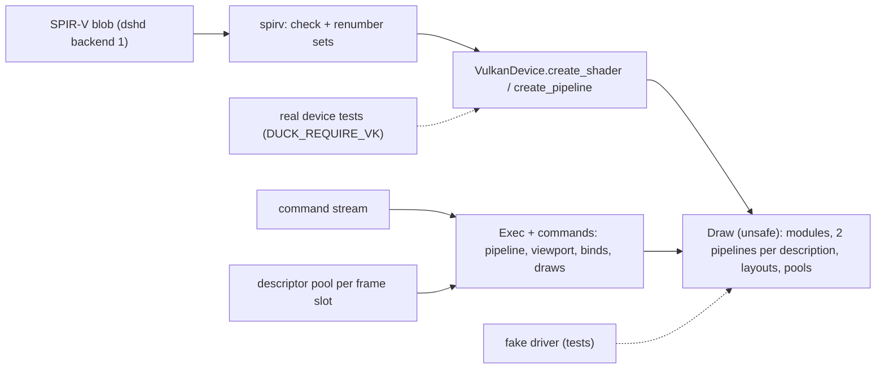

# Review 6-14: Vulkan adapter part 4b, shaders, pipelines, descriptors, viewport, binds and draws

Task: 6-14 (second half of 6-9). TDD, Class 2 (public API of an adapter, `unsafe`, concurrency of frames in flight), ordinary card into `develop`. Design page: [vulkan-adapter-v0](../wiki/architecture/vulkan-adapter-v0.md) section 8.

## Evidence

- Tests, run locally: 287 unit tests in the crate (new: SPIR-V 9, `Draw` 10, viewport maths 6, conversions 1, struct sizes 3, `VulkanDevice` on the fake driver 14), 2 + 3 + 6 other integration tests, and 5 tests in `tests/device.rs` on a real device (NVIDIA GeForce RTX 3050 Laptop GPU) with `DUCK_REQUIRE_VK=1`: the generic render contract suite unchanged (no new case), the sprite SPIR-V golden file drawing a quad into a texture (row 0 at the bottom, read back), a viewport rectangle, and six frames of plain and indexed draws into the backbuffer. The test for closing a rendering scope after a failed command is in `render_device/tests.rs`.
- `cargo clippy -p adapter_render_vk --all-targets` clean on Windows and `x86_64-unknown-linux-gnu`; `cargo fmt` applied.
- Khronos validation layer: not installed on this machine, so the real-device runs were not validated by it.
- TDD: tests were written with the code against the fake driver; red evidence was not kept for every test. The tests added for the review fixes were written with the fix.
- Not run locally: Miri, coverage, mutation, benchmarks (local gates report what ran).

## Limits, stated

- Validation layer absent here; a job with it must run the real-device tests before the milestone.
- 1024 changed-binding draws per frame, then `OutOfMemory` until the next frame.
- A draw whose shader reads a slot nothing is bound to reads an unwritten descriptor (GL would give a default texture).
- The storage-class check of the SPIR-V does not look at the type of the variable (storage images, texel buffers, descriptor arrays, legacy `BufferBlock` are not rejected).
- A failure between the acquire and the first command (now including the pool reset) leaves the acquire semaphore signalled (same open minor as in 6-9).
- The uniform descriptor covers the whole buffer; a buffer above `maxUniformBufferRange` is invalid.

## Independent review (R3)

A reviewer with no part in the work read the diff: 0 blocker, 2 major, 5 minor, 2 nit.

| Finding | Action |
|---|---|
| major: `retarget` walked the whole module per decoration (quadratic on an untrusted blob) | Fixed: one walk, storage classes in a sorted table with binary search; test with 20000 variables and decorations |
| major: `SetViewport` with width or height 0, or a huge rectangle, gave an invalid `VkViewport` | Fixed: the viewport sides are clamped to 1..4096, the scissor stays empty for a degenerate rectangle; test |
| minor: 1024 draws per frame is a hard limit | Open, stated above; a grown pool list is a later card |
| minor: unwritten descriptors for unbound slots | Open, stated above |
| minor: uniform range is `u64::MAX` unnamed | Fixed: named `WHOLE_SIZE`; the limit of the buffer size stays open |
| minor: SPIR-V descriptor type not checked against the layout | Open, stated above |
| minor: failure after acquire leaves the semaphore signalled | Open (same as 6-9), stated above |
| nit: magic `2`s in `draw.rs`, truncating attribute count | Open nits |
| nit: `retire` doc says "once on the queue" but the flush waits for the device | Open nit |

Fix loop: 1 of 3. 0 open blocker, 0 open major.
