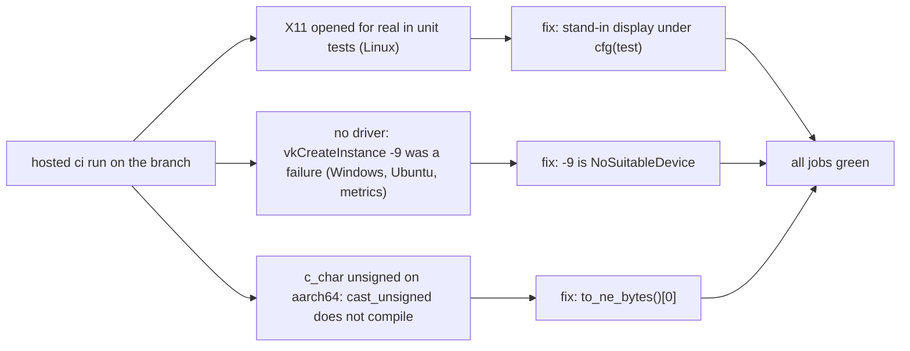

# Review 6-15: Vulkan adapter tests pass on hosted runners

Task: 6-15 (phase 6). Class 2 (an adapter's error mapping and `unsafe` display handling). Ordinary card into `develop`, `adapter_render_vk` only. It must land in the same release batch as 6-12.

## What changed

- `src/surface.rs`: under `cfg(test)` the Linux surface code uses a stand-in `Display` (no libX11, no X server). The release path is unchanged; the real-device tests in `tests/*.rs` still use the real one.
- `src/entry.rs`, `src/vk.rs`: `VK_ERROR_INCOMPATIBLE_DRIVER` (-9) from `vkCreateInstance` is `NoSuitableDevice` (a loader without a driver means no device). Other results stay `Call` errors.
- `src/context/tests.rs`: the old -9 error test now uses -1 (same assertions, same `Call` path); a new test pins -9 to `NoSuitableDevice`. Red first (`left: Call {..-9}`, `right: NoSuitableDevice`), then green.
- `src/entry.rs`, `src/instance.rs`: the driver-name bytes are read with `to_ne_bytes()[0]`, valid for the signed (x86) and unsigned (aarch64) `c_char`.

## What was found, and what I did not know

- The cause given on the card ("a race or shared state") was a guess. The code showed that Linux surface creation opened a real X11 connection in tests that use a fake driver, so they depended on an X server being reachable. This is the most likely cause of the random failures, **not proved**: I never reproduced the original random failure on the old code (it needs a hosted Linux run before the fix, and the earlier failing runs were not repeated). What is shown is that after the fix the job passes.
- Two more defects appeared on the first hosted runs of the whole workspace, which had never run on this crate: the no-driver case (Windows, Ubuntu and metrics jobs were red) and the aarch64 build. Both were real and are fixed here, so the card is broader than its title.

## Evidence

- Local: adapter tests 289 unit and 2 + 7 + 3 + 6 real-device tests pass on Windows; Clippy `-D warnings` clean on `x86_64-pc-windows-msvc`, `x86_64-unknown-linux-gnu` and `aarch64-unknown-linux-gnu`; the aarch64 check failed before the third fix (red) and passes after.
- Hosted `ci` by hand on the branch: all jobs green after reruns, including `vk_linux` (289 unit tests and the real-device tests on lavapipe, llvmpipe, Vulkan 1.4.335), the Windows and Ubuntu `build, test, fmt, clippy`, metrics, ARM64, D2, ThreadSanitizer.
- Two first runs had the apt-using jobs fail on `Temporary failure resolving` for the Ubuntu mirrors (runner network, not code); they passed on rerun.

## Independent review

A reviewer with no part in the work read the diff: 0 blocker, 0 major, 3 minor, 2 nit. Fixed: the `Drop` SAFETY comment now covers both display kinds, a comment explains `to_ne_bytes`, the test comment wording. Accepted: `_library` is an `Option` in production (always `Some`, sound); the `NoSuitableDevice` message says "no Vulkan device with 1.3 ..." which is slightly off for a missing driver (wording left, a text test pins it); mapping -9 can show a broken driver install (for example a wrong-architecture ICD) as "no device", which the required-device jobs (`DUCK_REQUIRE_VK`) still turn into a failure.

Open: 0 blocker, 0 major. Fix loop: 1 of 3.

## Not verified

The original random failure was not reproduced on the old code. Branch coverage and mutation were not run (as in the rest of phase 6, F-METRICS). `Display::open` has no unit-test coverage (it runs only in the real-device tests).
