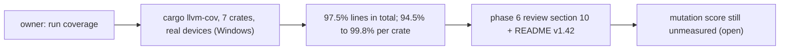

# Review 6-16: phase 6 coverage measurement

Task: 6-16 (phase 6). Class 1, measurement and documentation only; no code changed. Ordinary card into `develop`. Owner request: "let's run coverage" (2026-11-13), closing half of finding F-METRICS of the [phase 6 review](../wiki/spikes/phase6-milestone-review.md).

## What was done

- `cargo llvm-cov -p render -p assets -p tools_shaderc -p adapter_render_gl -p adapter_render_vk -p app_mesh_sample -p app_sprite_sample --locked --json --summary-only` at `develop` `81b3c11`, `DUCK_REQUIRE_GL=1`, `DUCK_REQUIRE_VK=1`, `DUCK_REQUIRE_SHADER_TOOLS=1`. 762 tests passed, 0 failed.
- Results and their limits recorded as section 10 of the phase 6 review (the original sections are untouched, with a pointer at the top).
- TDD exception: measurement and documentation, no code.

## Result

Line coverage 14,000 of 14,353 lines (97.5%); per crate 94.5% (`app_sprite_sample`) to 99.8% (`assets`). The two L0-L2 crates (`assets`, `render`) are above the line gate. Two files with 30 or more lines are under it: `app_sprite_sample/src/app.rs` and `adapter_render_gl/src/device.rs` (window and device code).

## Not done, stated

Mutation testing was not run. The new-line gate and the branch gate were not measured. One machine, Windows only: the Linux-only code was not run. The figures are whole-crate, not per changed line.

## Review

A reviewer with no part in the work checked every figure against the raw `cargo llvm-cov` JSON and the run log: 0 blocker, 0 major, 2 minor, 2 nit; every number matched.

| Finding | Resolution |
|---|---|
| minor: `tools_shaderc` is layer 4, not just "tool" | Labelled "L4 (tool)" |
| minor: the two low files are L3/L4, outside the L0-L2 gate | Wording says "for reference only" |
| nit: date mismatch between page and README header | Both 2026-11-13 |
| nit: "needs nightly options" not backed on the page | Removed |

Open: 0 blocker, 0 major.
