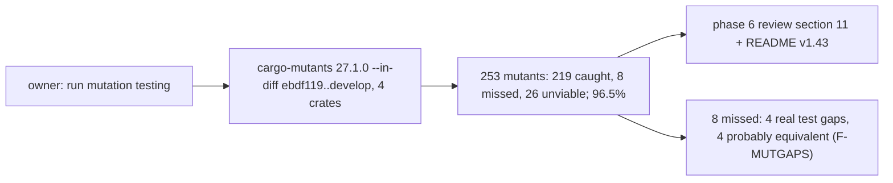

# Review 6-17: phase 6 mutation testing

Task: 6-17 (phase 6). Class 1, measurement and documentation only; no code or test changed. Ordinary card into `develop`. Owner request: "run mutation testing" (2026-11-13); the other half of finding F-METRICS of the [phase 6 review](../wiki/spikes/phase6-milestone-review.md).

## What was done

- `cargo mutants -p render -p assets -p tools_shaderc -p base --in-diff <git diff ebdf119 HEAD of the four src folders> --jobs 3` at `develop` `8f1db42`, shader tools available. 8 minutes.
- Result and limits recorded as section 11 of the phase 6 review; README v1.43.
- TDD exception: measurement and documentation.

## Result

253 mutants: 219 caught, 8 missed, 0 timeouts, 26 unviable. Score 219 of 227 = 96.5%, above the 80% gate. The eight misses: five boundary and non-finite checks in `Mat4::perspective_rh` (three or four probably equivalent because the matrix is checked for finiteness at the end; one is a real gap, an infinite aspect), one sign in `Mat4::look_at_rh`, one `||` in `validate_pipeline_layout` and one field in `PassState::begin` (all three real gaps). None was proved either way by a run.

## Not done, stated

The misses were not fixed (no test added): that is a separate card if the owner wants it. Windows only; changed lines only; adapters and samples not mutated; no whole-crate mutation run.

## Review

A reviewer with no part in the work checked the counts against the raw `cargo-mutants` output (all match: 253, 219, 8, 0, 26; 96.5%) and read the code of each miss: 0 blocker, 2 major, 2 minor, 1 nit.

| Finding | Resolution |
|---|---|
| major: three `>` to `>=` misses and one `||` miss are probably equivalent because of the final `is_finite` check; the page called all eight test gaps | Reclassified: four probably equivalent, four real gaps |
| major: three misses were misdescribed (`far > near` not the near plane; `-forward.y` is in the rotation part, not a translation; `backbuffer` is a size, not a flag) | Rewritten from the code |
| minor: the `null.rs` row should say depth test only or write only | Done |
| minor / nit: counts of gaps in the review file and README | Updated |

Open: 0 blocker, 0 major.
