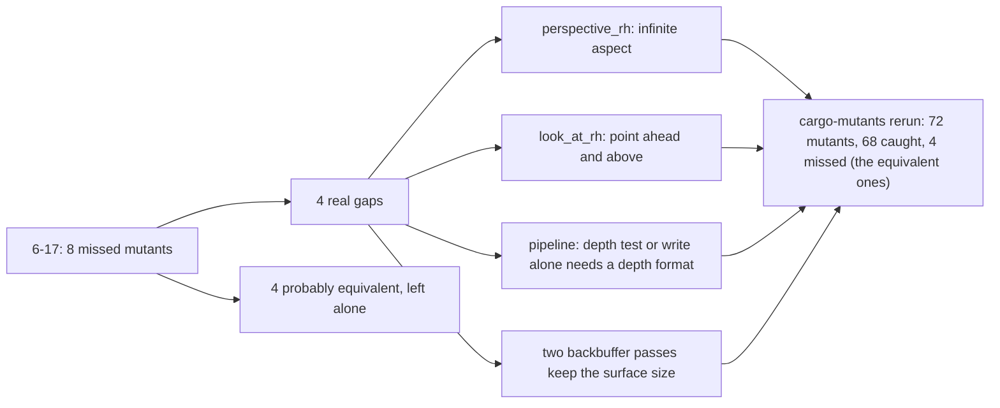

# Review 6-18: tests for the missed mutants of card 6-17

Class 1 (tests only, no engine code changed).

Evidence: base and render library tests pass, rustfmt and Clippy clean, mutation rerun as in the figure. An independent reviewer applied each of the four mutants by hand and saw the new test fail. Findings: 0 blocker, 0 major, 1 minor (a redundant infinite-far case: removed), 1 nit (comment on the 64 by 32 surface: added). Open: 0 blocker, 0 major.
