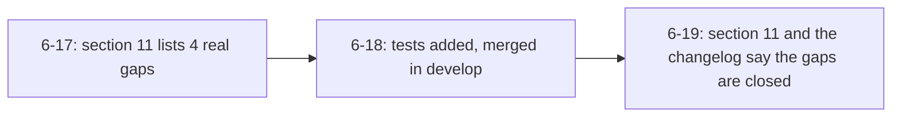

# Review 6-19: record that F-MUTGAPS is closed

Class 1, documentation only (`wiki/spikes/phase6-milestone-review.md`, `wiki/README.md`).

Evidence: wiki-lint and local gates (see the PR). The facts come from `reviews/6-18.md` and the mutation rerun recorded there. Open: 0 blocker, 0 major.
