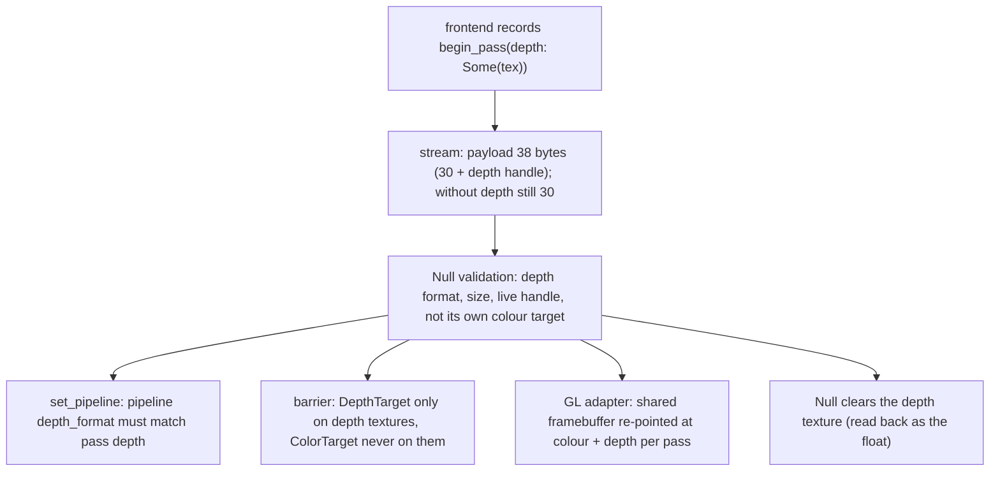

# Review 6-2: render port revision 1, depth in pass, pipeline and barrier

Task: 6-2. Class 2 (public port API, the one counted port revision of phase 6). Ordinary card into `develop`. Spec: [vulkan-and-mesh-v0](../wiki/architecture/vulkan-and-mesh-v0.md) section 5; result described in [render-port-v0](../wiki/architecture/render-port-v0.md) section 13.

## Evidence

- Red first: `engine/render/tests/depth_revision.rs` did not compile against the old port (no `depth`, no `DepthTarget`); green after the change (12 tests, 13 after review). Byte-identity tests use an independently computed oracle for the old payload.
- `render` 131 unit tests + integration tests green; whole workspace tests green; clippy `-D warnings` clean; `cargo fmt` clean.
- The OpenGL adapter ran on a real OpenGL 4.5 device: the render contract suite (now with `depth_contract`) passes.
- Local gates against `origin/develop`: 29 steps pass. Not run locally: Miri, coverage, mutation, benchmarks, metrics.
- Golden dump of the basic scene is unchanged.

## Limits, stated

- On OpenGL a pass on the backbuffer uses the window's own depth buffer; the depth texture named there is checked, not drawn into.
- No OpenGL image test of depth ordering yet (the mesh sample card adds the first depth drawing).
- The render graph still emits `depth: None`; the mesh frontend card extends it.

## Independent review (R3)

A reviewer with no part in the work: 0 blocker, 0 major, 3 minor.

| Finding | Action |
|---|---|
| m1: a depth texture accepted as its own colour target (GL would be incomplete) | Fixed with a regression test written first (red, then green) |
| m2: header comment of `stream.rs` over-long | Re-wrapped |
| m3: `Present`/`ShaderRead` on depth textures not stated | Stated in section 13 |

Open blocker/major: 0.
