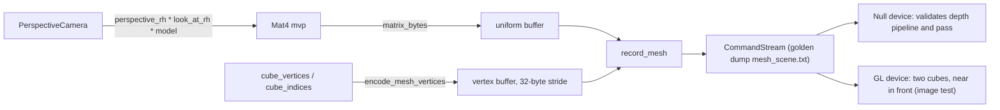

# Review 6-3: the mesh frontend (perspective camera, vertex layout, cube, indexed draw)

Task: 6-3. Class 2 (public API in `base` and `render`). Ordinary card into `develop`. Spec: [vulkan-and-mesh-v0](../wiki/architecture/vulkan-and-mesh-v0.md) sections 5 and 8; result described in [render-port-v0](../wiki/architecture/render-port-v0.md) section 14. Engine-side preparation: it lands before the swap-diff range.

## Evidence

- Red first: the matrix tests (`perspective_rh`, `look_at_rh`) and the camera, mesh and scene tests did not compile before the code existed; green after.
- The golden stream was written by hand before the code; it passed on the first run, and the other mesh tests (winding, normals, uv, indices) are independent of it.
- Workspace: 1,622 tests passed, 0 failed (before the review fixes); after them `base` matrix tests (84) and `render` (all) pass again. `cargo clippy --workspace --all-targets -- -D warnings` and `cargo fmt` clean.
- Real OpenGL 4.5 device: `mesh_image` passes with `DUCK_REQUIRE_GL=1`. Eight probe pixels match the geometry; a control frame with the depth test off shows the far cube winning the overlap, so the probe discriminates.
- No allocator call while recording a mesh frame (counting allocator).
- No `unsafe` added; no `unwrap`/`expect` in engine code.

## Limits, stated

- The GL image shows the front face of each cube only; the winding of the other faces is verified on the CPU (the port has no cull state).
- The render graph still emits `depth: None`; the mesh scenes record the pass by hand. Whether the graph learns depth is left to the mesh sample (6-11).
- Not run locally: Miri, coverage, mutation, benchmarks, metrics.

## Independent review (R3)

A reviewer with no part in the work: 0 blocker, 0 major, 5 minor.

| Finding | Action |
|---|---|
| m1: two tests used `unwrap_or(IDENTITY)` and could pass if the matrix were wrongly `None` | Both now assert `is_some()` first |
| m2: the overflow refusal of `perspective_rh` and `look_at_rh` was documented, not tested | Three cases added (tiny field of view, huge near/far, far-apart eye and target); they pass |
| m3: magic numbers (12, 24, 32, the index pattern) in `mesh.rs` | Named constants; the stride is derived |
| m4: GL image sees the front faces only | Stated in section 14 and above |
| m5: a doc line over 100 columns | Re-wrapped |

Open blocker/major: 0.
