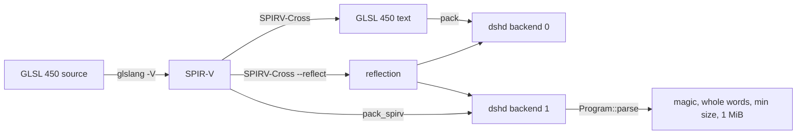

# Review 6-4: SPIR-V output of the shader tool and the `dshd` SPIR-V backend

Task: 6-4. Class 2 (the engine's own asset format in `assets` and the build tool `tools_shaderc`; not a port revision, not a governance file). Ordinary card into `develop`. Spec: [vulkan-and-mesh-v0](../wiki/architecture/vulkan-and-mesh-v0.md) section 4; result described in [render-port-v0](../wiki/architecture/render-port-v0.md) section 15. Engine-side preparation: it lands before the swap-diff range.

## Evidence

- Red first: the `dshd`, compiler, pack and CLI tests did not compile before the code existed; the golden comparison `the_golden_spirv_asset_is_what_the_tool_makes_today` failed before `golden/sprite.spv.dshd` existed. Green after.
- Workspace: 2,294 tests passed, 0 failed, run with the real glslang 16.6.0 and SPIRV-Cross (`DUCK_REQUIRE_SHADER_TOOLS=1`, so a missing tool would fail, not skip). `cargo clippy --workspace --all-targets -- -D warnings` and `cargo fmt` clean.
- GLSL files are unchanged: the existing golden `sprite.dshd` still equals the tool output, the GLSL encoder still writes backend byte 0, and the GLSL API kept its signatures.
- Hostile input: bad magic, byte-swapped magic, length not a multiple of 4, shorter than the header, over the limit, a bad blob in the second module, trailing bytes, every prefix of a valid file, backend 2, a GLSL file flipped to backend 1. None panics; each gives an error value.
- The two outputs have one reflection (contract rule `real_spirv`, run against the real tools).
- The contract rules themselves can fail: `should_panic` tests with a careless compiler and one that returns a binary without the magic.
- No `unsafe`; no `unwrap`/`expect` in engine code; the reader and encoder do not allocate.

## Limits, stated

- The SPIR-V golden is compared with the tool output only where the tools are installed (the test says "not run" otherwise; the golden is still parsed on every machine).
- No `spirv-val` run and no `VkShaderModule`: the driver and validation layers check the blob in card 6-9.
- glslang runs with its existing arguments, so the SPIR-V is the Vulkan 1.0 flavour, which a Vulkan 1.3 driver accepts.
- Not run locally: Miri, coverage, mutation, benchmarks, metrics.

## Independent review (R3)

A reviewer with no part in the work: 0 blocker, 0 major, 4 minor, 3 nit.

| Finding | Action |
|---|---|
| m1: `Module::code()` is empty for a SPIR-V module, so a GL consumer given a SPIR-V file would get an empty shader | Documented on `code()`; consumers check `Program::backend()` |
| m2: `Module::spirv()` is only byte-aligned; a cast to `*const u32` would be undefined behaviour | Documented; `Module::spirv_words()` added (reads words from the bytes), with a test |
| m3: doc lines over 100 columns (`cli.rs`, `null.rs`, `compiler.rs`) | Re-wrapped |
| m4: reader SPIR-V checks tested only on the first module, no trailing-byte or swapped-magic case through `parse` | Three tests added |
| n5: reader and encoder report two simultaneous faults in a different order | None needed (already so for `BadCode`) |
| n6: a repeated `--backend` keeps the last one | Documented and tested |
| n7: closure that only derefs a `String` | Replaced by `String::as_str` |

Open blocker/major: 0.
