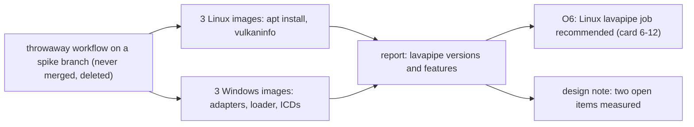

# Review 6-5: Vulkan availability spike on the runner images

Task: 6-5. Spike (TDD exception: no engine code, a measurement and a report), Class 1 documentation, ordinary card into `develop`. Report: [vulkan-availability-spike](../wiki/spikes/vulkan-availability-spike.md). It settles two open items of [vulkan-and-mesh-v0](../wiki/architecture/vulkan-and-mesh-v0.md) section 1 and gives the evidence for choice O6.

## Evidence

- One run of the probe workflow on six hosted images (three Linux, three Windows), all jobs completed; the run id and the table of versions are in the report. The owner approved the throwaway workflow before it was pushed (it touches a CI path). The branch was never merged, had read-only permissions and no secrets, and was deleted after the run.
- Findings: lavapipe is available on every hosted Linux image after an `apt install` (Ubuntu 24.04: Mesa 25.2.8, API 1.4.318; `ubuntu-latest`, which is Ubuntu 26.04: Mesa 26.0.8, API 1.4.335; 22.04: Mesa 23.2.1, API 1.3.255) with dynamic rendering, synchronization2, timeline semaphores and `D32_SFLOAT`; no Vulkan device was found on the hosted Windows images.
- No engine code changed; no tests apply.

## Limits, stated

- That the contract suite passes on lavapipe is not known (there is no adapter yet): cards 6-9 and 6-12.
- `vkcube`'s exit status was masked, so it is weak evidence; the swapchain formats were not read; on Windows `vkCreateInstance` was not called.
- The owner's-machine figures come from a local `vulkaninfo` run that is not in the log.

## Independent review (R3)

A reviewer with no part in the work fact-checked the report against the saved run log: 0 blocker, 3 major, 6 minor. All were corrected.

| Finding | Action |
|---|---|
| Install time and the cause of the 4-minute Ubuntu 24.04 job | Report now says the install alone took about 4 minutes |
| "No loader preinstalled" was wrong: the loader was already there | Corrected; Mesa and `vulkan-tools` were the new packages |
| Ubuntu 22.04 features were marked "not read" but the log has them | Filled in (all present, no headless surface extension) |
| Wrong section number for the design note; undefined confidence tag; timeline semaphore core version; "no driver" stated flatly on Windows; O6 wording went beyond the evidence | All corrected |

Open blocker/major: 0.
