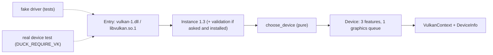

# Review 6-6: Vulkan adapter part 1, loader, instance, device, queue

Task: 6-6. TDD, Class 2 (new adapter crate, `unsafe`), ordinary card into `develop`. Design page: [vulkan-adapter-v0](../wiki/architecture/vulkan-adapter-v0.md). Part 1 of 4 of `adapter_render_vk`; it draws nothing.

## Evidence

- Tests, run locally: 63 unit tests (version, device choice, error texts, struct layouts, validation log, loader errors, and the start-up and tear-down order against a scripted fake driver) and 2 real-device tests. Each cycle began with a failing test.
- Real device on the development machine: NVIDIA GeForce RTX 3050 Laptop GPU, device API 1.4.357, loader 1.4.357, graphics queue family 0. The context starts, waits idle, and starts and drops five times.
- `cargo clippy --workspace --all-targets -- -D warnings` clean; `cargo fmt --check` clean; the crate also passes Clippy for `x86_64-unknown-linux-gnu`.

## Limits, stated

- The Khronos validation layer is not installed on this machine, so the debug-messenger path ran only against the fake driver and the callback unit tests. The real layer runs in 6-7 onwards and in the lavapipe job planned in 6-12.
- Linux was compile- and Clippy-checked, not run.
- The queue family is chosen without a surface; presenting is checked in 6-7.
- `dynlib.rs` and `lookup.rs` are copies of the OpenGL adapter's (a shared crate needs a governance edit to `gates/architecture.toml`).
- Struct layouts were checked by hand against Vulkan-Headers 1.3.296; the tests pin sizes and offsets, not the header.
- The Windows loader unload path (`Library::drop`) has no test with a real unload.
- Not run locally: Miri, coverage, mutation, benchmarks.

## Independent review (R3)

A reviewer with no part in the work read the crate: 0 blocker, 0 major, 8 minor items and some nits.

| Finding | Action |
|---|---|
| m1 The fake did not check `sType` or the API version sent | The fake now asserts both on `vkCreateInstance` |
| m3 Error paths untested: messenger creation, missing messenger functions, layer listing, device listing | Four tests added |
| m5 A failing layer list aborted a start that asked only for optional validation | It now runs without validation (test added) |
| m6 The magic number -3 appeared twice | `ERROR_INITIALIZATION_FAILED` in `vk.rs` |
| m7 The 1.3 feature chain was queried on devices below 1.3 | Skipped for those devices |
| m8 Doc claims: unsafe counts, layouts "tested against the header", diagram arrow | Softened and corrected |
| m4 Enumeration edge cases (count changes, over the cap, names without NUL) | Not tested; the code clamps and truncates. Left as follow-up |
| Nits: `cfg(unix)` vs Linux, `forget` on an error path, bare function pointers | Left as they are; no behaviour impact |

Open blocker/major: 0.
