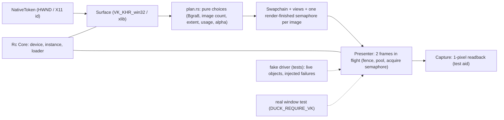

# Review 6-7: Vulkan adapter part 2, surface, swapchain, frames, clear colour

Task: 6-7. TDD, Class 2 (window system, swapchain, `unsafe`), ordinary card into `develop`. Design page: [vulkan-adapter-v0](../wiki/architecture/vulkan-adapter-v0.md) section 5. Part 2 of 4 of `adapter_render_vk`; it clears a window and shows it.

## Evidence

- Tests, run locally: 117 unit tests (pure swapchain choices, struct layouts and header structure-type numbers, error mapping, and the presenter against a scripted fake driver: call order, barriers, semaphore wiring, two frames in flight, out of date, suboptimal, surface lost, resize, minimized, capture, drop order, clean-up after an injected failure in each create call), 2 context tests and 3 real-window tests. Cycles began with a failing test (the first presenter tests failed to compile until the fake driver gained the new functions); the tests added after the independent review for the three major findings were written together with the fixes, not shown red first.
- Real device and window on the development machine (NVIDIA GeForce RTX 3050 Laptop GPU, Vulkan 1.4.357, GLFW window): with `DUCK_REQUIRE_VK=1` the cleared colours red, green and blue read back from the swapchain image as Bgra bytes `[0,0,255,255]`, `[0,255,0,255]`, `[255,0,0,255]`; 120 frames in flight run; a resize request rebuilds.
- `cargo clippy -p adapter_render_vk --all-targets -- -D warnings` clean on Windows and on `x86_64-unknown-linux-gnu`; `cargo fmt` applied.

## Limits, stated

- The Khronos validation layer is not installed on this machine, so the real-device tests ran without it. The reviewer found a wrong structure-type number (below) that the layer would have reported on the first frame; it is fixed and pinned, but the real calls have still never run under the layer. They run where it is installed, and in the lavapipe job planned in 6-12.
- Linux (Xlib surface) was compile- and Clippy-checked, not run. It opens its own X connection without an error handler.
- The real-device resize test sends a resize request; the window port has no call to resize the window, so no size change is seen on the device.
- The token must name a live window: Vulkan does not check the handle (documented on `create_presenter`).
- After a failed frame (an error before the submit) the acquire semaphore may stay signalled; the presenter is meant to be dropped after an error that is not `SurfaceLost`-recoverable. The fence no longer hangs.
- The capture buffer is written by both frames in flight without a barrier between them; harmless for a test aid read after the device is idle.
- `DeviceInfo` gained `can_present` (a public struct without `#[non_exhaustive]`).
- Not run locally: Miri, coverage, mutation, benchmarks.

## Independent review (R3)

A reviewer with no part in the work read the crate: 1 blocker, 2 major, 7 minor, 3 nit.

| Finding | Action |
|---|---|
| B1 `STYPE_IMAGE_MEMORY_BARRIER_2` was 1000314008 (header: 1000314002); fake and code shared the constant, so tests could not see it | Fixed; a unit test pins every structure-type constant to the header's number |
| M2 A failed swapchain create left the retired old swapchain in use; the next rebuild handed it over again | The old swapchain is destroyed and dropped on failure; test checks the next create passes `old = 0` |
| M3 The fence was reset before recording; a recording error left it unsignalled and the next wait hung | The fence is reset right before the submit; test: a failed `vkBeginCommandBuffer` leaves it signalled; call-order test updated |
| m4 Surface lost not mapped in `formats()` and swapchain create | One helper `call_or_lost`, used by `check_created`, formats and capabilities; test |
| m5 A persistent suboptimal result rebuilt every frame | Rebuild only when the surface asks for another size; three tests (present, acquire, not about size) |
| m6 No failure injection for the create paths | `fail_call` in the fake; tests for semaphore, fence, pool, command buffer, view, image listing, and the four capture calls, each checking the live objects |
| m7 False SAFETY comment on the window handle | Comment and the `create_presenter` doc now state the precondition |
| m8 Xlib path: own connection, no error handler | Documented as a limit; not changed (cannot run here) |
| m9 `record_clear` length | Clippy's count is within 60; the gate tool decides (see PR) |
| m10 Wiki section 5 contradicted the code (suboptimal, test counts, resize) | Corrected |
| m11 Real resize test proves less than named | Renamed, comment states what it checks |
| m12 `assert_quiet` proves nothing without the layer | Prints a note when the layer is off; the limit is stated above |
| Nits: vacuous `Option` comparisons in two tests | Fixed. Capture write-after-write and the public struct field: left, stated above |

Open blocker/major: 0.
