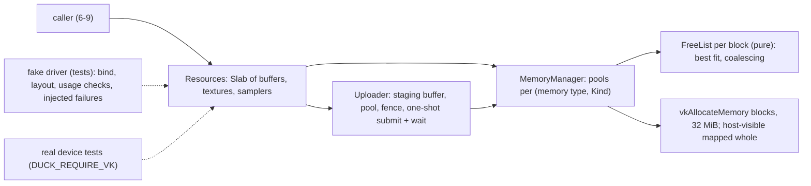

# Review 6-8: Vulkan adapter part 3, memory sub-allocator, buffers, textures, samplers, staged uploads

Task: 6-8. TDD, Class 2 (`unsafe`, allocators, new public API), ordinary card into `develop`. Design page: [vulkan-adapter-v0](../wiki/architecture/vulkan-adapter-v0.md) section 6. Part 3 of 4 of `adapter_render_vk`; it can make buffers, textures and samplers and move bytes in and out. Nothing draws yet (6-9).

## Evidence

- Tests, run locally: 199 unit tests in the crate (`FreeList` 15, `Slab` 8, Vulkan declarations 4, `MemoryManager` 15, `Resources` 40, plus the earlier parts), 2 context, 3 presenter and 6 resource tests on the real device.
- Real device on the development machine (NVIDIA GeForce RTX 3050 Laptop GPU, Vulkan 1.4.357) with `DUCK_REQUIRE_VK=1`: texel round trips from 1x1 to 300x17, a partial write, a 300 KB buffer write, 400 small resources sharing a few blocks, samplers, a depth texture.
- `cargo clippy -p adapter_render_vk --all-targets -- -D warnings` clean on Windows and `x86_64-unknown-linux-gnu`; `cargo fmt` applied; `python tools/local-gates/local_gates.py --base origin/develop` passed before the review fixes and is re-run on the final tree (see the PR).
- TDD: red evidence was shown for the free list and the memory manager. The slab, the Vulkan declaration tests and the tests added for the review fixes were written together with their code, not shown red first. One real defect was found by a test: when the uploader's setup failed partway it leaked the command pool and fence; fixed, covered.

## Limits, stated

- A write waits for the GPU (one fence per transfer): correct and simple, a CPU stall per upload; a batched path needs a benchmark first.
- Destroying a resource frees it at once; the caller must know the GPU is done with it (6-9 owns this rule once frames exist).
- Only mip level 0 is written; a texture never written has undefined contents.
- No retry with a smaller block when a block allocation fails.
- The Khronos validation layer is not installed here: the real-device tests ran without it, and barrier masks are checked by the fake only where stated (the host-read barrier). No real-device test reads a buffer back.
- The presenter's capture buffer still uses a direct `vkAllocateMemory`.
- Read-back staging is uncached memory; an id is not tied to the `Resources` that made it (both are noted in the page).
- Not run locally: Miri, coverage, mutation, benchmarks.

## Independent review (R3)

A reviewer with no part in the work read the crate: 0 blocker, 1 major, 5 minor, 8 nit. It checked the Vulkan constants and struct layouts against the header and found them right.

| Finding | Action |
|---|---|
| M1 `read_back` did not make the GPU copy visible to the host (no host-stage / host-read barrier; a fence wait alone is not enough) | Added the barrier after the copy, host stage and access constants pinned to the header, fake records global barrier masks, test pins the barrier |
| m2 `free(&Allocation)` allowed a double free that could corrupt a later allocation | `free` takes the allocation by value |
| m3 Depth attachment support of `D32` never checked | Checked at start; creation is `Unsupported` without it; test |
| m4 Doc and fake claimed more barrier checking than they do | Wording corrected; masks of global barriers are now recorded |
| m5 Real-device tests passed silently without the layer; no depth read-back | Each prints a note when the layer is off; depth read-back added (accepts `Unsupported`); buffer read-back stays a stated limit |
| m6 Tracked layout could drift when the wait failed after a successful submit | The uploader remembers pending work and waits for it first; the layout is updated when the GPU got the work; two tests |
| n7 endianness comment of `maxImageDimension2D` | Decoded with native-endian bytes |
| n8 slab insert failure leaked the object | `Slab::insert` returns the value on failure; the caller releases it |
| n9 size-zero / odd-alignment request made and freed a block | Refused first; test |
| n10 uncached read-back memory | Left, stated |
| n11 misleading fence comment | Fixed |
| n12 dead lines in a test | Removed |
| n13 `Vec` per free-list allocation | Left (not a hot path) |
| n14 ids not tied to their `Resources` | Left, stated |

Open blocker/major: 0.
