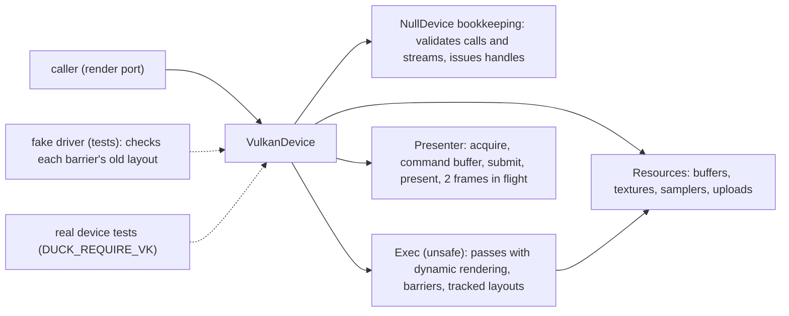

# Review 6-9: Vulkan adapter part 4a, the render device, frames, passes and barriers

Task: 6-9 (first half). TDD, Class 2 (public API of an adapter, `unsafe`, concurrency of frames in flight), ordinary card into `develop`. Design page: [vulkan-adapter-v0](../wiki/architecture/vulkan-adapter-v0.md) section 7.

Scope decision: card 6-9 is split. This PR (4a) holds `VulkanDevice` with frames, passes, barriers, clears, depth, read-back and surfaces; the existing render contract suite passes on a real GPU. Shaders, pipelines, descriptors, viewport, binds and draws, a real-device picture test, and the test for closing a rendering scope after a failed command move to the new card 6-14. Card 6-10 (sprite sample) needs both. The owner may rule otherwise.

## Evidence

- Tests, run locally: 245 unit tests in the crate (new: `sync` 5, conversions 2, handle table 5, presenter frame calls 6, `VulkanDevice` on the fake driver 26), plus 2 real-device tests in `tests/device.rs`.
- Real device (NVIDIA GeForce RTX 3050 Laptop GPU) with `DUCK_REQUIRE_VK=1`: the generic render contract suite and eight frames on the backbuffer pass. The Khronos validation layer is not installed on this machine, so these runs were not validated by it.
- `cargo clippy -p adapter_render_vk --all-targets -- -D warnings` clean on Windows and `x86_64-unknown-linux-gnu`; `cargo fmt` applied.
- TDD: the presenter frame calls, the layout table and the device tests were written with their code against the fake driver (which fails a barrier whose old layout is wrong); red evidence was not kept for every test. The tests added for the review fixes were written after the findings, with the fix.
- Not run locally: Miri, coverage, mutation, benchmarks.

## Limits, stated

- No shader, pipeline or draw yet (card 6-14); the commands that need a pipeline do nothing.
- `write_texture` and `read_back` are refused while the open frame holds recorded commands; `write_buffer` is seen by every draw of the frame.
- Destroy waits for the device to be idle; inside a recording frame it is kept until `end_frame`.
- A failed submit drops the surface's presenter (`SurfaceLost` afterwards).
- Uniform alignment is the port's 256, not the device's value.
- The validation layer is not installed here; a job with it must run the real-device tests before the milestone.

## Independent review (R3)

A reviewer with no part in the work read the diff (without building it): 0 blocker, 3 major, 4 minor, 1 nit. The SAFETY comments in `exec.rs`, the close-on-error path and the give-back of handles on failed creates were found sound.

| Finding | Action |
|---|---|
| M1 a resource destroyed after a `submit` and before `end_frame` is used by the not-yet-submitted buffer (use after free on the GPU) | Destroy is kept in a pending list while the frame holds recorded commands and runs after `end_frame`; test checks the order of queue submit and image destroy |
| M2 a failed `vkQueueSubmit2` leaves the frame fence unsignalled; the next `begin_frame` would wait for ever | `end_frame` drops the presenter on error; the surface answers `SurfaceLost`; test calls `begin_frame` afterwards |
| M3 a `ShaderRead` barrier on the backbuffer or a depth texture, and a depth texture as colour target, pass the bookkeeping device but are invalid Vulkan | `Exec` refuses them with `Unsupported`; two tests |
| m4 shadow size kept after a failed presenter resize | Left, stated here: a failed resize needs a presenter that can be rebuilt; to be handled with surface-loss handling in 6-14 |
| m5 the depth-covers-colour check and the swapchain-extent versus description size are not explained in the page | Left as a note: the extent of the swapchain is used for backbuffer passes |
| m6 failure between the acquire and the first command leaves the acquire semaphore signalled | Left, stated in the page; rare path, to be fixed with m4 |
| m7 `write_texture` and `read_back` during an open frame could start from a wrong layout | Refused while the frame holds recorded commands; test |
| n8 unwrapped comment line and a trivial helper | Left |

Open blocker/major: 0. Open minor: m4, m5, m6 (stated above and on card 6-14).
