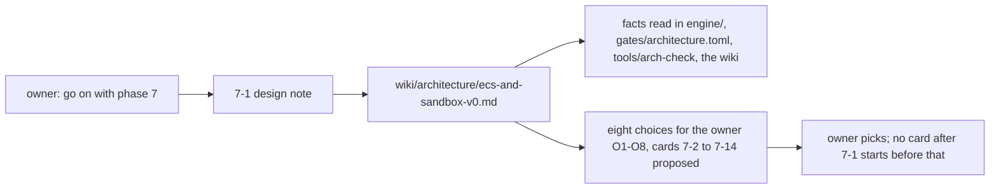

# Review 7-1: phase 7 design note

Task: 7-1. Class 1 (documentation only, no code, no governance file). Ordinary card into `develop`. Phase 7 started on the owner's explicit go-ahead of 2026-11-14 ("go on with phase 7"); the CI run on `main` after the phase 6 release was green.

## What changes

- New page `wiki/architecture/ecs-and-sandbox-v0.md` (evidence table, code layout, the ECS and how its storage is chosen, scene, input, glue and sandbox, tests and measurements, proposed cards, choices, risks).
- `wiki/README.md`: status line v1.45, one changelog entry, one index row.
- Not changed: any code, gate, workflow, ADR, digest.

## Evidence

- Facts were read from the files named in the page's evidence table; what could not be settled is tagged unverified with the card that checks it.
- No threshold-like number was added; the ECS and frame budget targets are left to measurement and the owner (O4).
- wiki-lint: 0 violations.

## Independent review (R3)

A reviewer with no part in the work checked the claims against the files: 0 blocker, 1 major, 5 minor, 2 nit.

| Finding | Action |
|---|---|
| Major: the `unsafe` budget entry for `ecs` came in card 7-6, after the first `ecs` PR (7-4) | Moved into 7-3 (with the ADR), before 7-4 |
| Minor: 7-6 named only the benchmark file; a new count job also needs the workflow and maybe the gate file | 7-6 names `benchmarks.toml`, `ci.yml`, `gates.toml` |
| Minor: `scene -> ecs` and `input -> platform` called same-layer edges | Corrected in the evidence table |
| Minor: roadmap wording for the native adapters | Now "a target", scope-control rule 2 |
| Minor / nit: sample claim, O2 reason, diagram | Sample claim confirmed; O2 reworded; diagram left (consistent with conventions §3) |

Open: 0 blocker, 0 major.
