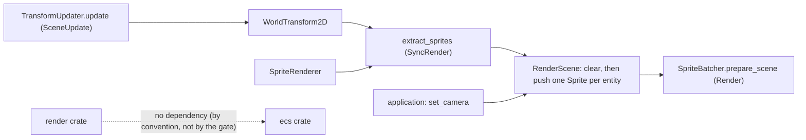

# Review 7-10: `RenderScene` and the `sync_render` glue crate

Task: 7-10. Class 2 (new public API in two crates; no `unsafe`, no new dependency, no governance file touched). Ordinary card into `develop`. Loops: 1 fix loop (1 independent review: 0 blocker, 0 major, 2 minors and 3 nits, all handled). Open blocker/major: 0.

Delivers: in `render`, `RenderScene` (a camera and a fixed-capacity list of sprites, allocated once) and `SpriteBatcher::prepare_scene`; the crate `engine/sync_render` (layer 2 glue, depends on `base`, `ecs`, `scene`, `render`; dev-depends on `frame`): `SpriteRenderer`, `extract_sprites`, `ExtractReport`, `SyncError`. Also the as-built entry and two diagrams in `wiki/architecture/ecs-and-sandbox-v0.md`, and README v1.54.

## Decisions

1. **`RenderScene` lives in `render`**, because the renderer must consume a plain type and not know the ECS. It has a fixed capacity (at most `MAX_SPRITES`) and a camera; `push` into a full scene is refused and changes nothing.
2. **The camera is set by the application**, not extracted: it knows the viewport. A camera entity can come later.
3. **Position, angle and size come from the world matrix**: translation, turn of the x axis, and the renderer size times the length of each axis. A value that is not finite or a size that is not positive is `skipped`; a sprite that does not fit is `dropped`; neither is an error.
4. **Stated limits:** a mirror is not drawn mirrored (a negative x scale shows the sprite turned by half a circle); a shear is not drawn; the order inside a layer and texture follows the ECS tables (an entity that gains a component changes place); no culling, no visibility flag; one camera per scene.
5. **No governance file touched.** `gates/architecture.toml` is unchanged: 36 crates, 0 violations.

## Evidence

- Tests: `render` scene unit tests 9, plus one allocation test; `sync_render` 19 in one test program (extract 15 including the component defaults and the error text, frame loop 2, allocation 2); fmt and clippy `-D warnings` clean, tests included.
- Red evidence (`target/red-7-10-render.txt`, `target/red-7-10-sync.txt`, not committed): `RenderScene` stub, 9 of 9 failed. `sync_render` stubs, 11 of 15 failed; the 4 that passed hold for an empty implementation (the empty cases, the error text, a determinism test that was empty on both sides; the last was made non-vacuous afterwards). The tests added in the fix loop were written after the review, with no red run.
- Mutation: `cargo mutants -p sync_render` 21 mutants, 19 caught, 2 unviable, 0 missed (the first run missed one size check, `size.y > 0.0`; the thin-sprite case was added). `render` scene.rs 11 mutants, 9 caught, 2 unviable; `prepare_scene` 2 mutants, 1 caught, 1 unviable. 0 missed, 0 timeouts. The fix-loop tests were run against `sync_render` again (see the final run in `target/mut-7-10-sync`).
- Allocation: `counts.calls() == 0` for 200 entities, and for a full scene with skipped entities (10 extracted, 6 skipped, 14 dropped); `render` test for clear, push and `prepare_scene`.
- Architecture check: `tools/arch-check` 36 crates, 0 violations. A temporary `render -> ecs` dependency was **not refused** (probe reverted, not in the diff).
- Local gates: `python tools/local-gates/local_gates.py --base origin/develop`, exit 0. The four `FAIL` lines it prints are the tools' own negative-case output. Output `target/local-gates-7-10.txt` (not committed).

## Finding for the owner

`gates/architecture.toml` forbids only `physics -> ecs`. The layer rule allows an edge from layer 2 down to layer 1, so `render -> ecs` (and `render -> scene`) would pass. "The renderer sees only the scene" is held by convention. Adding `["render", "ecs"]` and `["render", "scene"]` to `forbidden_edges` is a governance change; it is not in this card and needs your declaration.

## Not verified

- Line and branch coverage were not measured locally; the CI coverage runs on `main` and by hand.
- Linux and ARM64 were not run. `atan2` and `length` use `std`, so sprites are repeatable on one machine and build, not promised bit-identical across platforms.
- No real device drew these sprites: the frame test stops at the batcher's staged vertices and batches. The sprite sample still builds its own sprites; moving it to the glue crate belongs to the sandbox card 7-12.
- The whole-frame hash across thread counts belongs to 7-12.

## R1 to R8

| phase | result |
|---|---|
| R1 self | done; found the missing `Vec2::is_finite`, one test that assumed distinct texture handles |
| R2 automated | fmt, clippy `-D warnings` clean; tests pass; mutation 0 missed; local gates exit 0 |
| R3 independent | read-only reviewer: 0 blocker, 0 major, 2 minors (half-tested allocation claim, imprecise mirror wording), 3 nits (weak frame test, gaps, archetype order); all handled |
| R4 QA | per behaviour: defaults, mapping, angle, scale, hierarchy, missing parts, order, replace, full scene, bad values, camera, archetypes |
| R5 architecture | glue knows `ecs`, `scene`, `render`; `render` depends on `base` only; gate gap recorded |
| R6 security | no `unsafe`, no input parsing; non-finite values are skipped, capacity is bounded |
| R7 performance | zero allocation after warm-up (tested, including full scene); no timing measured here, card 7-13 measures |
| R8 product fit | the owner reads the sequence and class diagrams and the changelog; no behaviour visible to a player yet |

## Loops

| loop | finding | handling |
|---|---|---|
| 1 | minor: allocation test counted `allocations` only and ran the happy path only | asserts `calls()`; second test with a full scene and skipped entities |
| 1 | minor: mirror wording inexact (a half turn, not "not mirrored") | code doc and wiki corrected; test pins the behaviour |
| 1 | nit: frame test weak | exact batch textures, counts, first sprites and staged x checked |
| 1 | nit: no test for an angle above pi or for several tables | two tests added; the wiki states the table order |
