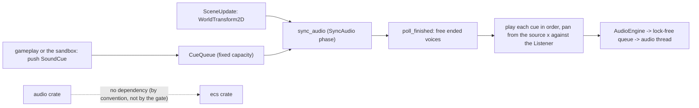

# Review 7-11: the `sync_audio` glue crate

Task: 7-11. Class 2 (new crate with a public API; no `unsafe`, no new dependency, no governance file touched; the `audio` crate is unchanged). Ordinary card into `develop`. Loops: 1 fix loop (1 independent review: 0 blocker, 1 major, 2 minors, 2 nits, all handled). Open blocker/major: 0.

Delivers: the crate `engine/sync_audio` (layer 2 glue, depends on `base`, `ecs`, `scene`, `audio`; dev-depends on `frame`): `SoundCue`, `CueQueue`, `Listener`, `sync_audio`, `SyncReport`, `SyncError`. Also the as-built entry and two diagrams in `wiki/architecture/ecs-and-sandbox-v0.md`, and README v1.55.

## Decisions

1. **A game event is data in a queue** (`SoundCue` in a `CueQueue` with a fixed capacity), pushed by gameplay and read once a frame. The audio crate stays free of the ECS.
2. **The glue does not decide what is an event.** That a contact above a speed or a spawn becomes a cue is gameplay and belongs to the sandbox (7-12); it reads the physics contacts. So `sync_audio` has no physics dependency.
3. **Pan from the world x of the source entity** against a `Listener` (x and half width), clamped to -1..1. A cue without a source, a source that is gone, one without a `WorldTransform2D` (also one not yet updated), or an unusable number is heard in the centre.
4. **Ended voices are freed first, then the cues play**, so a voice slot freed this frame is usable in the same call. A cue the engine refuses is counted in `failed` and is **not retried** (a late sound would be wrong).
5. **Stated limits:** pan only (no distance attenuation, no Doppler); one listener; looping, stopping a voice and bus changes are done on the engine directly (the voice handle of a cue is not kept); the caller runs the scene update first and calls once a frame.
6. **No governance file touched.** `gates/architecture.toml` is unchanged: 37 crates, 0 violations.

## Evidence

- Tests: 26 in `engine/sync_audio` in one test program: cue and queue 6, listener 6, play 10, frame loop 3, allocation 1. `cargo test -p sync_audio` passes; `cargo clippy -p sync_audio --all-targets -- -D warnings` and `cargo fmt --all --check` are clean.
- Red evidence (`target/red-7-11.txt`, not committed; stubs that compile): 20 of 23 failed; the 3 that passed hold for an empty stub (error text, capacity zero, empty queue). **The 3 tests added or rewritten in the fix loop have no red run of their own**: the pitch test was rewritten after the review, and the two pan edge tests and the stale-source test were added then.
- Mutation (`cargo mutants -p sync_audio`): 33 mutants, 28 caught, 5 unviable, 0 missed, 0 timeouts, before and after the fix loop.
- Allocation: one measured warm call with plays, failures and ended voices makes 0 allocator calls on the calling thread (`counts.calls()`).
- Architecture check: `tools/arch-check` 37 crates, 0 violations. A temporary `audio -> ecs` dependency was **not refused** (probe reverted, not in the diff).
- Local gates (`python tools/local-gates/local_gates.py --base origin/develop`): exit 0; the four `FAIL` lines it prints are the tools' own negative-case output. Output `target/local-gates-7-11.txt` (not committed).

## Finding for the owner (extends card 7-10)

`forbidden_edges` holds only `physics -> ecs`. The layer rule allows an edge from layer 2 down to layer 1, so `render -> ecs` and `audio -> ecs` (and the same to `scene`) pass the gate. "The renderer and the audio engine do not know the ECS" is held by convention. Adding `["render", "ecs"]`, `["render", "scene"]`, `["audio", "ecs"]` and `["audio", "scene"]` is a governance change and needs your declaration; it is not in this card.

## Not verified

- Line and branch coverage were not measured locally; CI coverage runs on `main` and by hand.
- Linux and ARM64 were not run.
- No real device played these cues: the tests render through the audio processor on the calling thread. A threaded run of the glue with a live device belongs to the sandbox (7-12).
- The mixer output was checked at one frame of one block, not across a fade or a long run.

## R1 to R8

| phase | result |
|---|---|
| R1 self | done; found clippy's by-value rule for the small listener and nesting in the first frame test |
| R2 automated | fmt, clippy `-D warnings` clean; 26 tests pass; mutation 0 missed; local gates exit 0 |
| R3 independent | read-only reviewer: 0 blocker, 1 major (pitch test passed with pitch ignored), 2 minors (frame test did not pin the order; pan edges untested), 2 nits; all handled |
| R4 QA | per behaviour: defaults, queue limits, pan law and edges, centre fallbacks, gain, pitch, bad values, order, voice exhaustion, ended voices, frame order, allocation |
| R5 architecture | glue knows `ecs`, `scene`, `audio`; no physics knowledge; gate gap recorded |
| R6 security | no `unsafe`, no input parsing; non-finite values are refused by the engine and counted; the ended-voice loop is bounded by the engine's event queue |
| R7 performance | zero allocation after warm-up (tested); no timing measured here, card 7-13 measures |
| R8 product fit | the owner reads the sequence and class diagrams and the changelog; no sound is heard by a player yet |

## Loops

| loop | finding | handling |
|---|---|---|
| 1 | major: the pitch test passed with pitch ignored (both pitches end in the two blocks rendered) | rewritten: one block, pitch two ends the sound, pitch one does not |
| 1 | minor: the frame test did not pin the phase order or the stale transform | cue raised in frame 0, pan to the right asserted; stale-source test; the wiki and the crate doc say to run the scene update first |
| 1 | minor: pan edges untested | overflow, tiny half width and negative zero tests |
| 1 | nit: allocation wording | "one measured call" |
| 1 | nit: crate doc on voice handles | sentence added |
