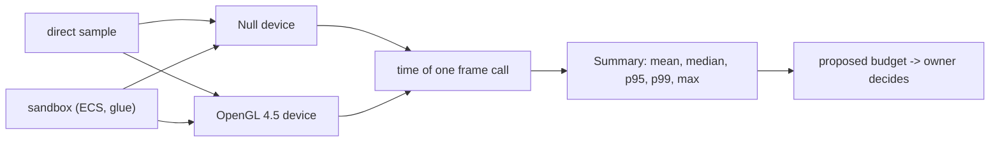

# Review 7-13: frame budget measurement and proposed budget

Task: 7-13. Class 1 by the card (measurement and docs); the diff also adds a small public module and an example to `app_sandbox`, no governance file, no engine crate, no `unsafe`. Ordinary card into `develop`. Loops: 1 fix loop. Open blocker/major: 0.

Delivers: `app_sandbox::measure` (the summary of a list of frame times, tested), the example `engine/app_sandbox/examples/frame_budget.rs`, the measured table, the analysis and a **proposed** frame budget in `wiki/architecture/ecs-and-sandbox-v0.md`, README v1.57. The budget is the owner's to accept, change or refuse (choice O4); nothing enforces it.

## Result (reference machine: i7-12700H laptop, Windows 11, release build)

- The sandbox frame is about 0.2 ms of CPU on OpenGL (1.2% of 16.67 ms; p99 0.47 ms).
- The ECS and glue path costs about 5 to 10 us per frame more than the direct sample with its debug drawing off (6% to 12% on the Null device, about 4% on OpenGL). The direct sample ships with debug drawing on, which doubles its time; the sandbox has none, so that row is not the comparison.
- No dirty flags needed at 83 entities.

## Evidence

- Tests: `cargo test -p app_sandbox` passes (5 new tests for `measure`); clippy `-D warnings` and fmt clean; local gates exit 0; wiki lint 67 pages, 0 violations; arch-check unchanged.
- Mutation on `measure.rs`: 12 mutants, 1 unviable, 11 caught, 0 missed. **The tests of `measure` were written together with the code, not before it: there is no red run.**
- Raw output of the final runs: `target/frame-budget-7-13.txt` (not committed): 3 Null runs, 2 OpenGL runs, order of the two sides alternating.

## Not verified

- GPU time and the wait of the present; scenes larger than 83 entities; other machines; Linux.
- The GPU the OpenGL window used was not recorded. Runs are one process on a laptop with other programs open: the figures move by about 10%, and the gap between the two sides is of the size of that spread.
- The 6.7 us transform probe is a flat world of 82 children, not the sandbox's own world.
- The example is not run by any gate.

## R1 to R8

| phase | result |
|---|---|
| R1 self | found the debug drawing default (the first comparison was not like-for-like), a lint on a percentage threshold, a float cast |
| R2 automated | fmt, clippy, tests, mutation on `measure`, local gates, wiki lint |
| R3 independent | read-only reviewer: 0 blocker, 1 major, 4 minor, 4 nits (below) |
| R4 QA | percentile edge cases (1, 3, 4, 100 frames, overflow) |
| R5 architecture | example and module inside the L4 crate; no new edge |
| R6 security | no input, no `unsafe` |
| R7 performance | the subject of the card; figures above |
| R8 product fit | the owner gets a number to accept or change, with its limits |

## Loops

| loop | finding | handling |
|---|---|---|
| 1 | major: fixed run order could favour one side; the headline 9.5 us was the favourable figure | order alternates between runs, harness rerun, the gap is stated as 5 to 10 us with both measurements |
| 1 | minor: "ECS path" also contains the audio mix, the camera upload and the timing wrapper; breakdown inconsistent; missing limits (one OpenGL run, uncapped loop, `end_frame` timed) | prose rewritten, limits added, OpenGL run twice |
| 1 | minor: budget leans on thin data; 6% belongs to the p99 cap only; transform probe shape | stated in the text |
| 1 | nit: the literal 80 | `STREAM_LIMIT` |
| 1 | nits: dead `unwrap_or` in the mean, 32-bit overflow of `len * percent`, device resources not freed | accepted, harmless in a hand-run example |
