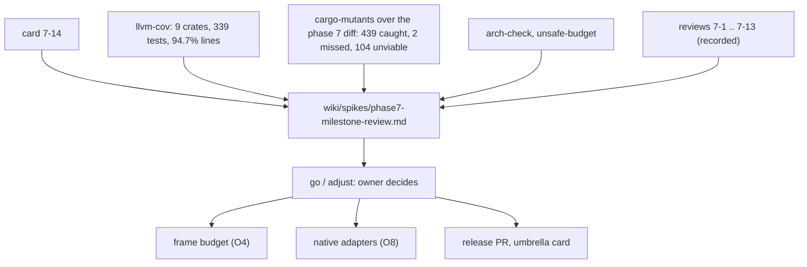

# Review 7-14: phase 7 exit record, milestone review, retrospective

Task: 7-14. Class 1 (documentation only: one new wiki page, the README changelog and index, this file; no code, no gate, no governance file). Ordinary card into `develop`. Loops: 1 fix loop (1 independent review). Open blocker/major: 0.

Delivers: [spikes/phase7-milestone-review](../wiki/spikes/phase7-milestone-review.md), the exit record of phase 7 in the form of the phase 6 review: summary, exit criteria of the roadmap row against evidence, cards and pull requests, a whole-phase measurement of line coverage (nine crates) and mutation (the phase 7 diff), open findings, retrospective, and the decisions that are the owner's. README v1.58 and index row 47.

## Decisions

1. **Same form as the phase 6 review**, so the owner reads the same sections in the same order. The page marks every figure as *recorded* (taken from a review file, not re-run) or *measured here*.
2. **Coverage and mutation were run for the whole phase** (the design note, section 5, asks for it "as done for phase 6"). Coverage: `cargo llvm-cov` on nine crates. Mutation: `cargo mutants --in-diff` over the phase 7 changes in the L0 to L2 crates, as in card 6-17.
3. **The exit criteria are stated as the roadmap row says them**, and two of them are marked as open for the owner, not closed by me: the frame budget (a proposal since 7-13, nobody accepted it) and the native adapters (the roadmap says "before phase 7 closes"; no card exists; the acceptance of O1 to O8 on 2026-11-14 does not name the option for O8).
4. **The page closes nothing**: no card moves to Done, the umbrella card is not touched, the roadmap line is not edited, phase 8 is not started.

## Evidence

- Coverage: `cargo llvm-cov -p ecs -p scene -p input -p frame -p sync_physics -p sync_render -p sync_audio -p app_sandbox -p tools_ecs_bench --locked --summary-only`: 339 passed, 0 failed, 94.7% lines (2,996 of 3,163). Output `target/cov-7-14.txt` (not committed).
- Mutation: 545 mutants in 20 minutes, 439 caught, 2 missed, 0 timeouts, 104 unviable, score 99.5%. The two missed are the equivalent `two_mut` mutants judged in the 7-4 review. Output `target/mut-7-14/` (not committed).
- `arch_check.py`: 38 crates, 0 violations. `unsafe_budget.py`: 88 of 54,376 lines (0.16%), 0 violations.
- Local gates (`python tools/local-gates/local_gates.py --base origin/develop`): exit 0, all steps pass (the four `FAIL` lines are the tools' own negative-case output). Output `target/local-gates-7-14.txt` (not committed).
- Wiki lint: 68 pages, 0 violations (the first run flagged a threshold-like phrase; reworded).

## Not verified

- No benchmark was repeated; the figures of 7-5 and 7-13 are the recorded ones.
- No Linux, ARM64 or hosted run; branch coverage and the new-line gate were not measured; line coverage of the `RenderScene` change in `render` is not in the run.
- Mermaid syntax read by the author, not rendered.

## R1 to R8

| phase | result |
|---|---|
| R1 self | read the page against the review files; corrected counts of blockers and majors, the line counts of the glue crates and two sentences about governance runs that I could not source |
| R2 automated | local gates, wiki lint, diff hash (see Evidence) |
| R3 independent | read-only reviewer: 0 blocker, 1 major, 6 minor, 3 nit; all handled |
| R4 QA | every number on the page traced to a review file, a tool output in this session or git history |
| R5 architecture | no code and no gate touched; arch-check unchanged |
| R6 security | documentation only; no secrets, no session identifier, no path outside the repository |
| R7 performance | not applicable; the page repeats recorded figures and says so |
| R8 product fit | the owner reads sections 1, 2, 5 and 7; the decisions are in one table |

## Loops

| loop | finding | handling |
|---|---|---|
| 1 | major: the page called the sandbox "playable" and met, but no review records interactive play with a display and an audio device | wording now "builds and runs frames, headless and timed on OpenGL"; added to Not verified |
| 1 | minor: "three items" for the owner against two decisions in the table; the 7-3 blocker described as a hang; a card 7-15 named in the design note not mentioned; "followed as recommended" not sourced; two different "rule 2" of the roadmap; "every time" overstated | all corrected in the page |
| 1 | nit: missing nit counts in two rows; first person in a wiki page | corrected |
