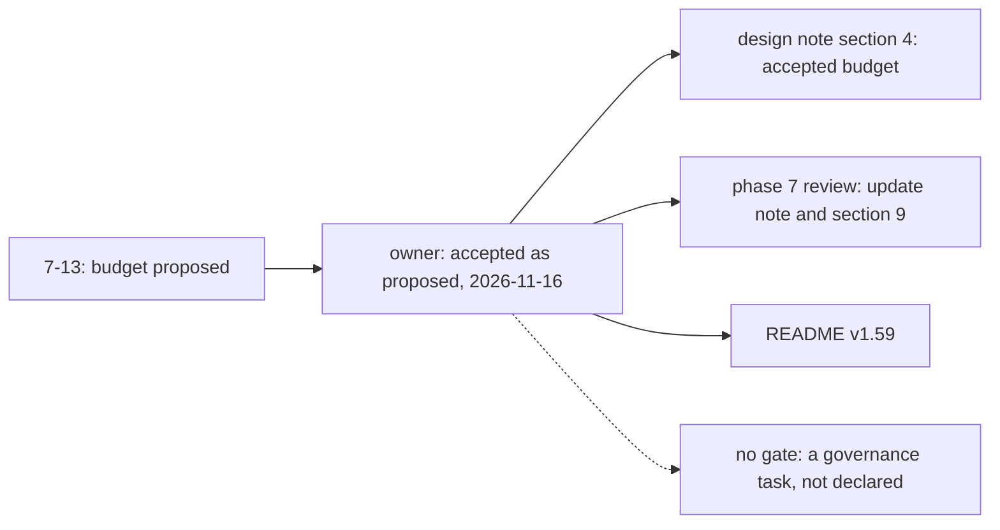

# Review 7-16: record the accepted frame budget

Task: 7-16. Class 1 (documentation only: three wiki files and this file; no code, no gate, no governance file). Ordinary card into `develop`. Loops: 1 fix loop (1 independent review: 0 blocker, 0 major, 1 minor, 3 nits). Open blocker/major: 0.

Delivers: the owner's acceptance of the frame budget proposed by card 7-13, given in the session of 2026-11-16 ("accept the budget as proposed"), recorded in [architecture/ecs-and-sandbox-v0](../wiki/architecture/ecs-and-sandbox-v0.md) section 4 (five small edits), in a new section 9 and an update note of [spikes/phase7-milestone-review](../wiki/spikes/phase7-milestone-review.md), and in README v1.59.

## Decisions

1. **The numbers are not changed**: OpenGL mean at most 0.5 ms and p99 at most 1.0 ms, Null mean at most 0.2 ms, the ECS path at most 25 us more per frame than the direct sample (debug drawing off).
2. **No enforcement is added.** A gate would be an entry in `gates/benchmarks.toml`, a governance task the owner has not declared. The pages say so.
3. **The reference machine is not claimed as confirmed.** The owner accepted the numbers; they did not separately confirm the measured laptop. The pages say that.
4. **Sections 1 to 8 of the phase 7 review are left as written** (as the phase 6 review does for its updates); an update note at the top and section 9 give the new state.

## Evidence

- Wiki lint: 68 pages, 0 violations. Local gates: exit 0 (`target/local-gates-7-16.txt`, not committed).
- The figures in section 9 were checked against the table of the design note by the independent reviewer.

## Not verified

- Mermaid syntax read by the author, not rendered.
- The design note row "size of the ECS iteration target and of the frame budget" still carries the confidence mark U in its first cell; the same row now says accepted.

## R1 to R8

| phase | result |
|---|---|
| R1 self | wording checked so that nothing claims a gate or a confirmed machine |
| R2 automated | wiki lint, local gates, diff hash |
| R3 independent | read-only reviewer: 0 blocker, 0 major, 1 minor, 3 nits |
| R4 QA | numbers compared with the proposal paragraph and the table |
| R5 to R7 | not applicable (no code, no gate, no dependency) |
| R8 product fit | the owner's decision is recorded where the roadmap criterion is read |

## Loops

| loop | finding | handling |
|---|---|---|
| 1 | minor: section 9 did not say that the laptop was left unconfirmed | wording added in section 9 and in the design note |
| 1 | nit: release version not in the diff | checked: tag `v0.13.0` exists in this clone |
| 1 | nits: the confidence mark U on the design note row; F-BUDGET row still says proposal | left, stated above; the update note covers the row |
