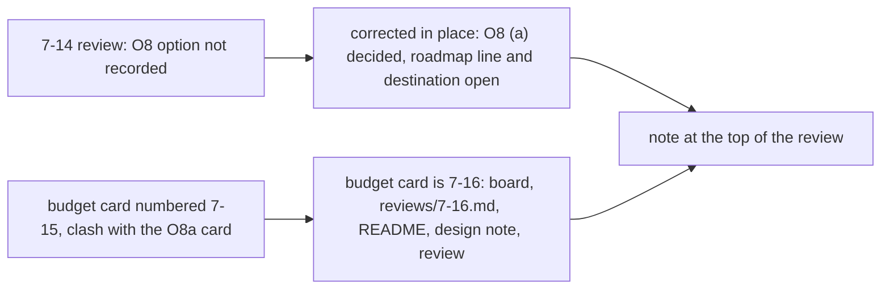

# Review 7-17: correct the O8 statement and the card id of the budget card

Task: 7-17. Class 1 (documentation only: three wiki files, a renamed review file and this file; no code, no gate, no governance file). Ordinary card into `develop`. Owner order: "fix both" (2026-11-16). Loops: LOOPS. Open blocker/major: 0.

Two mistakes of mine, found after the release of phase 7:

1. The phase 7 review (card 7-14) said the option the owner chose for O8 was not recorded and treated the native adapters as an open decision. Backlog card 7-15 ("Roadmap: native Win32/audio adapters leave phase 7 (O8a)") records that the owner accepted O8 (a) on 2026-11-14. I had read the design note and the changelog but not the card text, and I searched the Backlog by phase, not by id.
2. I numbered the frame budget card 7-15 without checking the whole board for that id; 7-15 already existed. The budget card is now 7-16.

## Decisions

1. **Corrected in place, with a note at the top**, because a wrong statement about a decision is worse than a changed page; the earlier sections are otherwise unchanged.
2. **The owner's decision list is changed**: native adapters are decided (O8 (a)); open are only where they go and the roadmap line (Backlog card 7-15, a governance task that needs the owner to say where the adapters go). The roadmap is not touched here.
3. **The budget card keeps its content and gets the id 7-16**; the review file is renamed (`reviews/7-15.md` to `reviews/7-16.md`, history kept by `git mv`). The old PR title of #69 still says 7-15: a squash commit message is not rewritten.
4. **Rule for the future (mine)**: before giving an id, search the board for that exact id in every column, not only the list I am working in.

## Evidence

- Wiki lint: LINT. Local gates: GATES.
- `grep` for `7-15` in `wiki` and `reviews`: what remains is the design note's "card 7-15 and later" for a real audio device (a plan text, which now fits the O8a card), and the history rows of reviews 7-14 and 7-17.

## Not verified

- Trello card text was read for card 7-15 only; the board was not searched for other cards that record owner decisions on O1 to O7.
- Mermaid syntax read by the author, not rendered.

## R1 to R8

| phase | result |
|---|---|
| R1 self | every statement about the native adapters in the review page was found by grep and read |
| R2 automated | wiki lint, local gates, diff hash |
| R3 independent | read-only reviewer, see Loops |
| R4 QA | no remaining claim that the O8 option is unrecorded, no remaining reference to the budget card as 7-15 |
| R5 to R7 | not applicable (no code, no gate) |
| R8 product fit | the owner's decision of 2026-11-14 is now shown as decided, where the owner reads the open items |

## Loops

LOOPTABLE
