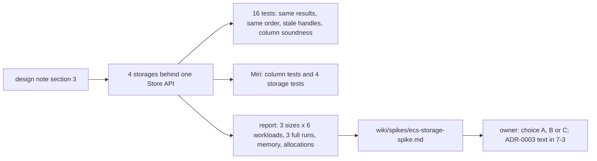

# Review 7-2: ECS storage spike, archetype tables (safe and type-erased), sparse sets and a hybrid

Task: 7-2. Class 2 (new tool crate, `unsafe` in a tool crate). Loops: 1. Open blocker/major: 0.

Delivers: crate `engine/tools_ecs_spike` (workspace member line in `Cargo.toml`, `Cargo.lock` entry), page `wiki/spikes/ecs-storage-spike.md`, README index row 45 and changelog v1.46, this file. No protected path touched. The ADR text is card 7-3 (governance, owner-declared); no entry in `gates/unsafe-budget.toml` is needed because the recommendation does not use `unsafe`.

## Decisions

1. **Harness as a layer 4 tool**, `publish = false`, `std` and `base` only. Under `engine/tools_*`, so the unsafe-budget scan (layers 0 to 2) does not count it and the gate files are untouched (`tools_*` is layer 4 by the glob in `gates/architecture.toml`).
2. **One `unsafe` module**, `raw_column.rs`: 11 blocks and one `unsafe fn`, every block with a `// SAFETY:` comment, the four invariants in the module doc, every typed access guarded by a `TypeId` check.
3. **Lints deviation, for the owner** (same as card 4-5): the crate has its own `[lints]` table instead of `workspace = true`, because `unsafe_code = "forbid"` at workspace level cannot be lifted per crate; it repeats the workspace Clippy rules, sets `unsafe_code = "deny"` and carries one `#![expect(unsafe_code, ...)]` in `lib.rs`.
4. **One generic world for (a) and (b)**: they differ only in the column type, so the comparison is not confounded by two codebases.
5. **Hand-written queries**, no generic query layer: the numbers are the storage cost; the layer is cards 7-4 and 7-5.
6. **Raw outputs** of the three full runs are in `target/spike-raw/` (git-ignored); the page gives the median of the three medians per cell.

## Evidence

- Tests: 16 (7 storage equivalence and determinism, 8 type-erased column, 1 registration), green; clippy (pedantic, the repository's nesting, length and complexity limits) clean on `--all-targets`; `cargo fmt` clean.
- Red evidence: making the sparse marker query do nothing fails two equivalence tests (the digest compares every field); restored. An earlier version of the tests did not catch that (finding 1 below).
- Miri (nightly): the 8 column tests clean; 4 of the 7 storage tests clean (118 s); the other three (the scripted session, the order hash and the scripted-results check) were too slow under Miri and were not run there.
- Local gates: see the PR body.
- Benchmarks: Windows 11 x86-64, 20 logical CPUs, release, one thread, load not controlled, 3 full runs of 40 samples per cell, spread at most 1.6 times (the 1,000-entity cells reach 2 times at 0.1 ns resolution).

## Not verified

- No instruction counts (no `valgrind` on this machine), no Linux, no ARM64, one thread, no parallel iteration, no generic query layer, no cold-cache size, fixed component set, tables created at construction. The page section 8 lists them.
- The hybrid's marker query path is hand-written and untuned, so its 13 to 15 times is an upper bound; the recommendation does not depend on it.
- The cause of the slower type-erased row moves (run-time size copy) is a hypothesis.
- A panic inside a destructor during a column operation would break an invariant of the type-erased column (documented in the module; the workspace builds with `panic = abort`).

## R1 to R8

| phase | result |
|---|---|
| R1 self | code read through; clippy, fmt, tests |
| R2 automated | fmt, clippy `--all-targets`, tests, wiki lint 0 violations; local gates in the PR body |
| R3 independent | read-only agent re-aggregated the three runs and read every `unsafe` block: 0 blocker, 3 major, 6 minor; see Loops |
| R4 QA | cross-storage equivalence on a scripted and a random session with a full-field digest, determinism, stale handles, drop counts |
| R5 architecture | `tools_*` is layer 4, depends on `base` only; no protected path |
| R6 security | `unsafe` confined to one module, no `unwrap`/`expect`, no secrets, no network; the reviewer found no undefined behaviour |
| R7 performance | the subject of the spike |
| R8 product fit | answers the ADR-0003 question with a recommendation, its limits and the alternatives for the owner |

## Loops

Loop 1, independent review (a7c8, read-only): 0 blocker, 3 major, 6 minor.

| # | Finding | Resolution |
|---|---|---|
| 1 major | equivalence checksums did not read `rot`, `y`, velocity, radius, sprite layer: the marker query was unchecked | fixed: `Store::digest` covers every field of every component of every entity (and the slot numbers), used in both sessions; red evidence above |
| 2 major | the hybrid marker query does a column lookup and downcast per marked entity, so its 2.7 ns and "13 times" are partly an artefact | resolved by disclosure: the page says the path is untuned and the ratio an upper bound (13 to 15 times, the 0.2 denominator at print resolution); the recommendation does not depend on it. Not re-implemented: a tuned hybrid is the work of a later card if option B is chosen |
| 3 major | "every workload leaves the world as it found it" was false for the two writing workloads | fixed: the page says entities and tables are restored and the integer values accumulate |
| 4 minor | panic in a destructor would double-drop in `swap_remove_drop` | documented in the module doc (invariant 3 note); moot under `panic = abort` |
| 5 | no undefined behaviour found in the 11 blocks; counts on the page match | none needed |
| 6 minor | an unused sparse set was allocated and counted in the all-tables storages; memory said "by length" | fixed: not allocated when the marker is in a table; memory is now 67.4 bytes (tables), 71.8 (hybrid), 93.6 (sparse); text says what is counted by slot |
| 7 minor | "tables win the marker query 3 times" only at 10,000 | fixed: 3 to 5 times against the sparse set, 13 to 15 against the hybrid |
| 8 minor | small overstatements (two-component range, capacity reserved, "nine tenths", hypothesis stated as cause) | fixed in the page |
| 9 minor | one-component query is a serial add chain; sparse joins read in slot order | added to the limits |
| 10 | Miri result and this file not checkable by the reviewer | this file; the Miri result is stated above with its limit |

Numbers after the fixes were re-measured (three new full runs); the type-erased row moves are now 10% to 30% slower, against 4% to 14% in the first set of runs, which the page states.
