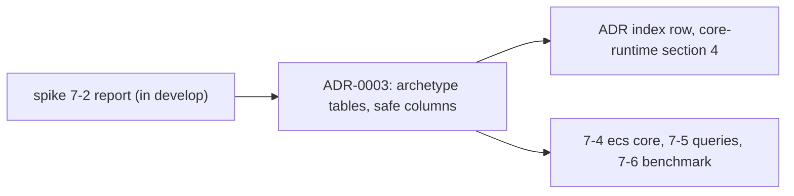

# Review 7-3: ADR-0003 record (ECS storage), governance task

Class 3, documentation only: `wiki/decisions/adr-0003-ecs-storage.md` (new), `wiki/decisions/README.md` (row 0003), `wiki/architecture/core-runtime.md` (section 4 pointer), `wiki/README.md` (changelog v1.47, index row). No code, no gate file, no `unsafe-budget` entry (option A uses no `unsafe`). Declared as a governance task by the owner on 2026-11-14.

Choice recorded: option A of the spike (recommended). The owner has not named an option in words; the approval of this PR against its diff hash is the acceptance, and B or C would change the ADR text before merge.

## R1 to R8

| phase | result |
|---|---|
| R1 self | every figure re-read against the spike page |
| R2 automated | wiki lint 0 violations (65 pages) |
| R3 independent | read-only agent: 1 blocker, 2 major, 3 minor, see Loops |
| R4 to R7 | not applicable (no code); no secrets, no session identifiers |
| R8 product fit | records the decision the owner asked for, with alternatives and open risks |

## Loops

Loop 1: the independent review compared all figures with the spike (all match).

| finding | resolution |
|---|---|
| blocker: two links to the design note, which is not on `main` yet | replaced by plain text naming the page and `develop` |
| major: README row and version will conflict when `main` merges into `develop` | stated in the PR; resolve by row 46, v1.47 kept |
| major: core-runtime said "Decided" without the approval caveat | now "upon the owner's approval of the PR" |
| minor: "best iteration of the four" | now "as good as the best (equal within noise)" |
| minor: ranges and the `[S]` tag | accepted as is |

Open blocker/major: 0. Not rendered: the Mermaid diagram was checked by reading, not by a renderer.
